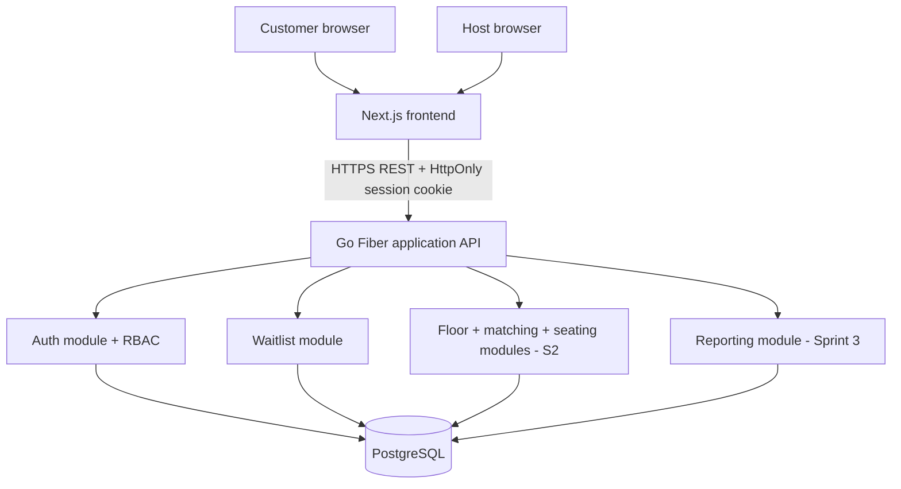
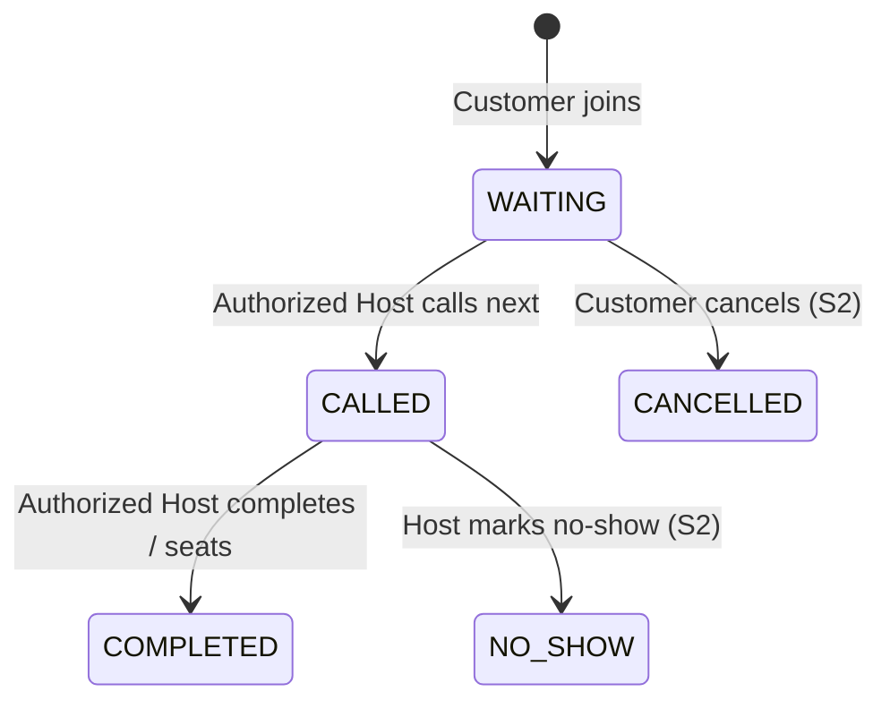
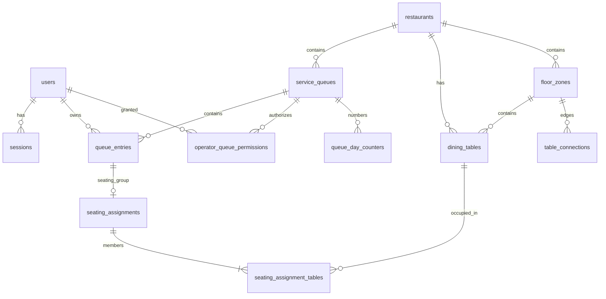
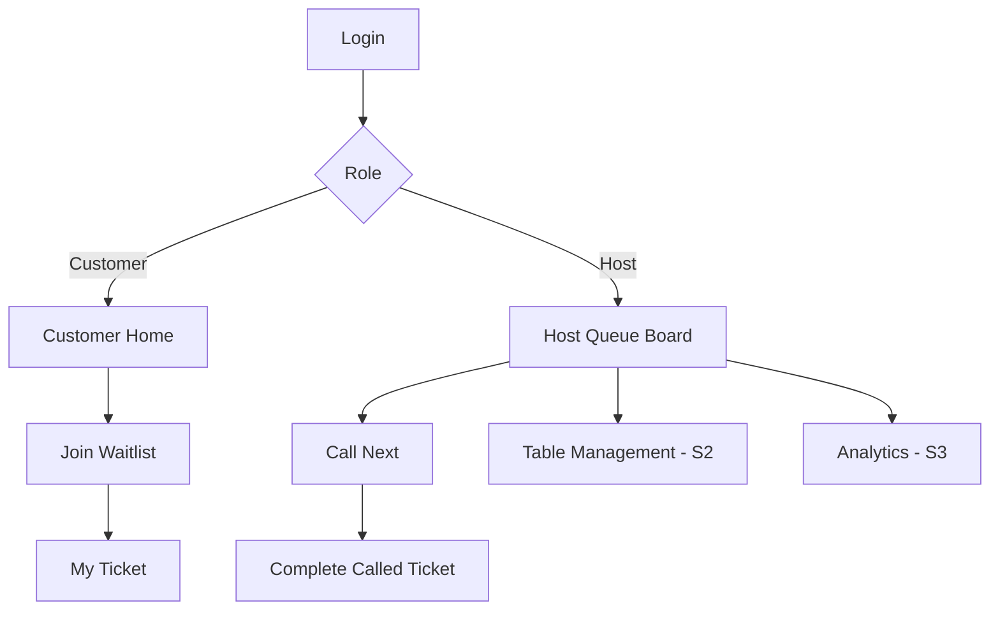

# DineQueue — Engineering Specification v2.0 (Consolidated)

> Repository snapshot synchronized on **13 November 2026**, base HEAD `d7f27a3` plus the Sprint 1 review fix worktree.
> Actual local checks and source fingerprint are recorded in the review results section.
> The individual source files in this repository define the current project baseline.
> `docs/reference/group_work_specs_v1.pdf` remains authoritative for course assessment.
> This generated copy adds no requirements beyond its canonical sources.
> Synchronization alone does not rerun checks or establish teammate/TA approval, CI or deployment.

## Reconciliation with the imported 5 November package

Compared all 24 original sections with their repository sources: 20 differed and
4 already matched. Updated those sections and appended the 13 implementation
contracts/evidence files added since the original package. All 37 current Markdown
source documents are included below. Existing FR/BR/NFR/F/AC/test IDs are retained.
No additional product requirement was identified beyond the repository baseline.

| Topic | Imported consolidated version | Current repository baseline |
|---|---|---|
| Database access | pgx/sqlc proposal | Fiber v3 + GORM + PostgreSQL, explicit SQL migrations, no startup AutoMigrate (DEC-026) |
| Sprint 1 organization | Five parent features F-01..F-05 | Four parents F-01..F-04; Complete retains legacy F-05 inside F-04 (DEC-028) |
| Party size | Some SRS text still said 1–8 | Party 1–16; physical table 1–8; 10-person join persists a WAITING ticket |
| AC-007 | Incorrectly said accepted party 10 creates no DB entry | Invalid inputs create no entry; accepted party 10 creates a persisted ticket |
| Configuration/security | SESSION_SECRET / optional public API URL; generic CSRF description | Server-only API_INTERNAL_URL, hashed opaque sessions, exact Origin and per-session CSRF token (DEC-027) |
| Implementation/API/UI | Entire package described as unimplemented/not tested | Foundation and F-01..F-04 present; Sprint 1 review fixes and regression evidence included |
| Evidence | All tests described as NOT RUN | Dated local execution records included; no new execution implied by this synchronization |

## Reading current scope and historical records

| Scope | Status at this snapshot |
|---|---|
| F-01 | Login/logout/me, sessions and backend guards present |
| F-02 | Join, persisted unique daily ticket and concurrency guards present |
| F-03 | Owned active/detail reads and My Ticket UI integrated; Customer home follows active state |
| F-04, including legacy F-05 | Host board, FIFO Call Next and Complete integrated; confirmation/read-retry review fixes present |
| Sprint 2 / Sprint 3 | Planned; floor/matching/table operations/history/analytics remain design scope |

Original dates, proposals, unchecked acceptance templates and past execution results
inside source sections are preserved as historical context. Read the decision register
and the later feature addenda for superseding decisions. In particular, the original
F-02 addendum's in-place success card was superseded by F-03's `/my-queue` redirect;
early foundation records using pgx/sqlc do not describe the current GORM access layer.
Recorded passing checks cover their stated worktree and environment only; copying
them here does not constitute a fresh test run or acceptance of the whole sprint.
Relative links to included documents point to their sections in this file; the Source
links open the canonical repository files. The PDF is referenced, not embedded.

## Contents

- [1. README.md](#source-01)
- [2. AGENTS.md](#source-02)
- [3. docs/00-thai-overview.md](#source-03)
- [4. docs/15-v2-change-log.md](#source-04)
- [5. docs/01-srs.md](#source-05)
- [6. docs/02-features.md](#source-06)
- [7. docs/03-system-sds.md](#source-07)
- [8. docs/04-data-and-api.md](#source-08)
- [9. docs/06-restaurant-operations.md](#source-09)
- [10. docs/05-ui-spec.md](#source-10)
- [11. docs/ui/operations-interaction-spec.md](#source-11)
- [12. docs/sprints/plan.md](#source-12)
- [13. docs/features/sprint1-contracts.md](#source-13)
- [14. docs/testing/sprint1-sts.md](#source-14)
- [15. docs/features/sprint2-restaurant-operations-contracts.md](#source-15)
- [16. docs/testing/sprint2-operations-sts.md](#source-16)
- [17. docs/09-traceability.md](#source-17)
- [18. docs/10-workflow.md](#source-18)
- [19. docs/13-decisions.md](#source-19)
- [20. docs/14-issue-backlog.md](#source-20)
- [21. docs/16-security-quality-review.md](#source-21)
- [22. docs/sprints/sprint1-execution-checklist.md](#source-22)
- [23. docs/labs/labs5-7.md](#source-23)
- [24. docs/release/submissions.md](#source-24)
- [25. docs/features/sprint1-foundation-contract.md](#source-25)
- [26. docs/features/f01-auth-implementation-contract.md](#source-26)
- [27. docs/features/f02-join-implementation-contract.md](#source-27)
- [28. docs/features/f03-my-ticket-implementation-contract.md](#source-28)
- [29. docs/testing/sprint1-foundation-results.md](#source-29)
- [30. docs/testing/sprint1-gorm-results.md](#source-30)
- [31. docs/testing/f01-auth-results.md](#source-31)
- [32. docs/testing/f02-join-results.md](#source-32)
- [33. docs/testing/f03-my-ticket-results.md](#source-33)
- [34. docs/features/f04-host-queue-implementation-contract.md](#source-34)
- [35. docs/testing/f04-host-queue-results.md](#source-35)
- [36. docs/testing/sprint1-review-results.md](#source-36)
- [37. docs/testing/sprint1-completion-checklist.md](#source-37)

---

<a id="source-01"></a>

## 1. `README.md`

> Source: [README.md](README.md)

<!-- BEGIN SOURCE: README.md -->
# DineQueue v2 — Restaurant Waitlist, Floor & Seating Operations

> **Engineering Package v2.0 — Current project baseline, clarified 6 November 2026.**
> **F-01..F-04 are implemented in the Sprint 1 integration baseline**, including Host board, FIFO Call Next and manual Complete;
> local checks are recorded separately below. No instructor approval, product acceptance,
> deployment or release is claimed.
> Grounded on CPE 334 `group_work_specs_v1.pdf` (15 pages, issued 6 Oct 2026, itself marked *Draft for instructor review*); Domain-specific table algorithms, seat limits, screens, schemas and Go Fiber are **proposed project decisions**, not requirements imposed by the PDF.

## Current v2 baseline and implementation status

- Party size: **1–16**; a physical table seats **1–8**.
- Sprint 1: **4 parent features, F-01..F-04**, two core roles (`CUSTOMER`, `HOST`), manual waitlist completion. F-04 Host Queue Operations includes Complete (legacy F-05).
- Sprint 2 design: approved connected sets of **1–3 tables**, atomic hold/call/seat,
  no-show, whole-group checkout and cleaning. These workflows are not implemented.
- Present source: repository foundation + F-01 login/logout/me, secure sessions,
  F-02 join/ticket issuance, F-03 own-ticket reads/privacy and F-04 Host board,
  FIFO Call Next and manual completion (legacy F-05).
  See [F-01 evidence](#source-31),
  [F-02 evidence](#source-32) and
  [F-03 evidence](#source-33),
  [F-04 evidence](#source-35) and
  [Sprint 1 review regression](#source-36) for actual checks and limits.
  The [Sprint 1 completion checklist](#source-37)
  maps every S1 functional/business rule, UI screen and applicable NFR to implementation
  and verification, with human review/release evidence tracked separately.
  User-authorized DEC-028 groups Sprint 1 into four
  parent features while preserving F-05, FR/BR, AC and test IDs for traceability.
- Git repository initialized on `main`, with `origin` connected to
  `https://github.com/bbxndg/DineQueue.git`. Commits import existing work as of
  6 November; they do not establish historical test-first or teammate-review evidence.
- Selecting v2 does not imply TA approval of unresolved policies in the decision register.

## Product vision

A walk-in restaurant operations platform: **Customer Waitlist Management**, **Interactive Floor & Table Management**, **Smart Queue/Table Matching**, **Combined Adjacent Tables** and **Restaurant Operations Analytics**. The central workflow remains a waiting line (CPE 334 theme 9), not advance appointment/reservation booking or POS/payment.

**The ten-person requirement:** each physical dining table seats at most **8**; a group may be **1–16** people. For party size 10, two approved adjacent tables T4(6)+T5(4), both AVAILABLE, same zone and restaurant, can be claimed/held/seated as **one atomic group assignment**. Arbitrary tables nearby on a screen cannot automatically be combined. A staff member must confirm physical compatibility. In v2 up to 3 connected tables may be joined, pending team/TA approval.

## Read these files first

1. [Thai overview](#source-03) — สรุปไทยและผลกระทบต่อ Sprint.
2. [v2 change log](#source-04) — what was revised from original baseline.
3. [SRS](#source-05) — actors, functional, business, nonfunctional requirements.
4. [Feature inventory](#source-06) — F-01..F-19, prioritization, planned sprint.
5. [System SDS](#source-07) — modular architecture, Go proposal, permissions, transaction design.
6. [Database and API Contract](#source-08) — schema, joins, uniqueness, v1/v2 routes.
7. [Restaurant Operations Domain Design](#source-09) — most important new document: topology, 10-person matching, holds, checkout, concurrency and fairness.
8. [UI Specification](#source-10) and [detailed interaction specification](#source-11).
9. [Three-sprint plan](#source-12).
10. [S1 Engineering Contracts](#source-13) and [S1 STS](#source-14).
11. [S2 Engineering Contracts](#source-15) and [S2 STS](#source-16).
12. [Traceability](#source-17).
13. [Decisions / open questions](#source-19).
14. [Security and quality review](#source-21).
15. [Workflow](#source-18), [Issue backlog](#source-20), [Lab 5–7](#source-23) and [submission requirements](#source-24).

## Current implementation stack (DEC-026)

| Layer | Technology |
|---|---|
| Frontend | Next.js + TypeScript + Tailwind CSS |
| Backend | **Go Fiber v3** + Go modules, handlers → services → repositories |
| Database | PostgreSQL |
| DB access | GORM + PostgreSQL driver; explicit versioned SQL migrations |
| Authentication | server-backed opaque session cookie, password hashing, CSRF protection |
| Testing | Go `testing`, PostgreSQL integration tests, Playwright E2E |
| DevOps | Docker, GitHub Actions, GCP (Lab 5) |

Official Fiber v3 docs currently say Go 1.26+ is required. Framework selection is a **proposal** following team discussion; the course encourages reusing the Lab 1–4 stack where practical. Do not install an unknown dependency, run external scripts, or commit secrets to make a prototype work.

## Three-sprint scope

| Milestone | Target features | Deadline |
|---|---|---|
| **Sprint 1** | Authentication/RBAC; customer joins party 1–16; unique ticket, own status; strict FIFO call/complete; persistence, negative/race tests, reviewed Git workflow; no digital table allocation yet | **8 Nov 2026** |
| **Sprint 2** | Floor zones; table graph; matching; atomic single/combined hold/seat; cancellation/no-show; checkout/cleaning; operations UI; negative+concurrency integration tests | **29 Nov 2026** |
| **Sprint 3** | Customer status improvements/guarded ETA; queue history; measured analytics; optional floor config/public display; UAT fixes, regression and final release | **Progress by 29 Nov; final 13 Dec** |

**Course labs also mandatory:** Lab 5 Docker/CI/GCP by **15 Nov**, Lab 6 cross-team UAT and defect fix by **22 Nov**, Lab 7 approved change + regression/metrics by **29 Nov**. Submission deadline 23:59 on the specified date.

## Primary engineering acceptance scenario

1. Customer signs in and joins party of 10, receives A-001 WAITING (valid despite no single 10-seat table).
2. Host sees T4(6) and T5(4) connected in Terrace; T7(8) alone is not eligible.
3. Host previews match, calls and **holds both** T4/T5; queue CALLED.
4. Second Host tries an overlapping table group and is rejected without a partial allocation.
5. Host confirms seating; ticket COMPLETED, assignment ACTIVE, both tables OCCUPIED.
6. Guest leaves: group checkout makes both DIRTY; cleaning returns each to AVAILABLE.
7. API rejects cross-tenant/unauthorized, wrong-state, disconnected, occupied and undersized table groups.

## Important caveats

- Dated F-01..F-04 and integration execution evidence is linked under `docs/testing`.
  Worktree results do not establish release approval, a CI run or a tested future merge commit.
  S2 operations remain pending. Unresolved domain decisions remain **PROPOSED / PENDING** unless team/TA signs off.
- Sprint 1 minimum is deliberately preserved, with a versioned boundary change from max party 8 to 16. Do not silently backdate commits or claim previous tests had already validated 10 guests.
- Matching is a deterministic heuristic, not an ML model and not guaranteed globally optimal. Floor adjacency must be manager-approved, not inferred from CSS coordinates.
- If advanced scope threatens deadlines, prioritize strict S1 flow then S2 atomic combined-table seating with true DB tests; defer decorative maps, ML ETA, public display or floor editing before dropping engineering correctness.

## Source and technical reading (no execution required)

Course: `group_work_specs_v1.pdf`, Sections 5, 6.9, 7–11. Official references in `docs/16-security-quality-review.md` include PostgreSQL locking/partial indexes, OWASP session/CSRF/authorization, and Fiber v3 API docs.

## Local repository foundation

Scope: [foundation contract](#source-25).
Results and limitations: [foundation evidence](#source-29).
The foundation is extended by the four Sprint 1 features. Release review, CI and tagging
are separate from local implementation and regression checks.

```text
apps/web/          Next.js + TypeScript + Tailwind; minimal landing shell
apps/api/cmd/api/  Go Fiber entrypoint and graceful shutdown
apps/api/internal/health/           bounded readiness service
apps/api/internal/transport/http/   health handlers and generic errors
apps/api/internal/platform/         validated config and GORM adapter
apps/api/internal/auth/             password/session service, repository and HTTP guards
apps/api/internal/queue/            join and owner-scoped ticket reads (F-02/F-03)
apps/api/cmd/db/                    explicit migrate/seed CLI
apps/api/db/migrations/             versioned SQL migrations (F-01 schema)
```

### Run the local Docker development environment

Requires a running Docker daemon and Compose. It does not require host Go/Node.

1. Copy `.env.example` to `.env` and restrict permissions (`chmod 600 .env`).
2. Generate a local password, for example with `openssl rand -hex 24`, and put it in
   `POSTGRES_PASSWORD`. There is deliberately no default password.
3. Set `DATABASE_URL` to `postgres://dinequeue:<your-password>@db:5432/dinequeue?sslmode=disable`.
   Replace the placeholder; if using a non-hex password, URL-encode its credential component.
   Match `POSTGRES_USER` and `POSTGRES_DB` if changing them. Never commit this file or print it in CI.
4. Run `docker compose config --quiet`, then `docker compose up --build`.
5. Run `docker compose run --rm db-tools` to apply migrations. Set the four blank
   `SEED_*_PASSWORD` values in your local `.env` (12–128 UTF-8 bytes each), then run
   `docker compose run --rm db-tools go run -buildvcs=false ./cmd/db seed` once.
6. Open http://localhost:3000/login. Check `curl --fail http://localhost:8080/health/live`
   and `curl --fail http://localhost:3000/api/health/ready`.

PostgreSQL is private to the Compose network. Web and API published ports bind only
to loopback. The database named volume survives `docker compose down`; do not use
`down --volumes` unless intentionally deleting local data. Changing PostgreSQL environment
passwords does not update credentials in an already initialized volume.

Web source changes reload through the read-only source mount. For backend/config/dependency
changes rerun `docker compose up --build`. These Dockerfiles are development targets;
production image hardening and CI/GCP delivery remain Lab 5 work.

### Host tools and checks

Pinned runtime targets: Node 22.23.4 (`.nvmrc`), Go 1.26.10, PostgreSQL 18.6.
Database access: GORM 1.31.2 + PostgreSQL driver 1.6.3.
The web also supports the existing host Node 22.17.0 used for foundation validation.
Direct dependencies and transitive resolution are recorded in `package-lock.json`,
`go.mod` and `go.sum`. No external install script is required.

```bash
npm ci --ignore-scripts
npm test
npm run lint
npm run typecheck
npm run build
npm run dev
```

`API_INTERNAL_URL` is server-only and defaults to `http://127.0.0.1:8080` for host web
development; Compose sets `http://api:8080`. Production builds bake Next.js rewrites
using the build-time value, so rebuild when changing it. No database/session secret
belongs in `NEXT_PUBLIC_*`. Only explicit health/auth/queue/ticket paths are proxied; the UI uses
same-origin browser requests. No credentialed cross-origin CORS is enabled.

From `apps/api`, with Go on PATH:

```bash
go test -race ./...
go vet ./...
go build -buildvcs=false -o /tmp/dinequeue-api ./cmd/api
```

GORM replaces the former sqlc generation and direct pgx pool. The official PostgreSQL
driver still uses pgx internally. Readiness runs SELECT 1 through GORM; no application
tables are created at API startup. Keep reviewed SQL migrations under `db/migrations`;
never call AutoMigrate on startup. Apply F-01 schema/seed explicitly as below.
Services must coordinate a single `db.Transaction` and pass its `tx` through repositories.
See the [ORM change record](#source-30) for current checks;
the original foundation evidence records the earlier database access approach.

For a host API process, supply `APP_ENV`, `APP_ORIGIN`, `DATABASE_URL` and optional `PORT`
through the process environment, then run `go run -buildvcs=false ./cmd/api` in `apps/api`.
Go does not automatically load `.env`. A host API needs a reachable PostgreSQL instance;
the Compose-only hostname `db` will not resolve on the host.

Production config rejects HTTP origins and database URLs without `sslmode=verify-full`.
TLS termination and deployment proxy/shared-limit policies still require verification before release.

For the opt-in foundation integration tests, set `TEST_DATABASE_URL` to a dedicated isolated
PostgreSQL database with an empty `public` schema and run `go test -tags=integration -race ./...`
from `apps/api`. ORM writes use temporary test tables. Missing configuration
fails explicitly instead of silently reporting a skipped integration check as success.

The `-buildvcs=false` flag supports source archives without Git metadata; it does not create
release provenance. Foundation validation originally ran before Git initialization. Keep
that execution record separate from subsequent commits, reviews, releases and CI results.

### F-01 accounts and checks

With server config exported in your shell, from `apps/api`:

```bash
go run -buildvcs=false ./cmd/db migrate
# Set the four SEED_*_PASSWORD variables securely in the process environment first.
go run -buildvcs=false ./cmd/db seed
```

Host Go commands do not load `.env` automatically. Demo seed is disabled when
APP_ENV=production. Seed does not reset existing passwords, active flags or revoked
grants. Use a dedicated local demo database. Accounts: `customer1@example.test`,
`customer2@example.test`, `host@example.test` (grant to demo Q1) and
`other-host@example.test` (no Q1 grant). Passwords are those you supply; none are
printed or committed. Treat these accounts as local fixtures, not production users.

Login returns an HttpOnly session cookie and a csrfToken. HTTPS uses a Secure
`__Host-dineq_session`; HTTP development uses `dineq_session`. Unsafe calls must
send exact APP_ORIGIN; logout and future cookie-auth mutations must include
X-CSRF-Token from login/me. Sessions expire after 12h and logout revokes them in DB.
The cookie token is never stored in browser localStorage or plaintext in DB.
The per-process login limit uses the API socket IP. Behind the Next.js proxy,
clients can share that quota; trusted-proxy/shared limiting must be configured
and tested for deployment. Expired session records also need a retention policy.

Integration tests require TEST_DATABASE_URL with an empty public schema and
CREATE SCHEMA privilege in a disposable database. F-01 fixtures migrate/seed a
random schema per test and drop it afterwards; foundation checks inspect public.

Browser checks require `npm ci --ignore-scripts`, the pinned Playwright Chromium
(`npx playwright install chromium`), a built/running web/API and isolated demo seed.
Set F01_BASE_URL to that web origin and F01_TEST_PASSWORD to the password used for
all four isolated test accounts, then run `npm run test:e2e --workspace @dinequeue/web`.
F-03 stored-state/error-recovery browser tests also require `psql` on PATH and
`TEST_DATABASE_URL` pointing to the **same disposable seeded DB as the API**.
They create/remove a temporary customer and briefly rename the ticket table to
test a real read failure; use one worker as configured, never a shared/live DB.
Never use live accounts. Reports stay under /tmp; traces/video are disabled to avoid
recording credential-bearing requests. F-02/F-03 browser checks use the same fresh
seeded environment. Customer home links to Join Waitlist and My Ticket; joining
redirects to `/my-queue`. Refresh status loads persisted WAITING/CALLED entries.
Owners may bookmark `/my-queue/{entryId}` for details, including COMPLETED.
F-03 does not add Host transitions, cancellation, history listing or ETA.
<!-- END SOURCE: README.md -->

---

<a id="source-02"></a>

## 2. `AGENTS.md`

> Source: [AGENTS.md](AGENTS.md)

<!-- BEGIN SOURCE: AGENTS.md -->
# DineQueue v2 — Agent / Developer Instructions

Follow `README.md` → `docs/01-srs.md` → `docs/06-restaurant-operations.md` → the applicable pre-implementation feature contract and STS. **These are proposed specs, not authorization to claim implementation or passing tests.** The course PDF is the authority for assessment process; our algorithms/stack need team/TA approval.

## Scope and priorities

- This is a walk-in **queue** product, not appointment booking, POS, payments or automatic restaurant reservations.
- Preserve S1's four parent features F-01..F-04: login/logout/me; backend RBAC + own-ticket privacy; join party 1–16; daily unique queue number; Host queue board, FIFO call-next/complete and concurrency tests. F-05 is the retained legacy ID for Complete within F-04, not a fifth parent feature (DEC-028). S1 completion means *manual waitlist handling*.
- S2 requires F-06..09 and F-14..16: **interactive floor, approved adjacency graph, deterministic matching, atomic hold of 1–3 connected tables, seat, no-show, group checkout and cleaning**. Do not implement seating as a single `table_id` on ticket.
- Sample 10-person group: T4(6)+T5(4) approved connected pair qualifies; T7(8) alone and unconnected sets do not. All chosen tables must share restaurant/zone and be AVAILABLE.
- Keep old FR/F/BR IDs and explicitly version changed BR-008/010/011/013; new IDs FR-023..035, BR-015..025, F-14..19.

## Architecture and safety

- Current backend access choice (DEC-026, user authorized): Go Fiber v3 + GORM + PostgreSQL, Next.js frontend. Keep explicit SQL migrations; do not use startup AutoMigrate. Unresolved domain decisions still need team/TA resolution.
- Module design: HTTP handler → business service (rules/transaction/permissions) → SQL repository; no transaction split across service calls.
- PostgreSQL is authoritative: partial unique indexes, row locks in deterministic order, transactional table-group membership, concurrency/rollback tests. Never trust UI status, capacity, adjacency, ranks or user role.
- Sessions: HttpOnly Secure cookie, opaque token hash in DB, logout revocation, CSRF defense and Origin restrictions, no secrets in client bundles. Strict input validation and parameterized SQL.
- Public display is ticket-code-only; never leak customer email/name/free-text notes or private DB identifiers.
- Do not execute third-party install scripts from untrusted sources. Pin and review dependencies, use official documentation as references. No security claim is absolute.

## Workflow / evidence

1. Log pending decisions in `docs/13-decisions.md`, get team/TA sign-off before freezing rules.
2. Create Issue → feature branch from sprint staging → commit pre-implementation Feature SDS / UI/API/Data / AC / STS / DoD.
3. Implement tests fail-first for important rules, add code, run test suite against isolated real DB, inspect diff, request teammate review.
4. Integrate sprint, regression-test S1 whenever S2 lifecycle changes, release through reviewed main PR and tag.
5. Record actual test names/commands/dates/commit/CI URLs. **Do not report PASS, deployment or approval without evidence.**
6. Keep docs, traceability and decision history synchronized with code.

## Read specific files

- Domain invariants: `docs/06-restaurant-operations.md`
- Data / API: `docs/04-data-and-api.md`
- S2 contracts: `docs/features/sprint2-restaurant-operations-contracts.md`
- S2 STS: `docs/testing/sprint2-operations-sts.md`
- Security: `docs/16-security-quality-review.md`
- Course labs and evidence: `docs/labs/labs5-7.md`, `docs/release/submissions.md`
<!-- END SOURCE: AGENTS.md -->

---

<a id="source-03"></a>

## 3. `docs/00-thai-overview.md`

> Source: [docs/00-thai-overview.md](docs/00-thai-overview.md)

<!-- BEGIN SOURCE: docs/00-thai-overview.md -->
# DineQueue — คู่มือภาพรวมโปรเจกต์ภาษาไทย

> แหล่งอ้างอิง: `group_work_specs_v1.pdf` ส่วน 1–12 โดยเฉพาะ Topic 9 หน้า 8–9, Sprint Model หน้า 9–10, Engineering Artifacts หน้า 10–11 และ Rubric หน้า 11–15
> เอกสารในชุดนี้เป็น **ข้อเสนอออกแบบ** ไม่ใช่ระบบที่เขียนโค้ดแล้ว และไม่ได้แปลว่าอาจารย์อนุมัติทุก Design Decision

## โปรเจกต์ทำอะไร

DineQueue เป็นระบบคิวร้านอาหาร Walk-in ลูกค้าเข้าระบบ ระบุจำนวนคน รับเลขคิว และติดตามสถานะ พนักงานร้านอาหารเปิด Dashboard เรียกคิวถัดไปและปิดคิว เมื่อขยายใน Sprint 2 สามารถตรวจสถานะโต๊ะและจัดกลุ่มลูกค้าให้โต๊ะที่มีจำนวนที่นั่งเพียงพอได้ โดยต้องป้องกันการจัดโต๊ะซ้ำเวลาพนักงานหลายคนกดพร้อมกัน

### เป้าหมายและข้อจำกัด

- เริ่มร้านอาหาร 1 สาขา คิวบริการ 1 คิวก่อนใน Sprint 1
- User Roles: CUSTOMER และ HOST เท่านั้นใน Sprint 1; 2 roles เพียงพอ
- ไม่ต้องทำระบบสมัครสมาชิก ลืมรหัสผ่าน OTP หรือการส่ง SMS ใน Sprint 1
- ไม่มีจองโต๊ะล่วงหน้า อาหาร POS หรือชำระเงินจริง
- ต้องมี UI + API + persistent DB จริง ต้องเก็บข้อมูลหลังรีสตาร์ต
- Database constraints ช่วยรักษากฎภายใต้ concurrent requests

## Sprint 1: ขั้นต่ำที่ต้องทำให้เสร็จจริงก่อน 8 พ.ย.

ตาม DEC-028 แบ่งเป็น **4 features หลัก**: F-01 Authentication/Session/RBAC,
F-02 เข้าคิวและออกเลขคิว, F-03 ดูคิวของตนและความเป็นส่วนตัว,
F-04 Host Queue Operations ซึ่งรวมดูคิว, FIFO Call Next และ Complete
โดยเก็บ F-05 เป็นรหัสเดิมของงาน Complete ภายใต้ F-04 เพื่อ traceability
รายละเอียดกฎ AC และ test IDs เดิมยังต้องทำครบ

1. **Auth:** Login, Logout, Current User, password hashing, session lifecycle, RBAC ที่ตรวจบน Backend
2. **Customer:** เข้าคิวโดยระบุ Party Size, ได้เลข A-001/A-002, ดูคิวตัวเองอย่างเป็นส่วนตัว
3. **Host:** Login, ดูคิวที่ได้รับอนุญาต, Call Next ตาม FIFO, Complete คิวที่ถูกเรียก
4. **Business Rules:** ห้ามคิว Active ซ้ำ, ห้ามเลขคิวซ้ำ, ห้ามเรียกผิดลำดับ/เปลี่ยนสถานะผิด, ห้ามคนไม่มีสิทธิ์
5. **Tests:** มี Unit, API+Database Integration, E2E สำหรับ Critical Journey, Negative, Boundary, Concurrency และหลักฐาน TDD ที่รันจริง
6. **Process:** ใช้ Issue, Feature Branch, PR, Review เพื่อนร่วมทีม, Sprint Staging, Integration Test, Main Release Tag, Setup/Seed/Demo Instructions
7. **Documentation:** SRS, Feature Inventory, Traceability, System-Level SDS, Three-Sprint Plan, Feature-Level Contracts, AC, STS, DoD และ Evidence Index

**ห้ามสรุปว่างานเสร็จเพียงเพราะมีเอกสาร:** Deliverable 1 ยังต้องมีแอปที่ทำงานจริง และหลักฐานทดสอบ/PR/Review ตาม Git SHA ที่ส่ง

## Sprint 2: ภายใน 29 พ.ย.

- ตารางโต๊ะ: รหัสโต๊ะ ขนาดที่นั่ง สถานะ AVAILABLE/OCCUPIED
- Assign Table: ต้องโต๊ะว่าง รองรับจำนวนคน และไม่ถูกจัดซ้ำ
- การเรียกกลุ่มที่โต๊ะรองรับได้: เลือก FIFO เฉพาะกลุ่มที่เหมาะสมภายใต้นโยบายที่ยืนยันกับ TA
- ยกเลิกคิว WAITING, ทำ No-show จาก CALLED, ปลดล็อกโต๊ะหลังใช้งาน
- Feature Contracts และ Tests ต้องเขียนก่อน implement; Sprint 2 ทุกฟีเจอร์ต้องเสร็จและปล่อย integrated release

## Sprint 3: เสร็จ 13 ธ.ค.

- Queue History, จำนวนคิว/เวลารอจริง, dashboard summary
- Public Queue Display แบบไม่เปิดข้อมูลลูกค้า (ถ้าเลือกเก็บใน scope)
- แก้ UAT defects, จัดการ failure paths, สิทธิ์, usability, regression tests
- Final verified product + PDF evidence report + deployed URL + วิดีโอไม่เกิน 10 นาที ทั้ง 2 คนมีส่วนร่วม

## Lab ที่ต้องทำควบคู่กัน

- 15 พ.ย. **Lab 5:** Docker, CI/CD quality gate, Deploy GCP, พิสูจน์ Database Persistence
- 22 พ.ย. **Lab 6:** แลก UAT กับอีกทีม 4 กรณี, defect issue, fix และให้ทีมอื่น retest
- 29 พ.ย. **Lab 7:** ทำ change ที่ TA/อาจารย์อนุมัติ, impact analysis, failing test ก่อนแก้, regression, metrics 5 ค่า และ readiness

## กฎสำคัญที่ทีมต้องรู้

- **BR-001:** คนเดียวกันมี Active Ticket ในคิวบริการเดียวกันได้เพียงหนึ่งใบ
- **BR-002:** เลขคิวต้องไม่ซ้ำภายใน queue + local date แม้มีคน Join พร้อมกัน
- **BR-003:** Sprint 1 เรียกคิวเรียงเวลารับคิวแบบ FIFO
- **BR-004:** Sprint 1 `WAITING -> CALLED -> COMPLETED` เท่านั้น
- **BR-005:** เรียกคิวใหม่ไม่ได้ถ้ามีคิว CALLED ค้างอยู่
- **BR-006/007:** Host ต้องมีสิทธิ์ในคิว และ Customer เห็นได้เฉพาะคิวของตัวเอง
- **BR-010 (Sprint 2):** โต๊ะต้องว่างและมี capacity >= party size; assignment ใช้ transaction
- **BR-011 (Sprint 2):** First Eligible Table Matching ต้องนิยามเรื่องการข้ามคิวให้ชัดกับ TA

## โครงสร้างที่ต้องส่งไปให้ Codex

เริ่มจาก `AGENTS.md`, `docs/01-srs.md`, `docs/03-system-sds.md`, `docs/04-data-and-api.md`, `docs/features/sprint1-contracts.md`, `docs/testing/sprint1-sts.md` และ `docs/09-traceability.md`. ใช้เอกสารเหล่านี้เป็น source of truth ระหว่างสร้างโค้ด แต่ต้อง verify ความถูกต้องและผลทดสอบด้วยมนุษย์ทั้งสองคน

## สิ่งที่ต้องขอคำตอบ/ยืนยันก่อนเริ่มหรือก่อน Sprint 2

1. ทีมมีสิทธิ์เลือก Topic 9 ตามเลขหลักสุดท้ายของ Student ID หรือไม่
2. ในร้านอาหาร `COMPLETED` หมายถึงเรียกและจัดให้ลูกค้าได้โต๊ะแล้วใช่หรือไม่
3. โต๊ะว่าง 2 ที่นั่ง สามารถเรียกกลุ่ม 2 คนข้ามกลุ่ม 6 คนที่มาก่อนหรือไม่
4. วันใหม่ของเลขคิวเริ่มกี่โมง และขนาดกลุ่มสูงสุดเท่าไร
5. ใช้ GCP resources อะไรตาม Lab5 handout และต้องมีหลักฐานอะไรเพิ่มเติม

รายละเอียดเต็ม รวม UI/API/Database, AC, STS, Traceability, Process และ Submission อยู่ในไฟล์ภาษาอังกฤษที่เหลือใน `docs/`


## อัปเดต v2: Restaurant Operations + รวมโต๊ะ

- **ลูกค้ากลุ่ม 10 คนรับคิวได้** (`party_size` 1–16) แม้โต๊ะเดี่ยวรองรับได้สูงสุด 8 คน; Sprint 1 ยังไม่ต้องจัดโต๊ะจริง
- Sprint 2 จัดการ Floor/Zone/Table State, ตารางการเชื่อมโต๊ะที่อนุมัติ, Smart Matching แบบอธิบายเหตุผลได้, Call + Hold, Seat, Checkout/Cleaning และ Concurrent Allocation
- **ตัวอย่าง:** T4 (6 ที่) ติดกับ T5 (4 ที่) → รวมได้ 10 ที่ จึงรองรับกลุ่ม 10 คน; T4 + โต๊ะที่อยู่อีกโซนหรือไม่เชื่อมกันห้ามรวม
- Sprint 3 แสดง Analytics ที่วัดจริง, Queue Tracking/ETA อย่างระมัดระวัง, History, การตั้งค่าผังร้านและ Testing/Release Hardening
- ข้อกำหนดนี้เป็น Design Decisions ของทีมที่ต้องตกลงและยืนยันกับ TA; เอกสารอาจารย์บังคับขอบเขตและกระบวนการ Engineering ไม่ได้บังคับ Algorithm หรือจำนวนโต๊ะ
- สเปกละเอียดอยู่ที่ `docs/06-restaurant-operations.md` และ `docs/features/sprint2-restaurant-operations-contracts.md`
<!-- END SOURCE: docs/00-thai-overview.md -->

---

<a id="source-04"></a>

## 4. `docs/15-v2-change-log.md`

> Source: [docs/15-v2-change-log.md](docs/15-v2-change-log.md)

<!-- BEGIN SOURCE: docs/15-v2-change-log.md -->
# 15. Change Log — Engineering Package v1 → v2

**Date:** 2026-11-05. This is a specification revision and **does not** indicate that the group implemented, ran tests or obtained instructor sign-off.

## Requested changes and exact impact

| User change | Old specification | v2 behavior | Artifacts to update |
|---|---|---|---|
| Customer Waitlist Management | party 1–8, basic status | party 1–16; 10+ accepted; private status, future ETA/cancel/history | SRS BR-008 FR-023/031; Feature F-02/F-17; AC-007 T-011/T-036; UI |
| Interactive Floor | basic table grid | zones, state, accessible floor/list, graph and cleaning | SRS FR-024/029/035; F-06/F-16; SDS/Data/UI; STS |
| Smart Matching | oldest fitting single table | deterministic joined set recommendations; explain skipped cases | FR-025/026/030, BR-011/016/017, F-14 |
| Joined Tables | one table per assignment | 2–3 connected tables, one group assignment, atomically held/seated | FR-026..028/034, BR-015..021, F-07/F-15, Data/API and S2 tests |
| Restaurant Operations Analytics | counts/average wait | queue wait, occupancy, turnover, no-show, data-quality notes | FR-032, F-11/F-18, S3 plan |
| Backend direction | NestJS/Prisma proposal | Go Fiber v3 + pgx/sqlc proposal, Next.js, PostgreSQL retained | SDS, API, README, AGENTS, STS |

## Traceability / release constraints

- Existing `FR-001..022`, `F-01..13`, `BR-001..014` identities are kept for historical reference; conflicts (BR-008/010/011/013) are **explicitly revised**, not silently ignored.
- New FR-023..035, BR-015..025, NFR-011..015, F-14..19 are tracked in the SRS/features/traceability tables.
- Sprint 1 remains the minimal authenticated queue slice; the party-size boundary changes and requires a visible contract/test revision before implementation.
- Sprint 2 contracts and detailed tests are new; they cannot retroactively become proof of pre-implementation history.
- `README.md` is the entrypoint; detailed nontechnical explanation in `docs/00-thai-overview.md`; joined-table scenarios in `docs/06-restaurant-operations.md`.

## Remaining team/TA decisions

**6 November Sprint 1 grouping revision (DEC-028):** user authorized four parent
features F-01..F-04. F-04 Host Queue Operations includes the former standalone
F-05 completion workflow. F-05 is kept as a legacy sub-scope ID; FR/BR/AC/test
IDs and completion acceptance remain intact. F-06..F-19 are not renumbered.
This is a documentation/scope-organization update; no test result or approval
status is changed by regrouping.

**6 November access-layer revision (DEC-026):** user authorized GORM + PostgreSQL
driver in place of sqlc/direct pgx access. Foundation code, current SDS/contracts,
security guidance and setup instructions now follow that choice. Explicit SQL
migrations, transaction ownership, PostgreSQL constraints/locks and concurrency
requirements are retained. The table above records the original v1-to-v2 proposal;
it is historical rather than the current database-access selection.

**6 November baseline clarification:** the user confirmed v2 as the latest project baseline.
Stale SRS party-size text now reads 1–16 (physical tables remain 1–8), and AC-007 now
requires a persisted WAITING ticket for a valid 10-person party. Existing IDs and the
documented BR-008/010/011/013 revision history are preserved. This is not TA approval
of unresolved policies, implemented functionality or executed product-test evidence.

- Confirm per-party max 16, maximum joined-table count 3 and floor safety restrictions.
- Confirm how an operator may skip an earlier group and how the action is audited.
- Confirm hold expiry/no-show handling and in-service semantics.
- Confirm Go Fiber stack with both developers; the course encourages reuse of Lab 1–4 stack but does not mandate it.
- Confirm whether a manager editing UI is in final scope or seeded admin config is enough.
- Record acceptance dates/decision owners before treating proposed rules as frozen requirements.
<!-- END SOURCE: docs/15-v2-change-log.md -->

---

<a id="source-05"></a>

## 5. `docs/01-srs.md`

> Source: [docs/01-srs.md](docs/01-srs.md)

<!-- BEGIN SOURCE: docs/01-srs.md -->
# 01. Software Requirements Specification (SRS)

**Document:** DQ-SRS-2.0 (current v2 baseline; unresolved rules pending team and instructor/TA resolution)
**Source mapping:** CPE 334 master spec §§5, 6 theme 9, 7, 8.1.
**Product:** DineQueue — walk-in restaurant waitlist and table management.

## 1. Purpose and context

Problem: During peak hours restaurant hosts track walk-in parties with paper, ad hoc chat or spreadsheets. Customers are unsure of queue status; staff may mistakenly call the wrong party or allocate the same table twice.

Goal: Deliver a reliable, auditable waitlist flow for one pilot restaurant: register a **walk-in** party, issue a unique ticket, view waiting status, permit an authorized Host to call and complete entries, and later coordinate table seating.

**Explicitly not** advance appointment booking, table reservation, food orders, POS, payment processing, loyalty programs, SMS/email notifications, external APIs, or medical or sensitive personal data processing.

## 2. Actors

- **Customer:** authenticated individual representing one party; joins a service queue and views only their own ticket details.
- **Host (Operator):** authenticated restaurant operator with authorization to a specific service queue; views/manage its entries and subsequently tables at assigned restaurant.
- **Guest/public display (later, optional):** anonymous viewer of non-private ticket number/status only; never personal/customer details.
- **Manager (optional later, not required):** an extra role only if time permits; core requirements must work with Customer + Host.

## 3. Scope and constraints

### 3.1 Sprint 1 committed scope

Sprint 1 has four parent features (DEC-028): F-01 Authentication/Session/RBAC,
F-02 Join Waitlist and Ticket Issuance, F-03 My Ticket and Privacy, and F-04 Host
Queue Operations (board, FIFO Call Next, Complete). F-05 remains the legacy ID
for completion within F-04. Existing requirements, rules and acceptance scope are retained.

One seeded restaurant with one seeded service queue; predefined customer and host accounts; login, logout, current user; customer joins, retrieves and sees status of own ticket; host sees queue, calls FIFO next, completes ticket; unique ticket creation under concurrency; duplicate active-ticket rejection; state and date validation; authorization and persistence; automated evidence; release on `main` with setup guide.

**Party size** is stored from Sprint 1 (integer 1–16 under the v2 BR-008 revision) but capacity matching starts in Sprint 2. The separate physical-table capacity limit is 1–8. Sprint 1 does **not** imply table matching, reservation calendar or public notifications.

### 3.2 Scope for later sprints

Sprint 2: dining table inventory, host table status, party-to-table assignment, cancellation, no-show, queue eligibility policy. Sprint 3: history and summary metrics, restricted public display (if retained), robustness and usability, regression and UAT fixes.

### 3.3 Assumptions requiring confirmation

- Pilot uses one restaurant, one walk-in service queue, and a single operating timezone `Asia/Bangkok`.
- For Sprint 1, ordering is strict FIFO by server-recorded `joined_at` and id tie-breaker.
- `COMPLETED` means **waitlist service successfully completed / party seated**, NOT meal/payment completion.
- Ticket numbering is scoped per (service queue, local business date), starts at `A-001`, resets next local business date. Ticket identifiers remain permanently unique through internal UUID IDs.
- A customer may hold at most one active entry per queue (`WAITING`, `CALLED` in Sprint 1; extend if more active states added).
- One queue has at most one currently `CALLED` entry until it is completed/closed (Sprint 1 simplification).
- v2 party size: 1–16; customer name from seeded account; no public personally identifiable details.
- Any change to the selection policy for table-fit exceptions in Sprint 2 must be documented before implementation and clarified with TA if ambiguous.

## 4. Functional Requirements (FR)

| ID | Priority | Requirement | Sprint |
|---|---|---|---|
| FR-001 | Must | Authenticated Customer and Host can login and logout; current-user endpoint reports identity/role. | S1 |
| FR-002 | Must | Host/Customer permissions are enforced in API according to role and queue ownership. | S1 |
| FR-003 | Must | Customer selects the active seeded queue, provides valid party size, and joins. | S1 |
| FR-004 | Must | Successful joining persists a unique human-readable ticket number and `WAITING` status. | S1 |
| FR-005 | Must | Customer views own active queue entry, status, issue time, and number. | S1 |
| FR-006 | Must | Host views waiting entries and the current called ticket in an authorized queue. | S1 |
| FR-007 | Must | Host invokes `Call Next` for earliest eligible WAITING entry in authorized queue. | S1 |
| FR-008 | Must | Host marks currently called ticket as COMPLETED and records completion time. | S1 |
| FR-009 | Must | System rejects duplicate active tickets, invalid party sizes, invalid/out-of-order transitions and attempts that bypass queue ordering. | S1 |
| FR-010 | Must | Protected customer ticket details are inaccessible to any other customer/anonymous user. | S1 |
| FR-011 | Must | Data persists across API restart and supports repeatable setup/migrations/seeding. | S1 |
| FR-012 | Must | Host can view an interactive floor plan with table capacities/status/positions and seat an eligible CALLED party at one available table or an approved connected combination. | S2 |
| FR-013 | Must | Allocation/hold/occupancy of **every table** in an assignment is exclusive and recorded as one atomic transaction. | S2 |
| FR-014 | Must | Customer can cancel own eligible waiting entry; canceled ticket loses active status. | S2 |
| FR-015 | Must | Host can mark called entry NO_SHOW, with controlled permissions. | S2 |
| FR-016 | Must | Host can check out a seated party, mark all assigned tables DIRTY, then confirm CLEANING → AVAILABLE; release must apply to the entire combined set. | S2 |
| FR-017 | Should | Host can manage multiple counters/queues if approved, while scoping access to the assigned queue. | S2/S3 |
| FR-018 | Must | Authorized staff can inspect historical queue events, seating/turnover, counts, measured wait times and utilization metrics with date/zone filters. | S3 |
| FR-019 | Should | Public display can show current ticket number and limited non-private status without any user details. | S3 |
| FR-020 | Must | Deployed app uses documented configuration, guarded CI and repeatable delivery/release procedures. | Lab5+ |
| FR-021 | Must | Team records independent UAT, defects, fixes and re-test evidence. | Lab6 |
| FR-022 | Must | Team implements one TA-approved change with impact analysis and regression tests. | Lab7 |


### Extended requirements for Restaurant Operations (v2 design revision)

These IDs are **additional proposals** expanding Topic 9; they are not prescribed by the course PDF. The team must confirm them and revise contracts before implementation.

| ID | Priority | Requirement | Planned |
|---|---|---|---|
| FR-023 | Must | Customer can enter a party size 1–16, including a party larger than any single dining table, and still receive a valid waitlist ticket. | S1 |
| FR-024 | Must | Host sees floor zones, each table's seat capacity (1–8), stable coordinates and current availability, including HELD/occupied/dirty/cleaning states. | S2 |
| FR-025 | Must | Store manager-approved undirected combinability edges between tables; only connected tables within the same zone can form a seating set. | S2 |
| FR-026 | Must | For a party of 10, the system can suggest 6+4 adjacent seats and allocate **both** tables atomically; reject nonadjacent, already-held, undercapacity, or out-of-service groups. | S2 |
| FR-027 | Must | Host confirms a suggested set; system creates an exclusive short-lived hold and calls the selected customer atomically. | S2 |
| FR-028 | Must | Host seats the CALLED party, converting the hold into an ACTIVE seating assignment and all its tables to OCCUPIED in one transaction. | S2 |
| FR-029 | Must | Host closes the seating session, marks all member tables DIRTY, records cleaning and returns each table to AVAILABLE only after confirmation. | S2 |
| FR-030 | Should | Host sees why the matching algorithm recommended a table set, and can apply a permissioned override with an explicit reason/audit record. | S2/S3 |
| FR-031 | Must | Customer-facing status shows current ticket, own position where meaningful, and accurate non-private waitlist updates; approximate wait estimates must be clearly labelled or withheld when data is insufficient. | S3 |
| FR-032 | Must | Operations dashboard calculates wait time, seating turnaround, occupancy, no-show/cancellation counts using persisted timestamps and selected filters. | S3 |
| FR-033 | Should | Manager configures table capacities, zones, combinability edges and layout safely; seed-only management is acceptable until S3. | S3 |
| FR-034 | Must | Concurrent match/hold/seat/checkout requests cannot allocate overlapping tables, duplicate a seating assignment or leave a partially updated group. | S2 |
| FR-035 | Must | Operator sees both an actionable queue list and interactive floor surface, with conflict recovery, loading/empty/denied/error states and accessible labels. | S2 |

## 5. Business Rules (BR)

| ID | Rule and rejection behavior | Sprint |
|---|---|---|
| BR-001 | One active queue entry per (customer, service queue); concurrent attempts may create only one. Conflict: `ACTIVE_QUEUE_EXISTS`. | S1 |
| BR-002 | Unique ticket number per (queue, local service date) allocated atomically; concurrent joins cannot duplicate a sequence. | S1 |
| BR-003 | First eligible `WAITING` ticket is the oldest by `(joined_at ASC, id ASC)` in that queue; manual skip disallowed in S1. | S1 |
| BR-004 | Valid Sprint 1 transitions: `WAITING -> CALLED -> COMPLETED` only. `WAITING -> COMPLETED` rejected. | S1 |
| BR-005 | No new `Call Next` while the same service queue already has a `CALLED` ticket; rejection `CALL_IN_PROGRESS`. | S1 |
| BR-006 | Only authorized Host can call/complete tickets in the assigned queue. Customers cannot do staff transitions. | S1 |
| BR-007 | Customers can read only their own tickets; use non-revealing `404` for inaccessible foreign tickets. | S1 |
| BR-008 | Party size is integer in inclusive range [1,16] (REVISED proposal; per-table capacity is independently capped at 8, multi-table seating in Sprint 2). | S1 |
| BR-009 | Ticket dates/numbers come from the backend in restaurant-local timezone; never trust a supplied sequence/status. | S1 |
| BR-010 | Seating requires a `CALLED` ticket and one or more physically combinable, connected, AVAILABLE tables from the same restaurant/zone whose summed usable capacity is >= party size; assignments/holds are exclusive and transactional. | S2 |
| BR-011 | In S2, for a selected single/connected table set, recommend the oldest WAITING party who fits (joined_at,id). Skipping an earlier party is allowed only under an explicit capacity/availability policy; surface reason and log operator override. This revises S1 strict FIFO and needs TA/team confirmation. | S2 |
| BR-012 | Only WAITING may be customer-canceled; only CALLED may be marked NO_SHOW; terminal statuses cannot be reactivated. | S2 |
| BR-013 | In S2, `COMPLETED` means seated and requires an ACTIVE seating assignment and OCCUPIED table set, committed atomically. Sprint 1 `COMPLETED` is manual waitlist service completion only (contract-versioned change). | S2 |
| BR-014 | Wait duration = called_at - joined_at; completed counts are based on queue records, not simulated meal/payment events. | S3 |


### Extended business rules — table combination and operations

| ID | Rule | Phase |
|---|---|---|
| BR-015 | Each physical table has capacity 1–8; party size may be 1–16. A party of 10 therefore cannot use a single capacity-8 table. | S1/S2 |
| BR-016 | A combined seating set must consist of 2–3 distinct tables in one restaurant and zone; all edges must form a connected graph using explicitly manager-approved `table_connections` (not screen proximity). | S2 |
| BR-017 | The sum of **usable seats** must cover the party size; single-table and multiple-table candidates are ranked deterministically: minimum table count, then minimum unused seats, then stable table IDs, subject to oldest-eligible-party fairness policy. | S2 |
| BR-018 | Only AVAILABLE tables may be HELD; HELD tables cannot be used by any other ticket. An unexpired HELD set belongs to exactly one CALLED entry. | S2 |
| BR-019 | CALL+HOLD and SEAT transitions atomically mutate the queue entry, seating assignment, and **all** involved table rows/mappings. One failed check rolls back the entire operation. | S2 |
| BR-020 | Completing service after S2 seating enables requires ACTIVE assignment; seats must reflect OCCUPIED; a repeated seating request is rejected, never silently duplicated. | S2 |
| BR-021 | No-show or explicit hold expiry releases all held tables transactionally and records who/when/why. Define 5-minute configurable hold as proposal; do not use frontend timers as authority. | S2 |
| BR-022 | After seated party departs, all member tables become DIRTY; only authorized staff may set CLEANING then AVAILABLE. Partial release of a combined group is forbidden unless a separate reviewed business rule is approved. | S2 |
| BR-023 | Manual overrides must not bypass safety invariants; actor, reason, original suggestion and final selection are auditable. | S2/S3 |
| BR-024 | ETA must not imply a guaranteed seating time. Use measured historical durations and show 'Estimate unavailable' without adequate data. | S3 |
| BR-025 | Floor-plan positions are display metadata; server validates explicit table connections, capacity, role and state regardless of client-supplied coordinates. | S2 |

## 6. Measurable non-functional requirements (NFR)

These numerical targets are **team proposals**, not values mandated in the PDF.

| ID | Requirement | Verification |
|---|---|---|
| NFR-001 | Correctness: no duplicate numbers or active entries after 20 concurrent join attempts on isolated test DB. | Integration concurrency test |
| NFR-002 | Correctness: two simultaneous `Call Next` requests never claim the same entry or violate BR-005. | Integration concurrency test |
| NFR-003 | Security: server-side authorization applies to every protected endpoint, not just hidden UI buttons. | Role/ownership API tests |
| NFR-004 | Security: hash managed passwords with secure algorithm; sessions expire and logout invalidates them; do not commit secrets. | Auth tests/config review |
| NFR-005 | Persistence: tickets survive service restart and schema can be recreated by migrations/seeds. | Integration/restart check |
| NFR-006 | Usability: success, empty, error and loading states; forms have accessible text labels; clear status for color-blind users. | Manual accessibility/UAT cases |
| NFR-007 | Performance target: p95 API read response < 1s for 20 local synthetic concurrent users in documented hardware/test conditions. | Repeatable load test (S3) |
| NFR-008 | Reliability: normal release requires passing required CI build/tests; deployment identifies exact commit/tag. | Lab 5 CI pipeline record |
| NFR-009 | Maintainability: meaningful automated unit + DB integration + selected E2E tests with IDs mapped to ACs. | STS and CI results |
| NFR-010 | Privacy: anonymous display excludes customer names, emails, identifiers and private notes. | API/view review + tests |


### Extended NFRs for the revised scope

| ID | Measurable target | Evidence |
|---|---|---|
| NFR-011 | No overlapping ACTIVE/HELD table claims across at least 20 concurrent seating/hold requests in a real PostgreSQL test DB. | DB concurrency tests |
| NFR-012 | Table/queue/allocation state is all-or-nothing after injected SQL failure or concurrent update; zero partial table-group allocations. | Rollback integration tests |
| NFR-013 | Public status response contains ticket codes only and no user identifiers, emails or private notes. | API schema + negative privacy test |
| NFR-014 | Keyboard-usable floor interaction, accessible table statuses with text labels, clear mobile screens; check at 360px and desktop at 1280px. | UAT/accessibility checklist |
| NFR-015 | Logged-in state-changing requests use origin restriction and CSRF defense; sessions are securely invalidated; API validates all values and enforces scoped roles. | Security integration tests/review |

## 7. Acceptance boundaries

Acceptance requires demonstrable working UI → API → persistent DB, meaningful negative and boundary behavior, correct authorization, tests tied to AC IDs and reproducible developer setup. Screenshots or a front-end-only demonstration are **not** sufficient.

## 8. Open issues and stakeholder questions

- Does TA approve `COMPLETED = party seated` semantics, given the stakeholder's wording 'serving/completing'?
- Does the restaurant need strict FIFO even when table capacity would force a delay, or may the first fitting party be selected?
- Does the business date reset at midnight or restaurant opening hour?
- Are host permissions assigned per queue or per restaurant? (Proposed: per queue.)
- v2 uses party size up to 16 independently of the largest single table; confirm restaurant/TA acceptance of that operating limit.
- Is Sprint 2 table assignment acceptable within Topic 9? (It is a queue-specific extension, but confirm decisions if needed.)

All answers must be documented in `13-decisions.md`. Do not present draft assumptions as stakeholder-approved facts.
<!-- END SOURCE: docs/01-srs.md -->

---

<a id="source-06"></a>

## 6. `docs/02-features.md`

> Source: [docs/02-features.md](docs/02-features.md)

<!-- BEGIN SOURCE: docs/02-features.md -->
# 02. Feature Inventory and Scope Allocation

Source: CPE 334 §§6 theme 9, 7 and 8.1. A feature's sprint is a **proposed team allocation**, not an instructor-prescribed feature count.

**Sprint 1 grouping (DEC-028, user authorized 6 Nov 2026):** four parent features,
F-01..F-04. Complete is included in F-04; legacy ID F-05 is retained below for
historical references and is not counted as a separate feature. Scope and AC/test IDs are retained.

| Feature ID | Feature | Key FR/BR | Sprint | Priority | Dependency | Observable deliverable |
|---|---|---|---|---|---|---|
| F-01 | Login, logout, current user, seeded roles | FR-001, NFR-004 | 1 | P0 | Database + secrets | Customer/Host authenticated session |
| F-02 | Join waitlist and unique ticket issuance | FR-003,004,009, BR-001,002,008,009 | 1 | P0 | F-01, queue seed | Customer receives persisted ticket |
| F-03 | My ticket status and ownership control | FR-005,010, BR-007 | 1 | P0 | F-01, F-02 | Customer sees only own ticket |
| F-04 | Host Queue Operations: board, FIFO Call Next and Complete | FR-006,007,008,009, BR-003,004,005,006 | 1 | P0 | F-01, F-02 | Authorized Host views/calls oldest queue, completes CALLED entry and can call next |
| F-06 | Interactive table/floor zones + availability | FR-012 | 2 | P1 | Data model | Host views zone/approved connections, table states/capacity |
| F-07 | Capacity-aware matching, atomic call/hold/seat | FR-012,013, BR-010,011,013 | 2 | P1 | F-04, F-06 | Called party seated at one fitting table or connected table set |
| F-08 | Cancel and No-show | FR-014,015, BR-012 | 2 | P1 | F-02, F-04 | Approved terminal transitions |
| F-09 | Group checkout → dirty/cleaning → availability | FR-016 | 2 | P1 | F-07 | All related tables become available after cleaning |
| F-10 | Additional authorized queue/counter | FR-017 | 2/3 | P2 | F-04 | Permission-scoped separate waitlist |
| F-11 | Operations history, analytics and measured metrics | FR-018, BR-014 | 3 | P1 | F-04 (completion, legacy F-05), F-08 | Counts, time summaries, audit entries |
| F-12 | Non-private public display | FR-019, NFR-010 | 3 | P2 | F-04 | No personal identifiers shown |
| F-13 | Quality/usability hardening, regression | NFR-006,007,009 | 3 | P0 | All flows | Final verified release |
| F-L5 | Container + CI/CD + GCP | FR-020, NFR-008 | Lab 5 | Mandatory | Sprint1 release | Deployed repeatable workflow |
| F-L6 | Independent UAT, fixes and re-test | FR-021 | Lab 6 | Mandatory | Lab5 release | Evidence of 4 cases + 1 accepted fixed defect |
| F-L7 | Change impact + regression + metrics | FR-022 | Lab 7 | Mandatory | Implemented workflow | TA-approved change safely released |


### Retained legacy feature mapping

| Legacy ID | Original scope | Current parent | Preserved acceptance/tests |
|---|---|---|---|
| F-05 | Complete called ticket | F-04 Host Queue Operations | FR-008/009, BR-004/006; AC-019..021; T-028..033 |

Existing F-05 references resolve to this completion sub-scope. Do not renumber
F-06..F-19 or remove the original F-05 history.

### Expanded feature set (v2 additions; old IDs retained)

| Feature | Name | Requirements / Rules | Sprint | Priority | Demo / evidence |
|---|---|---|---|---|---|
| F-14 | Smart seating recommendations with transparent ranking | FR-030, BR-011,017,023 | 2 | P0 | Oldest eligible party + ranked valid table sets, explicit reason |
| F-15 | Combined adjacent-table allocation | FR-023,025,026,027,028,034; BR-015..020,025 | 2 | P0 | 10 guests at T4(6)+T5(4), cannot allocate nonadjacent set |
| F-16 | Interactive floor zones + state transitions | FR-024,029,035; BR-022,025 | 2 | P0 | Staff picks tables, sees HELD/OCCUPIED/DIRTY/CLEANING, recovers from conflicts |
| F-17 | Customer queue experience + wait estimate | FR-031, BR-024 | 3 | P1 | Live status, position or explicitly unavailable estimate |
| F-18 | Restaurant operating analytics | FR-032, NFR-013 | 3 | P1 | Persisted metrics by day/zone/service and verified report calculations |
| F-19 | Table/connection administration | FR-033, BR-016,025 | 3 | P2 | Validated connection edits and floor layout positions |

**Priority:** P0 core deliverables (not optional for selected v2 product), P1 planned enhancement, P2 deferrable only by recorded scope change. Avoid building floor drag-and-drop before atomic group seating.

## Scope-control rules

1. If Sprint 1 is at risk, remove design extras (public screen, charts, customer cancellation, table floor plan) before touching required tests, API persistence or role enforcement.
2. Sprint 1 needs **one real end-to-end slice**, not a polished multi-branch restaurant platform.
3. Table management is DineQueue's differentiation but must **not prevent** the 8 Nov Sprint 1 release.
4. Maintain `F-xx`, `FR-xxx`, `BR-xxx`, `AC-xxx`, `T-xxx` as stable IDs even when wording changes; record revisions.
5. Add a Feature-Level SDS / AC / STS *before* implementing each Sprint 2/3 feature.
<!-- END SOURCE: docs/02-features.md -->

---

<a id="source-07"></a>

## 7. `docs/03-system-sds.md`

> Source: [docs/03-system-sds.md](docs/03-system-sds.md)

<!-- BEGIN SOURCE: docs/03-system-sds.md -->
# 03. System-Level Software Design Specification (SDS)

**Version:** DQ-SDS-2.0 proposed (2026-11-05), prior to implementation. Required by CPE 334 §§5.1–5.3, 8.1, Deliverable 1 rubric.

**Implementation boundary (updated 13 Nov 2026):** repository foundation lives in
`apps/web` and `apps/api`; see `features/sprint1-foundation-contract.md` and
`testing/sprint1-foundation-results.md` (historical) and `testing/sprint1-gorm-results.md`
(current access-layer revision). The foundation includes web/config/health/GORM
wiring. F-01 auth, F-02 join, F-03 own-ticket reads/UI and F-04 Host board/FIFO
call/manual completion are implemented. Local integration and review evidence is
recorded in `testing/sprint1-review-results.md`, alongside the historical per-feature
records. Floor/reporting remain proposed designs for later sprints. Local worktree
evidence is not CI/release approval.

## 1. Architecture and rationale

Use a **modular monolith**, not microservices. Three logical layers are required, not three independently hosted machines.



### Tech decisions (proposals, not mandates)

| Concern | Choice | Why |
|---|---|---|
| Web UI | Next.js + TypeScript + Tailwind | Reusable responsive pages, type-safe UI |
| Backend | Go Fiber v3 REST | Lightweight HTTP handlers with explicit domain services and authorization middleware |
| Database | PostgreSQL | ACID transactions, row locks, partial unique indexes |
| DB access | GORM + PostgreSQL driver with SQL migrations (DEC-026) | Familiar ORM models, explicit transaction/locking control and reviewed schema changes |
| Auth | Opaque session cookie with hashed token in DB | Simple actual logout/revocation; easy expiry/ownership tests |
| API spec | [Sprint 1 OpenAPI](docs/api/sprint1.openapi.json) plus versioned route/DTO/error tables in `04-data-and-api.md` and feature addenda | Contract-first design |
| Unit/integration | Go `testing` + Fiber test client + isolated PostgreSQL | Rule, HTTP and persistence verification |
| Browser E2E | Playwright | Customer/Host critical journey |
| Delivery | Docker + GitHub Actions + GCP | Required by Lab 5 |

## 2. Module responsibilities

- `internal/auth`: login, logout, current user, password hashes, session expiry/invalidations, request identity.
- `internal/auth/seed.go`: seeded demo accounts and initial role/grant assignment (account admin UI **not** needed S1).
- `internal/queue`: service queue scope, join, duplicate detection, daily ticket allocation, my ticket, host list, call and complete.
- `internal/seating` (S2): table capacity, occupancy, assignment/release in transaction.
- `internal/reporting` (S3): wait duration and counts, optional event history.
- `internal/platform/postgres`: GORM connection and bounded pool; module repositories
  handle persistence models. SQL migrations and constraints live under `db/migrations`.

All permissions are checked in backend guards **and** resource query/service methods. UI hiding an action is never sufficient.

## 3. Authorization matrix

`✓`: allowed, `—`: forbidden; an authorized Host is assigned to the relevant queue.

| Capability | Anonymous | Customer | Assigned Host | Unassigned Host |
|---|---:|---:|---:|---:|
| Login | ✓ | ✓ | ✓ | ✓ |
| Current user/logout | — | ✓ (self) | ✓ (self) | ✓ (self) |
| Join waitlist | — | ✓ | — | — |
| View own ticket | — | ✓ (own) | — | — |
| List private queue details | — | — | ✓ | — |
| Call Next / Complete | — | — | ✓ | — |
| Table assign/release (S2) | — | — | ✓ | — |
| Cancel WAITING (S2) | — | ✓ (own) | — (unless separately specified) | — |
| Public current number (S3) | ✓ | ✓ | ✓ | ✓ |

Ownership failures must not reveal somebody else's private ticket; return 404 for direct foreign-ticket detail.

## 4. Authentication/session lifecycle

1. Seed accounts with strong, hashed passwords (Argon2id or framework-supported secure alternative).
2. `POST /api/v1/auth/login`: validate credentials and account active flag; create random high-entropy opaque session token; **only token hash** stored in `sessions` table; send token as HttpOnly cookie.
3. Session cookie: `HttpOnly`, `Secure` on HTTPS, `SameSite=Lax` for same-site frontend/API routing; fixed 12h validity (proposed). Deploy frontend/API behind one same-site domain or proxy so cookie policy is predictable.
4. Guard checks hashed token against non-expired DB session; attaches user id, role. Unknown/expired session → 401.
5. `GET /api/v1/auth/me`: reports id/name/role, not password hash.
6. `POST /api/v1/auth/logout`: revokes session row and clears cookie; repeat post-logout access denied.
7. CSRF from S1: exact Origin on login; exact Origin plus per-session HMAC CSRF token on authenticated mutations. SameSite=Lax complements these checks. Login/me return csrfToken to same-origin UI memory; logout uses X-CSRF-Token. See DEC-027.
8. Log auth failures without storing plaintext passwords/tokens. Secrets only in environment variables/secret manager.

S1 can use predefined demo accounts; registration/password reset/email verification are not required.

## 5. Queue transaction design

### Ticket issuance under concurrent joins

- Server validates account, queue, party size.
- Within one DB transaction, rely on the **database partial unique index** on `(customer_id, queue_id) WHERE status IN ('WAITING', 'CALLED')` to reject duplicate active entries. An optional precheck is not authoritative under races; the implementation handles the index conflict and rolls back the counter allocation.
- Atomically upsert `queue_day_counters` by `(queue_id, service_date)` and increment `last_number`, returning new value.
- Insert `queue_entries` with `queue_id`, `service_date`, `sequence_number`, `party_size`, status `WAITING` and server `joined_at`.
- Unique index `(queue_id, service_date, sequence_number)` protects against duplicate numbers.
- On unique/constraint conflict, rollback and respond `409 ACTIVE_QUEUE_EXISTS` or relevant conflict code.

### Call Next without duplicate claiming

- Start DB transaction; lock current `service_queues` row with `SELECT ... FOR UPDATE` **before** examining state.
- Verify operator's queue permission.
- If there is currently a `CALLED` ticket, respond `409 CALL_IN_PROGRESS`.
- Select oldest `WAITING` entry sorted `(joined_at, id)`; update to `CALLED`, set `called_at`, `called_by`.
- Commit; concurrent staff request waits for same queue lock and re-checks updated state. It must not call the same ticket.

### Completion

- Start transaction; confirm Host permission and entry queue/status `CALLED`.
- Update `COMPLETED`, `completed_at`, `completed_by`; release active-ticket constraint for customer.
- Reject any other from-state as `409 INVALID_TRANSITION`.

### Joined-table matching and allocation (Sprint 2, revised)

**This section supersedes the original one-table proposal.** The complete contract and 10-guest example are in [`06-restaurant-operations.md`](#source-09).

- Model physical floor as `floor_zones`, `dining_tables(capacity CHECK 1..8, status, display_position)` and approved undirected `table_connections(low_id,high_id)`. Same-zone, connected sets of at most 3 tables are eligible, regardless of pixel proximity.
- Read-only matching evaluates candidates deterministically; preview does not reserve tables. For party 10, T4(6)+T5(4) can match only if approved adjacent and both AVAILABLE. T7(8) alone cannot match.
- Host **Call & Hold** locks queue scope, queue entry and selected tables in stable order, revalidates eligible ticket/connection/availability, creates HELD assignment and membership rows, marks **all** tables HELD and sets ticket CALLED in one SQL transaction.
- Host **Seat** atomically sets all tables OCCUPIED, assignment ACTIVE and CALLED ticket COMPLETED (completion of *waiting*, not dining). The old S1 bare complete endpoint becomes guarded/retired by a versioned feature contract.
- Host **No-show/hold expiry** releases all HELD tables, records event and resolves ticket/assignment terminal states. Avoid frontend-authoritative timers.
- Host **Checkout** changes whole active assignment to CLOSED and all selected tables to DIRTY; cleaning proceeds DIRTY→CLEANING→AVAILABLE with server checks. Multiple-table groups are never partially released in v2.
- Add partial unique index on active `seating_assignment_tables.table_id` for HELD/ACTIVE mapping (via `released_at IS NULL`), and unique open assignment per queue entry. Consistent row locks + guards + DB indexes are all required; do not rely on optimistic button disabling.
- For a given selected set, choose oldest **eligible** WAITING ticket, with fairness and any overrides explicitly documented and TA-approved. No unverified 'optimal' or AI claim.

### Concurrency-safe Go service layering

```text
cmd/api/main.go
internal/auth/{handler,service,repository}.go
internal/queue/{handler,service,repository}.go
internal/floor/{handler,service,repository}.go
internal/matching/{algorithm,service}.go
internal/seating/{handler,service,repository}.go
internal/analytics/{handler,service}.go
internal/platform/{config,db,middleware}.go
db/migrations/
```

Handlers validate and parse HTTP input. Services enforce BRs, role/queue scope and transaction boundaries. Repositories use GORM parameterized queries or reviewed SQL where PostgreSQL-specific behavior is needed. Pass the same `tx *gorm.DB` through each atomic operation; no startup AutoMigrate. **Transactions belong to the service/transaction coordinator**, not independent repositories committing separately.

## 6. Explicit status model



`COMPLETED` refers to finishing the **waitlist service**, not a completed restaurant meal. In S2 `CALLED→COMPLETED` must occur in the same transaction as group seating. `CANCELLED` and `NO_SHOW` are planned Sprint 2 statuses. The transition contract will be versioned when introduced.

## 7. UI architecture

Customer mobile-first: `/login`, `/`, `/join`, `/my-queue`. Host desktop-first: `/host/queue`, `/host/floor`, `/host/analytics`, with accessible tabular fallback for interactive floor. Role routing is UX only; backend makes access decisions. Every important view requires loading, empty, error and success feedback.

## 8. Configuration and operations

- Current config: `DATABASE_URL`, `APP_ORIGIN`, `APP_ENV`, `PORT`, web server-only `API_INTERNAL_URL`; four `SEED_*_PASSWORD` values only for opt-in seed tooling. The custom opaque-session design requires no global SESSION_SECRET (DEC-027). HOLD_TTL_MINUTES is future S2 configuration; cross-origin frontend deployment is not implemented. Provide `.env.example` placeholders only.
- API commands proposed: `go build ./...`, `go test ./...`, `go test -tags=integration ./...`, `go vet ./...`; SQL migrations and seeds via documented explicit scripts; Playwright frontend E2E. All need actual implementation first.
- Health endpoints: `/health/live` and `/health/ready` for runtime and database readiness.
- S1 local run: web, API and DB; real data persists between restarts; seed script idempotent.
- Lab 5: containerize accepted release, CI build/test gate on PRs, reviewed main release through repeatable deployment to GCP; exact services to match assigned course resources.
- A separate cloud staging environment and microservices are **not required**.

## 9. Engineering quality constraints

Validate DTOs, keep domain logic in services, do not trust status/number from clients, add database constraints as last line of defense, write negative and race tests, record architecture and lock-order decisions. Do not claim CI, deployment or tests happened until actual logs and linkable results exist.

## 10. Backend stack decision and version caution

The team explored Go Fiber; DEC-023 originally proposed **Go Fiber v3 + pgx/sqlc**. User-authorized DEC-026 supersedes its access layer with **GORM + PostgreSQL driver**, retaining Fiber v3 and explicit SQL migrations. Current Fiber v3 docs require Go 1.26+. Both team members must approve toolchain/framework and ensure versions are pinned. Session middleware ordering (session before CSRF) matters if using Fiber-provided sessions. Fiber request-scoped buffer values must not escape request lifetime. See `16-security-quality-review.md`.
<!-- END SOURCE: docs/03-system-sds.md -->

---

<a id="source-08"></a>

## 8. `docs/04-data-and-api.md`

> Source: [docs/04-data-and-api.md](docs/04-data-and-api.md)

<!-- BEGIN SOURCE: docs/04-data-and-api.md -->
# 04. Database Design and API Contract

**Status:** proposed implementation contract. API response shapes and status/error codes are team choices. They are not prescribed by the CPE 334 PDF.

Machine-readable export of the implemented Sprint 1 routes:
[`api/sprint1.openapi.json`](docs/api/sprint1.openapi.json). S2 proposed routes below
are excluded from that implemented API export.

**Access-layer revision (DEC-026, 6 Nov 2026):** GORM + PostgreSQL driver replaces
sqlc/direct pgx access. The schema, API, FR/BR IDs and database invariants below are
unchanged. Use explicit versioned SQL migrations for checks, foreign keys and partial
indexes; do not call AutoMigrate on startup. Keep persistence models separate from
request/response DTOs. Services coordinate `db.Transaction` and pass the same `tx`
to all repository calls; use explicit conditional updates and inspect affected rows.
GORM's per-write default transactions are not a substitute for whole-use-case atomicity.

## Entity relationships (logical, conceptual)



`floor_zones`, `dining_tables`, `table_connections`, `seating_assignments`, `seating_assignment_tables` begin in Sprint 2; `queue_events` begins in Sprint 2 for meaningful audit. `user_id`/`actor_id` foreign keys are omitted from the diagram for readability but documented in tables below.

## 1. Data dictionary: Sprint 1

### `users`

| Field | Type/constraint | Purpose |
|---|---|---|
| `id` | UUID PK | Stable internal user key |
| `display_name` | varchar(100) not null | Account label |
| `email` | case-insensitive unique varchar(254) | Login identity |
| `password_hash` | text not null | Securely hashed password |
| `role` | enum `CUSTOMER`, `HOST` not null | Core two-role model |
| `is_active` | boolean default true | Disabled access prevention |
| `created_at` | timestamptz not null | Audit |

### `sessions`

| Field | Type/constraint | Purpose |
|---|---|---|
| `id` | UUID PK | Session identifier |
| `user_id` | UUID FK users, cascade/delete policy documented | Owner |
| `token_hash` | unique text not null | Hash of opaque cookie token |
| `expires_at` | timestamptz not null | Fixed expiry |
| `created_at` | timestamptz not null | Audit |
| `revoked_at` | timestamptz nullable | Logout/revocation |

### `restaurants`

| Field | Type/constraint | Purpose |
|---|---|---|
| `id` | UUID PK | Restaurant |
| `name` | varchar(120) not null | Display name |
| `timezone` | varchar(64) default `Asia/Bangkok` | Date boundary |

### `service_queues`

| Field | Type/constraint | Purpose |
|---|---|---|
| `id` | UUID PK | Waitlist domain |
| `restaurant_id` | UUID FK restaurants | Owner |
| `name` | varchar(120), e.g. 'Walk-in Dining' | Queue label |
| `ticket_prefix` | varchar(3), e.g. `A` | Human readable ticket |
| `is_active` | boolean not null | Disable new entries |

### `operator_queue_permissions`

| Field | Type/constraint | Purpose |
|---|---|---|
| `user_id` | UUID FK users | Host |
| `queue_id` | UUID FK service_queues | Scope |
| `(user_id,queue_id)` | composite PK | No duplicate grants |

### `queue_day_counters`

| Field | Type/constraint | Purpose |
|---|---|---|
| `queue_id` | UUID FK | Queue |
| `service_date` | date | Restaurant local day |
| `last_number` | int >= 0 | Last allocated number |
| `(queue_id, service_date)` | composite PK | One atomic allocator per day |

### `queue_entries`

| Field | Type/constraint | Purpose |
|---|---|---|
| `id` | UUID PK | Internal unique ticket |
| `queue_id` | UUID FK service_queues | Service scope |
| `customer_id` | UUID FK users | Owner |
| `service_date` | date not null | Numbering scope |
| `sequence_number` | positive int not null | Human number, e.g. 14 |
| `party_size` | int CHECK 1 <= n <= 16 | Number of diners |
| `status` | enum WAITING/CALLED/COMPLETED (S1) | State |
| `joined_at` | timestamptz not null | Fairness order |
| `called_at` | timestamptz nullable | Call time |
| `completed_at` | timestamptz nullable | Completion time |
| `called_by` | UUID nullable FK users | Audit |
| `completed_by` | UUID nullable FK users | Audit |
| `version` | integer default 1 | Optional optimistic control |

**Essential SQL constraints/indexes** (implement with migrations and confirm against test PostgreSQL):

```sql
-- One displayed ticket number per queue per local service day.
CREATE UNIQUE INDEX uq_queue_day_number
ON queue_entries (queue_id, service_date, sequence_number);

-- Prevent same customer holding multiple active entries in same queue.
CREATE UNIQUE INDEX uq_one_active_ticket_per_customer_queue
ON queue_entries (customer_id, queue_id)
WHERE status IN ('WAITING', 'CALLED');

-- S1 one currently called entry per queue.
CREATE UNIQUE INDEX uq_one_called_per_queue
ON queue_entries (queue_id)
WHERE status = 'CALLED';

CREATE INDEX idx_queue_fifo
ON queue_entries (queue_id, status, joined_at, id);
```

**Migration caution:** Keep one CALLED per service queue in v2; revise queue status enum/constraints when adding CANCELLED/NO_SHOW. Use SQL migrations for partial unique indexes and tested rollback. Do not assume ORM schema alone handles them.

## 2. Sprint 2 floor and seating extensions — definitive v2 design

All records are within a restaurant; enforce FK/transactional same-restaurant and zone checks. Do not use the location of visual cards to infer combinability. Use PostgreSQL `timestamptz` and store UTC instants.

### `floor_zones`

| Field | Type / constraint | Purpose |
|---|---|---|
| `id` | UUID PK | Stable floor zone |
| `restaurant_id` | UUID FK restaurants | Owning restaurant |
| `name` | varchar(80) | Main/Terrace/Private |
| `layout_version` | bigint >= 1 | Detect stale previews |
| `is_active` | bool | Whether eligible for seating |

### `dining_tables`

| Field | Type / constraint | Purpose |
|---|---|---|
| `id` | UUID PK | Physical table |
| `restaurant_id`, `zone_id` | UUID FKs | Restaurant/floor scope |
| `code` | varchar(20), unique per restaurant | T4, T5 |
| `capacity` | integer CHECK 1..8 | **Individual** table capacity |
| `status` | enum AVAILABLE/HELD/OCCUPIED/DIRTY/CLEANING/OUT_OF_SERVICE | Lifecycle |
| `position_x`, `position_y` | numeric bounded | Display coordinates, not adjacency proof |
| `version` | bigint default 1 | Snapshot protection |
| `updated_at` | timestamptz | Status update |

### `table_connections` — approved physical adjacency graph

| Field | Type / constraint | Purpose |
|---|---|---|
| `table_low_id`, `table_high_id` | UUID FKs, composite PK with `low_id < high_id` | Unique undirected edge |
| `is_active` | boolean default true | Explicit permitted combination |
| `approved_by` | UUID FK users nullable for seeded edges | Trace decision |
| `created_at` | timestamptz | Audit |

**Important:** `table_low_id < table_high_id` is a stable canonical order; physical floor joins must be manager-validated. A DB CHECK cannot enforce same-zone membership across two FKs by itself: service + transaction/trigger (if required) validates those referenced rows. Prevent removing an edge while held/active assignments rely on it, or record a reviewed migration policy.

### `seating_assignments` — one party, 1–3 physical tables

| Field | Type / constraint | Purpose |
|---|---|---|
| `id` | UUID PK | Group assignment |
| `queue_entry_id` | UUID unique FK | One seating assignment per queue entry in v2 |
| `status` | HELD/ACTIVE/CLOSED/RELEASED | Hold, seat, checkout lifecycle |
| `created_by` | UUID FK users | Authorized Host |
| `hold_expires_at` | timestamptz nullable | Server-controlled hold expiry |
| `held_at`, `seated_at`, `closed_at` | timestamptz | Operations analytics |
| `capacity_snapshot` | integer >= party size | Snapshot of all member seats |
| `restaurant_id`, `zone_id` | UUID FKs | Scope consistency |
| `idempotency_key` | unique per actor/operation scope | Safe UI repeat behavior |

### `seating_assignment_tables` — the crucial N:M membership table

| Field | Type / constraint | Purpose |
|---|---|---|
| `assignment_id`, `table_id` | UUID FKs, composite PK | Which tables belong to which party |
| `released_at` | timestamptz nullable | Non-null after RELEASED/CLOSED |
| `capacity_at_assignment` | integer 1..8 | Historical capacity snapshot |

Partial unique index `table_id WHERE released_at IS NULL` ensures one table cannot be concurrently HELD or ACTIVE for two different assignments. All membership rows for a group are created/closed in a **single transaction**. Status column and membership index are mutually consistent only with transaction service checks and tests.

### `queue_events` / `table_events`

- Append-only event with `id`, actor, restaurant, queue entry / assignment / table references, `action`, server timestamp, status from/to, restricted JSON metadata (reason and selected table IDs only; no session secrets).
- Event records begin Sprint 2 for important mutations (call, hold, seat, no-show, checkout, clean) and feed Sprint 3 analytics.

### Migration/invariant SQL sketch (adapt to actual schema)

```sql
ALTER TABLE queue_entries
  ADD CONSTRAINT chk_party_size CHECK (party_size BETWEEN 1 AND 16);

-- Physical table capacity remains <= 8; group capacity is summed at runtime.
ALTER TABLE dining_tables
  ADD CONSTRAINT chk_table_capacity CHECK (capacity BETWEEN 1 AND 8);

CREATE UNIQUE INDEX uq_open_table_member
ON seating_assignment_tables (table_id)
WHERE released_at IS NULL;

CREATE INDEX idx_tables_zone_state
ON dining_tables (zone_id, status, id);
```

**Migration note:** If a `chk_party_size` constraint already exists, replace it with `DROP CONSTRAINT` then `ADD CONSTRAINT` in a reviewed migration, not duplicate it. Creation-order/foreign-key state and exact constraint names must be checked against the actual DB, then integration-tested. PostgreSQL cannot directly enforce cross-row connectedness or summed group capacity with a simple CHECK; business transactions + explicit tests remain essential.

## 3. API design conventions

Base: `/api/v1`. JSON request/response. Cookie session. UUID as path ID; ticket code e.g. `A-014` as **display only**. UTC ISO timestamps and separately local `serviceDate` `YYYY-MM-DD`.

Common error body:

```json
{
  "error": {
    "code": "ACTIVE_QUEUE_EXISTS",
    "message": "You already have an active ticket for this queue.",
    "requestId": "opaque-correlation-id"
  }
}
```

Recommended codes: 400 validation; 401 unauthenticated; 403 forbidden action/scope; 404 not found or foreign private ticket; 409 business-rule/state conflict; 500 unexpected with no secret leaked.

### Authentication and public queue catalog — S1

| Method | Path | Role | Request | Success |
|---|---|---|---|---|
| POST | `/auth/login` | Anonymous | `{email,password}` + exact Origin | 200 `{user:{id,displayName,role},csrfToken}`, sets session cookie |
| POST | `/auth/logout` | Authenticated | exact Origin + X-CSRF-Token | 204, invalidates session and cookie |
| GET | `/auth/me` | Authenticated | none | 200 `{user:{id,displayName,role},csrfToken}` |
| GET | `/queues` | Authenticated | none | 200 `{queues:[{id,name,restaurantName}]}` active queues only (F-02) |

F-01 implementation uses a 12h opaque session, SHA-256 token digest in DB and
per-session HMAC CSRF token (DEC-027). No password hash/email/cookie-token value in user
responses. HTTPS uses `__Host-dineq_session`; local HTTP uses `dineq_session`.
Login allows only email/password JSON fields, limits body to 4 KiB and password
to 128 UTF-8 bytes; invalid credentials are generic 401, per-IP limits return 429.
No credentialed CORS is enabled. The frontend uses same-origin auth rewrites.

### Customer endpoints — S1

Queue path IDs in Join and Host routes use the 36-character UUID representation.
Malformed IDs and alternate encodings (URN, braces or compact hex) return 404
`NOT_FOUND` before SQL permission/resource queries. This preserves the existing
not-found contract without letting PostgreSQL parsing errors become 500 responses.

| Method | Path | Request | Success | Errors |
|---|---|---|---|---|
| POST | `/queues/{queueId}/entries` | `{ "partySize": 4 }` | 201 entry summary | 400,401,403,404,409 |
| GET | `/me/queue-entries/active` | none | 200 `{entries:[...]}` own WAITING/CALLED entries (0 or 1 per queue) | 401,403 |
| GET | `/me/queue-entries/{entryId}` | none | 200 own detail, including COMPLETED | 401,403,404 |

Both read endpoints require CUSTOMER at HTTP and service layers (DEC-030).
Read summaries contain the seven entry-summary fields below plus `queueName`,
`restaurantName` and `timezone`. `serviceDate` is YYYY-MM-DD, `joinedAt` UTC;
no customer identity or staff audit fields are returned. Active entries include
prior business dates and inactive queues, ordered `(joined_at,id)`; detail queries
bind both owner and entry ID. Malformed, missing and foreign ticket IDs produce
the same 404 `NOT_FOUND` response. All private reads are `Cache-Control: no-store`.

Example 201 response:

```json
{
  "id": "4a89b918-e95d-4e70-9b09-76c0ea181f8a",
  "queueId": "0f5812a0-e02b-4185-a803-62de3bef22bc",
  "ticketCode": "A-014",
  "serviceDate": "2026-11-05",
  "partySize": 4,
  "status": "WAITING",
  "joinedAt": "2026-11-05T04:15:00.000Z"
}
```

### Operator endpoints — S1

| Method | Path | Request | Success | Errors |
|---|---|---|---|---|
| GET | `/host/queues` | none | 200 `{queues:[{id,name,restaurantName,timezone,isActive}]}` assigned only | 401,403 |
| GET | `/host/queues/{queueId}/entries?status=WAITING` | none | 200 `{entries:[...]}` oldest first `(joined_at,id)` | 400,401,403,404 |
| GET | `/host/queues/{queueId}/current` | none | 200 `{entry:null|...}` | 401,403,404 |
| POST | `/host/queues/{queueId}/call-next` | empty body | 200 updated CALLED entry | 400,401,403,404,409 `CALL_IN_PROGRESS`/`QUEUE_EMPTY` |
| POST | `/host/queues/{queueId}/entries/{entryId}/complete` | empty body | 200 updated COMPLETED entry | 400,401,403,404,409 `INVALID_TRANSITION` |

All paths are under `/api/v1`, require role HOST plus a queue grant (unknown queue
UUID → 403, malformed ID → 404), and mutations require Origin + CSRF (DEC-031).
Host entry DTO: `id, queueId, ticketCode, serviceDate, partySize, status, joinedAt,
calledAt, completedAt`; no customer identity or actor IDs.

**S1 compatibility:** Host's `Complete` confirms party was seated/handled manually, before digital table assignment exists. S2 introduces table-assignment precondition via recorded contract revision.

### Proposed S2 extensions (updated; always under `/api/v1`)

| Method | Path | Role | Request / response shape | Principal validation |
|---|---|---|---|---|
| GET | `/host/restaurants/{id}/floor` | assigned Host | `{zones:[{id,name,layoutVersion,tables,connections}]}` | Scope, statuses server-backed |
| GET | `/host/queues/{id}/matching?entryId={uuid}` | assigned Host | `200 {entryId,candidates:[{tableIds,totalSeats,unusedSeats,reason}],snapshotVersion}` | Read-only candidate preview |
| POST | `/host/queues/{id}/match-and-call` | assigned Host | `{entryId,tableIds:[...],expectedLayoutVersion,idempotencyKey}` → `{ticket,assignment,holdExpiresAt}` | Connected & capacity-safe, atomic HELD/ CALLED |
| POST | `/host/seating-assignments/{id}/seat` | assigned Host | `{expectedVersion}` → active assignment + occupied table IDs | Valid unexpired HELD group; atomic |
| POST | `/host/seating-assignments/{id}/checkout` | assigned Host | `{expectedVersion}` → CLOSED + all DIRTY | Must be ACTIVE; whole group |
| POST | `/host/seating-assignments/{id}/start-cleaning` | assigned Host | `{expectedVersion}` → all member tables CLEANING | CLOSED group, all DIRTY |
| POST | `/host/seating-assignments/{id}/finish-cleaning` | assigned Host | `{expectedVersion}` → all member tables AVAILABLE | whole group CLEANING only |
| POST | `/me/queue-entries/{id}/cancel` | owning Customer | no body → CANCELLED | WAITING only |
| POST | `/host/queue-entries/{id}/no-show` | assigned Host | `{reasonCode}` → NO_SHOW and release all HELD members | CALLED only |

**10-person example request:**

```json
{
  "entryId": "4a89b918-e95d-4e70-9b09-76c0ea181f8a",
  "tableIds": ["<T4-uuid>", "<T5-uuid>"],
  "expectedLayoutVersion": 3,
  "idempotencyKey": "a-request-scoped-random-identifier"
}
```

The API checks both tables have APPROVED connection in same zone, capacity 6+4 >=10, statuses AVAILABLE, queue entry WAITING, Host queue grants, and one CALLED per queue. It locks and commits all member states or rejects with an error; **the JSON is illustrative**, not a valid request until actual UUID values exist.

**S1 backwards-compatibility:** `/host/queues/{queueId}/call-next` and bare `/complete` are valid for Sprint 1 without digital table handling. In Sprint 2 document whether to retire, alias or gate those operations; do **not** permit bypassing required seating assignment. New response shapes/409 codes must be formalized in S2 contracts and API tests.

### Proposed S3 extensions

`GET /host/restaurants/{restaurantId}/analytics?from=...&to=...&zoneId=...`, `GET /me/queue-entries/history`, `GET /public/queues/{queueId}/now-serving`. Public endpoint returns number/status only; no names or emails.

## 4. Seed and validation plan

- One restaurant, one active service queue (prefix A), one authorized Host, 2–3 demo Customers, one unassigned Host for negative tests.
- Seed scripts must be deterministic/idempotent; seed passwords sourced from secure local config and never printed in CI logs.
- Dedicated local/test Postgres databases; integration tests reset data between cases.
- API status/error schema frozen in Feature Contracts before implementation; actual test run must be linked to commit.


## 5. Analytical views and provenance (S3)

- `waitSeconds`: for called ticket, `called_at - joined_at`. Show sample count and exclude never-called records; do not turn it into exact ETA.
- `seatingSeconds`: from assignment `seated_at - held_at`; exclude missing timestamps.
- `tableOccupancySeconds`: sum ACTIVE windows `closed_at - seated_at` per table (combined party counts toward each occupied table's total), with total available table-time denominator and clear filter window.
- `throughput`: count distinct tickets seated (`COMPLETED` with ACTIVE/CLOSED assignment) in selected window, **not** per-table members.
- `noShowRate`: no-show / (called tickets with known terminal disposition) with zero-denominator safe handling.
- `turnoverSeconds`: DIRTY → AVAILABLE interval for fully cleaned group; status history provides times.
- `waitingCount`: currently WAITING, not sum of history; analytics never counts canceled as served.

No unverified “live” or AI-generated wait time claims. ETA is optional, must be explicitly labelled estimate with insufficient-data fallback.
<!-- END SOURCE: docs/04-data-and-api.md -->

---

<a id="source-09"></a>

## 9. `docs/06-restaurant-operations.md`

> Source: [docs/06-restaurant-operations.md](docs/06-restaurant-operations.md)

<!-- BEGIN SOURCE: docs/06-restaurant-operations.md -->
# 06. Restaurant Operations — Domain Design v2

**Status:** proposed engineering decisions; not implemented/tested. **Topic:** CPE 334 theme 9 (queue and service management). **Revision:** 2026-11-05. This document elaborates the team's chosen domain; the course does not prescribe any of these specific table rules.

## 1. Domain purpose and boundaries

DineQueue solves **walk-in restaurant waiting, calling, seating and table turnover** for a single restaurant. It is not reservation booking, an order-taking POS, a payment application, staff shift manager or automated interior-layout planner. A customer receives a numbered ticket for a party of **1–16** people. An **individual table has 1–8 seats**, so a party of 10 may require a physically valid combination, e.g. table T4 with 6 and adjacent table T5 with 4 seats.

### Roles and scope

- `CUSTOMER`: authenticated ticket join/view/cancel (own tickets only), no floor mutation; seed accounts in S1.
- `HOST`: only assigned restaurant/queue; view operational queue/floor, call, hold, seat, release/clean, mark no-show, limited summary. Every action uses server-side checks.
- `MANAGER` (optional S3): manage floor zones, table metadata and combinability; no default access to private account details beyond the specified operating need. If omitted, seed configuration and review it in PRs instead.

## 2. Example layout, capacity and connected pairs

| Zone | Table | Seats | Approved connections | Initial status |
|---|---|---:|---|---|
| Main | T1 | 2 | T2 | AVAILABLE |
| Main | T2 | 4 | T1, T3 | AVAILABLE |
| Main | T3 | 8 | T2 | AVAILABLE |
| Terrace | T4 | 6 | T5 | AVAILABLE |
| Terrace | T5 | 4 | T4, T6 | AVAILABLE |
| Terrace | T6 | 2 | T5 | AVAILABLE |
| Private | T7 | 8 | none | AVAILABLE |

**Essential 10-person demo:** 10 guests; T4(6)+T5(4) connected, both AVAILABLE and in Terrace → valid. T7(8) alone → insufficient; T3(8)+T5(4) → invalid (different zones, no approved edge). If T5 is HELD or DIRTY, T4+T5 cannot be claimed. Table arrangement is a manager-approved **graph**, never a rule derived from X/Y pixel distance alone.

### Combination algorithm

For a party size `p`, enumerate **single tables** plus connected combinations of **2–3** distinct tables. Reject groups with:

1. any table from different restaurants or floor zones;
2. any table with status other than `AVAILABLE`;
3. an absent/inactive combinability edge or a disconnected induced subgraph;
4. total usable capacity below `p`;
5. invalid edge or table data, size greater than 3, or already held/occupied resources.

A combination is connected if every member table is reachable from every other through **selected** approved edges; 3-table chains are acceptable if approved. Adjacency is symmetric and stored once as ordered `(table_low_id, table_high_id)`.

Candidate ranking (team proposal): **fewest tables → smallest unused capacity → stable lexicographic sorted table IDs**. The guest is chosen using the **oldest eligible WAITING ticket** for the selected set; if FIFO head cannot fit, record explicit `CAPACITY_NOT_ELIGIBLE`, not a secret discretionary skip. Matching is deterministic and explainable; it is not AI or medical-style priority scoring. If multiple sets and parties are eligible, keep a documented and deterministic ordering; do not imply mathematically globally optimal allocation.

**Policy issue for TA:** whether skipping earlier parties for feasible seating is acceptable, max joins/party size, table-moving rules, and how staff override works. Approval required before claiming those decisions as project facts.

## 3. State machines and invariants

### Queue state

| From | Event | To | Preconditions | Sprint |
|---|---|---|---|---|
| — | Join | `WAITING` | signed-in Customer, queue active, size 1–16, no active duplicate | 1 |
| `WAITING` | Call next (S1) | `CALLED` | authorized Host, strict FIFO, no concurrent CALLED ticket | 1 |
| `CALLED` | Complete manually (S1) | `COMPLETED` | authorized Host; means waitlist handled, not meal completed | 1 |
| `WAITING` | Cancel | `CANCELLED` | ticket owner; cancellation window policy | 2 |
| `WAITING` | Match + Call + Hold | `CALLED` | authorized Host, qualifying table set, no other active CALLED in queue | 2 |
| `CALLED` | Seat confirmed | `COMPLETED` | active HELD assignment of same group; all selected tables moved to OCCUPIED | 2 |
| `CALLED` | Mark no-show | `NO_SHOW` | authorized Host; release entire held set | 2 |

No transition out of `COMPLETED`, `CANCELLED`, `NO_SHOW`. No user-provided status or ticket number is authoritative. The S1 `Complete` endpoint's meaning is **revised in S2**; contract/test revisions must precede code changes. For S2, disable bare `complete` without a table assignment (or make it a guarded alias for Seat), documenting compatibility explicitly.

### Table state

`AVAILABLE → HELD → OCCUPIED → DIRTY → CLEANING → AVAILABLE`

- `AVAILABLE`: no active/held assignment; eligible for recommendations.
- `HELD`: reserved for a *single* CALLED group; hold contains server expiry and owner.
- `OCCUPIED`: seated party is currently using resource; may be one member of a combined group.
- `DIRTY`: guest departed but table not ready; cannot be allocated.
- `CLEANING`: staff cleaning; cannot be allocated.
- `OUT_OF_SERVICE`: administrative exception permitted only from allowed states; not part of normal cycle.

The `seating_assignments` record moves `HELD → ACTIVE → CLOSED` or `HELD → RELEASED` (expiry/no-show). **Do not infer table occupancy solely from a queue entry**: `COMPLETED` means the waiting journey ended when seated, while the table remains OCCUPIED until checkout.

### Invariants

1. One active ticket/customer/queue; ticket number unique per (queue, local service date, sequence).
2. A `HELD` or `ACTIVE` seating assignment may claim 1–3 tables; **no table belongs to two open assignments**.
3. All assignment members are same restaurant/zone, connected, usable combined capacity ≥ party size.
4. `CALLED` + held assignment are mutually consistent (S2); `COMPLETED` + active assignment are mutually consistent at seating time.
5. Every transition and actor is persisted and auditable; all timestamps issued server-side, UTC storage with restaurant-local service-day semantics.
6. No incomplete group allocation: transaction commits all table rows, mapping rows, assignment status, and queue transition together or none.
7. Checkout of a combined group releases **all** its tables into DIRTY atomically; cleaning availability remains separate staff-confirmed action.

## 4. Critical transactional workflows

### A. Customer joins with 10 guests (S1)

1. Client submits `{partySize:10}` to an authenticated queue.
2. Backend validates integer 1–16, queue open and no active ticket.
3. PostgreSQL transaction allocates next daily sequence and inserts `WAITING` ticket with race-safe partial unique index.
4. Client receives number `A-014`, status WAITING and size 10. **No table match is required in Sprint 1.**

### B. Host previews matching (S2)

1. UI displays zone/floor, waiting parties, table statuses and explanatory candidate groups.
2. Read endpoint computes deterministic candidates using snapshot, approved graph and rules.
3. Preview is **non-binding**, never claims capacity. Stale previews must be revalidated on commit.
4. A 10-person group may show `T4 + T5 · 10 seats · 0 unused`, with `2 tables combined` warning and staff physical confirmation.

### C. Host calls and holds a table set (S2)

1. `POST /host/queues/{queueId}/match-and-call` with opaque ticket ID, sorted `tableIds`, `layoutVersion`/optional `expectedVersion`, idempotency key.
2. Backend checks scoped permission, candidate eligibility and no outstanding CALLED ticket; locks the queue scope and selected table rows in a deterministic order; validates all rows are AVAILABLE and approved/connected.
3. Transaction inserts HELD assignment + member mappings, changes **all** selected table statuses to HELD, updates ticket to CALLED and appends an event. If any step fails, roll back all changes.
4. Return explicit ticket, hold deadline, selected table IDs, authoritative updated versions. Other Hosts see updated HELD states after refresh.
5. On conflict (409), UI discards preview and reloads. Do not retry blindly with stale IDs.

**Lock order policy:** queue scope → queue entry → selected tables sorted by stable ID → assignment/mapping inserts. Every write path uses same ordering. Transaction-level PostgreSQL row locks and unique constraints protect against concurrent claim; code must catch deadlock/serialization conflicts and retry only a bounded number of safe attempts where idempotency is defined.

### D. Seat held party (S2)

1. Host confirms the group arrived and tables are physically ready.
2. Transaction locks relevant scope/assignment/member tables, verifies CALLED, HELD, not expired, and all member tables still HELD for that assignment.
3. Update all tables to OCCUPIED; assignment HELD → ACTIVE, queue CALLED → COMPLETED, persist timestamps/events atomically.
4. Reject repeated/expired/unauthorized seats with 409/403 and leave data unchanged.

### E. No-show, expiry, checkout and cleaning (S2)

- **No-show:** only CALLED; release the entire HELD group → AVAILABLE, assignment → RELEASED, ticket → NO_SHOW, append event in one transaction.
- **Expiry:** server-controlled expiry check inside each relevant operation, optionally a scheduled sweeper with idempotent cleanup. Expiry must not race with seat; only one winning transaction. On expiry, define whether the ticket becomes NO_SHOW or requires explicit staff decision (**TA/team decision**).
- **Checkout:** after guests leave, mark assignment CLOSED, all member tables DIRTY and create turnover event atomically. Ticket stays COMPLETED.
- **Cleaning:** Host sets all group members DIRTY → CLEANING → AVAILABLE in group-level transactions, records actor/time; an OCCUPIED or HELD table can never be directly marked AVAILABLE.

## 5. Fairness and operational exceptions

- S1: strict FIFO, no skipping.
- S2: oldest fitting waiting group **for a chosen valid connected table set**; show `skipped 6-person group: selected table has only 4 seats` only in staff UI. Do not share customer identities in public read models.
- Manual selection outside recommendation requires documented permission, reason and event. It cannot bypass graph, capacity, state or ownership constraints.
- Capacity-efficiency vs fairness tension: ranked alternatives are suggestions; preserve reason and human confirmation. Do not misrepresent a heuristic as an optimum.
- Do not accept special seating requests as executable logic unless independently specified and tested. Keep free-text notes private and length-limited.

## 6. Customer and host experience

**Customer mobile:** view current waitlist, choose party size 1–16, review before joining, ticket with status/position, cancel waiting ticket in S2, history in S3. For party size >8, explicitly say “We may seat your group at adjacent tables; staff will confirm availability.” No guaranteed time, no promise that two tables can always be joined.

**Host workspace:** left queue rail, center active call/selected party, right or tabbed floor zone with table cards. Actions include Recommend, Call & Hold, Confirm Seating, No-show, Checkout, Start Cleaning, Mark Available. Buttons reflect status but every server mutation still checks authorization and the latest persisted state. Use server-provided rationale and conflict recovery, never silent optimistic allocation.

**Manager/reports:** configure zones/edges (S3 optional) and compare real waitlist/turnover metrics. Show metric definition, window, count of records and exclusions. No made-up ETA or “live” claims without a real refresh source.

## 7. Example acceptance walkthrough — 10 guests, 2 tables

1. Seed T4(6) ↔ T5(4) in Terrace. Seed nonconnected T7(8).
2. Customer C1 joins party of 10 and gets a ticket; C1 cannot join again while active.
3. Host sees recommendation `T4+T5` and selects Call & Hold.
4. Confirm **both** change AVAILABLE→HELD; another Host attempting either table receives conflict and no partial hold.
5. Confirm Seat: C1 queue becomes COMPLETED; T4/T5 OCCUPIED; one ACTIVE group assignment with two membership records.
6. Checkout: T4/T5 DIRTY and assignment CLOSED; neither may be allocated.
7. Start Cleaning → Mark Available: only then may either table be used again.
8. Negative: T4 + T7 rejected (not same zone); T7 alone rejected (8 < 10); T4 + already HELD T5 rejected; failure injection proves rollback.

## 8. Nonfunctional/security boundaries

- All mutations must enforce authentication, queue/restaurant scope, ownership and CSRF for cookie-based browser requests.
- Do not trust client-supplied capacity, adjacency, table state, timestamps, ranking, role, ticket number or price-like values.
- Prefer strict JSON schemas and field allowlists, parameterized GORM queries / explicit SQL (DEC-026), explicit transactions, minimal error details, limited request body sizes and rate limits on login/join.
- Public display only exposes ticket code + generic status, never customer details or staff-only notes.
- No CDNs or third-party scripts necessary for product execution; pin versions and review dependencies before use. No tool can guarantee an app will never be hacked: perform tests, review and deployment security checks.

## 9. Required decisions before accepting v2 baseline

- [ ] Team and TA agree the queue-first scope remains Topic 9.
- [ ] Team confirms party max 16, 2–3 joined tables, and per-table max 8.
- [ ] Restaurant staff/TA confirm which physical table pairs can actually be moved/combined.
- [ ] Team/TA approves oldest-eligible skip behavior and override audit requirements.
- [ ] Team agrees server hold expiry semantics and service-day/timezone handling.
- [ ] Sprint 2 feature contracts and STS are committed **before** corresponding implementation.
<!-- END SOURCE: docs/06-restaurant-operations.md -->

---

<a id="source-10"></a>

## 10. `docs/05-ui-spec.md`

> Source: [docs/05-ui-spec.md](docs/05-ui-spec.md)

<!-- BEGIN SOURCE: docs/05-ui-spec.md -->
# 05. UI/UX Specification

**Purpose:** Specify observable screens and state for feature engineering. Visuals are a concept, **not an approved mandatory screen layout**. Customer is mobile-first; Host is desktop-first. The previous DineQueue mockup is a visual reference; this file is the normative functional UI draft.

## 1. UI principles

- Restaurant feel: warm burgundy (#6C1728), off-white (#FCF9F6), clear green/amber/red statuses; color **plus label**, never color alone.
- Touch-friendly customer actions; desktop table/list scanning for Host.
- Loading/empty/success/error messages for every API operation; disable Submit while mutation is pending.
- Never display other customers' names or private IDs in a public queue/status screen.
- All forms have associated labels and inline validation; actionable error messages rather than raw server stack traces.

## 2. Sitemap / user journeys



### P-01 `/login` — Both roles, Sprint 1

Fields: Email, Password. Actions: Login. States: loading / invalid credentials / account disabled / success. The returned role determines landing route. No public sign-up required. Session persisted in HttpOnly cookie; logout control available on logged-in pages.

### P-02 `/` — Customer home, Sprint 1

Header: DineQueue logo, selected Restaurant/Queue name, My Queue, profile/logout. Primary card: **Join Waitlist**. If customer has active queue, primary action becomes **View My Queue**, and creating a second active entry is blocked both by UI and API. No estimated wait time promise in S1.

### P-03 `/join` — Join waitlist, Sprint 1

Inputs: Queue (seeded/readonly if only one); Party size control (1–16). Summary: queue name, walk-in notice. Confirm button. Client validates integer 1–16; backend independently validates. Success redirects to ticket. Error states: invalid party size (400), already active (409), queue closed (409/404), session expired (401).

### P-04 `/my-queue` — Own queue ticket, Sprint 1

Fields: large human-readable ticket number, party size, current status, created/joined timestamp, selected queue. Optionally show **now called ticket** from privacy-safe data; must not expose names. For status WAITING show a waiting badge; CALLED show prominent 'Please go to the counter'; COMPLETED show 'Your waitlist service has finished'. Sprint 2 adds customer Cancel if WAITING.

F-03 implements explicit Refresh status (no automatic refresh/ETA), queue and
restaurant labels, joined time in the labelled restaurant timezone, and an empty
state with Join Waitlist. `/my-queue/{entryId}` is an owner-only detail bookmark,
including COMPLETED; inaccessible details show generic not-found feedback.
Successful join navigates to `/my-queue`; duplicate feedback offers View My Ticket.
Now-called public data and history listing remain outside F-03.

### P-05 `/host/queue` — Host dashboard, Sprint 1

- Queue selector restricted to authorized queues; Sprint 1 only one.
- Current called card (ticket number/party size/join time) with **Complete** button when CALLED.
- Waiting list sorted by server FIFO: ticket number, party size, joined time; no need to expose customer email.
- On narrow screens the waiting table keeps readable column spacing inside a
  labelled, keyboard-focusable horizontal scroll region; the document itself
  must not overflow horizontally.
- **Call Next** button enabled only if no current called ticket and a WAITING entry exists.
- Important error: two Hosts racing to call next; losing request displays 'The queue has changed. Refreshing.' and refreshes state.
- Complete confirmation belongs to one entry ID. When refresh shows a different
  current ticket, discard the old confirmation and require a new Complete action.
- Retry after a server read failure re-fetches server data without requiring the
  Host to navigate away. A failed read must not be shown as an empty queue.
- Empty state 'No waiting parties'. Pending state blocks repeated button presses. Backend always enforces rules independently.

### P-06 `/host/floor` — Interactive Floor Plan, Sprint 2

Interactive zones and table cards: table code/capacity/coordinates, `AVAILABLE/HELD/OCCUPIED/DIRTY/CLEANING/OUT_OF_SERVICE`, plus accessible tabular/list fallback. Approved connectivity is drawn from `table_connections`, never pixel distance. Host selects one or multiple table cards and opens a matching drawer showing total seats and suitability. For a party of 10, an approved adjacent T4(6)+T5(4) set is valid, a lone 8-seat table is not. A separate **Call & Hold** confirmation shows selected queue, table IDs and expiry, then **Seat** confirms all OCCUPIED atomically. Conflicts reload authoritative floor data; check-out and cleaning follow explicit lifecycle.

### P-07 `/host/history` and `/host/analytics` — Sprint 3

Filter by date and queue. Display completed/cancelled/no-show counts and measured wait duration. Avoid ungrounded 'live wait estimate'. Clearly separate calculated metrics from optional predictions.

### P-08 `/public/now-serving` — Optional Sprint 3

Shows ticket code and counter only; does not show user names or email. If this feature is deferred, document omission explicitly in Sprint 3 completion status.

## 3. UI controls by sprint

| Control | S1 | S2 | S3 |
|---|---|---|---|
| Customer Login/Logout | ✓ | retain | retain |
| Customer Join with party size | ✓ | retain | retain |
| Customer My Ticket status | ✓ | retain | retain |
| Customer Cancel | — | ✓ | retain |
| Host Call Next/Complete | ✓ | revise for table allocation | retain |
| Host interactive floor/matching/combined assignment | — | ✓ | retain |
| History/analytics | — | — | ✓ |
| Public privacy-limited screen | — | — | optional |

## 4. Critical UI acceptance cases

- Clicking Join with party size 0/17 shows validation and does not create a ticket; choosing 10 is accepted in S1, with a non-guaranteed combined-table seating notice.
- Login as Customer never exposes Host actions; calling host API directly must be 403.
- Loading state prevents UI double-submit, **but database constraints** guarantee correctness even if requests race.
- Host Dashboard refresh after a completed ticket shows correct next waiting entry.
- On expired session, show login state without leaking old user ticket details.
- Screen supports keyboard focus order, visible focus, semantic buttons, and readable text labels.

## 5. Provisional wireframe sketch

```text
CUSTOMER                           HOST
┌────────────────────────┐         ┌─────────────────────────────────┐
│ DineQueue       Profile│         │ DineQueue / Host Queue          │
│ Welcome                │         │ Queue: Walk-in Dining          │
│ [Join Waitlist]        │         │ Current: A-013 [Complete]      │
│ [My Queue]             │         │ Waiting:                        │
└────────────────────────┘         │ A-014 | 4 guests | 12:05        │
┌────────────────────────┐         │ A-015 | 2 guests | 12:07        │
│ Your ticket: A-014     │         │ [Call Next]                     │
│ Party size: 4          │         └─────────────────────────────────┘
│ Status: WAITING        │
└────────────────────────┘
```

These are design expectations only; design handoff should use the previously generated visual mockup if desired, and screen behavior remains driven by ACs rather than pixel matching.


## 6. Expanded UI / screen coverage (v2)

Detailed states, routes, dialogs, accessible floor fallback, semantics of each action, typography/color tokens, privacy review and conflict scenarios are in `docs/ui/operations-interaction-spec.md`. Minimum S2 Host workspace: queue rail → selected party detail → live floor surface, with side drawer `Match Options` and explicit confirmation. `Call & Hold` is **not** equivalent to `Seat`; `Checkout` is **not** equivalent to `Mark Available`. Customer ticket status persists across refresh and uses server state.

**Prior mockups:** illustrative only. Where earlier design depicts only one table per assignment or permits immediate AVAILABLE after checkout, this v2 spec supersedes it. Visual sample values are never proof of live API data.
<!-- END SOURCE: docs/05-ui-spec.md -->

---

<a id="source-11"></a>

## 11. `docs/ui/operations-interaction-spec.md`

> Source: [docs/ui/operations-interaction-spec.md](docs/ui/operations-interaction-spec.md)

<!-- BEGIN SOURCE: docs/ui/operations-interaction-spec.md -->
# UI/UX Interaction Specification v2 — Operational Product, Not a Generic Dashboard

**Status:** design proposed. **Primary platforms:** Customer 360–430px mobile, Host 1024–1440px desktop/tablet. **Visual direction:** warm restaurant editorial character, ink typography, wine-red accent, sage/amber status colors and deliberate spacing; no excessive gradients, glassmorphism, animated decorations or fake metrics.

## 1. Design tokens and accessibility

| Token | Example | Usage |
|---|---|---|
| `--brand-700` | `#542B31` | Primary CTA, selected navigation |
| `--ink` | `#252725` | Text |
| `--background` | `#F6F5F2` | Page background |
| `--surface` | `#FFFFFF` | Cards/panels |
| `--border` | `#E2E1DC` | Dividers |
| `--success` | `#668F71` | AVAILABLE; always with text |
| `--warning` | `#C28A3B` | WAITING / HELD; always with text |
| `--danger` | `#A8433C` | Destructive/error; always with text |

Use locally installed/system fallback fonts when licensed assets are unavailable; never bundle fonts taken from unknown websites. Use 8px layout rhythm, minimum 44px touch target, semantic buttons, focus ring, readable labels, aria-live feedback for queue updates, WCAG contrast checks. Avoid exposing guest names in operations/public display unless a documented privacy need exists.

## 2. Route and screen inventory

| ID | Route / Surface | Actor | Sprint | Primary task |
|---|---|---|---|---|
| UI-01 | `/login` | both | 1 | Sign in securely, handle invalid/expired session |
| UI-02 | `/` | customer | 1 | Restaurant status / Join / My Ticket |
| UI-03 | `/join` | customer | 1 | Choose party size **1–16**, review constraints, join |
| UI-04 | `/my-queue` | customer | 1–3 | Ticket/position/status; cancel later |
| UI-05 | `/host/queue` | host | 1–2 | FIFO queue; CALLED party/action panel |
| UI-06 | `/host/floor` | host | 2 | Interactive zone/table map with accessible list fallback |
| UI-07 | `Match Drawer` | host | 2 | Ranked single/connected table sets and explanations |
| UI-08 | `Call & Hold Dialog` | host | 2 | Confirm exact ticket/table IDs and hold time |
| UI-09 | `Seating Detail` | host | 2 | Seat → checkout → cleaning lifecycle |
| UI-10 | `/host/activity` | host | 3 | Audited operational timeline |
| UI-11 | `/host/analytics` | host | 3 | Date/zone metrics with definitions and uncertainty |
| UI-12 | `/host/settings/floor` | manager | 3 optional | Configure approved adjacency and positions |
| UI-13 | `/public/now-serving` | anonymous | 3 optional | Non-private ticket codes only |

## 3. Customer design details

**Home:** calm restaurant photo/banner only if owned/licensed; open/closed status from backend; one dominant Join CTA and one secondary View Ticket. No unsupported 'open now' or made-up time claims.

**Join form:** large numeric stepper + direct numeric input 1–16, optional party notes (length limited and private), privacy line, callout for 9–16 guests: “Large groups may be seated across adjacent tables; confirmation depends on availability.” Before POST show queue/service and size; block duplicate submits visually, still enforce in DB. Invalid 0/17 gets explicit inline message.

**My Ticket:** large `A-014`, `WAITING/CALLED/COMPLETED/CANCELLED/NO_SHOW` text + icon, party size, timestamp, now-serving ticket if publicly safe, refresh time. Do not promise wait time. In S3 an estimate may be shown as a range with sample-size caveat or `Unavailable`. Cancel only while WAITING. If another login occurs, wipe cached protected ticket data.

## 4. Host operations workspace — detailed anatomy

**Layout:** persistent narrow navigation → queue list (left ~32%) → selected party/action panel (center ~33%) → live floor plan/right details (~35%) on desktop. On 1024px, floor collapses behind a tab. On mobile Host UI, show read-only operational overview and one task at a time, never microscopic 3-column controls.

**Queue list:** table columns Number, Party, Waited, Status, Joined; own-queue only, stable order. Filters are server-backed; do not hide higher priority or change allocation order silently. Selected ticket visually anchored and keyboard navigable.

**Floor:** zone selector with table cards/visual positions (T4 `6 seats · AVAILABLE`), explicit connection lines/markers from `table_connections`, status legend with words. A connected set selection draws border around all chosen tables; detached/cross-zone set shows reason, not just disabled button. Never mutate layout from dragging a card in normal Host operation.

**Match drawer:** ticket size, list of candidate sets, total seats, unused seats, number of tables, reason `2 adjacent tables required`, timestamp/version of snapshot, note that availability can change. Use `Recommend` as non-binding read; show `Call & Hold` as explicit confirmation, not single click on recommendation.

**Call & Hold dialog:** `Queue A-014 — 10 guests`, tables T4(6) + T5(4), combined seats 10, zone Terrace, expiry policy, action `Confirm call & hold`. On 409: `One or more tables changed. Refresh options`, keep ticket visible, refresh snapshot and clear selection.

**Active Call panel:** queue status CALLED, selected held tables, hold-expiry relative text from server timestamp, buttons `Seat party` and `No-show`. When hold is stale/expired, show recovery and reload. When seated, ticket moves out of waitlist, tables OCCUPIED and Host sees checkout action in the floor.

**Checkout/Clean:** confirmation `Finish dining — release T4 + T5` changes them to DIRTY; next explicit whole-group cleaning step, then mark all members available together. No dangerous shortcut directly from OCCUPIED to AVAILABLE. All transitions show live result and history actor/time.

## 5. Required states for each action

| Surface | Loading | Empty | Success | 409/conflict | Permission/session | Offline |
|---|---|---|---|---|---|---|
| Join | blocking CTA + progress | no active queue | ticket persisted | already active, reload own ticket | login prompt | retry without duplicate ticket assumption |
| My ticket | skeleton preserving structure | Join CTA | status refreshed | stale ticket refresh | wipe protected view | last-updated label, do not show fake live |
| Host queue | list skeleton | no WAITING | called/complete confirmation | called by someone else, reload | 403/401 state | read-only retry |
| Floor | layout skeleton | no configured tables | status change acknowledged | table state changed, clear selection | 403 | show last refresh, disable mutations |
| Matching | spinner | no connected set | preview rationale | snapshot expired | forbidden | recompute when online |
| Seat | pending/action disabled | N/A | every table OCCUPIED | hold expired/stale | forbidden | do not assume success |
| Analytics | trend skeleton | no measured data | metrics + source window | stale filter refresh | forbidden | last cached period marked clearly |

## 6. UI acceptance scenarios

- Customer selects 10 people → warning about adjacent tables → ticket successfully issued in S1; 17 is invalid.
- Staff on Terrace sees T4+T5 as a *connected pair*, not T4+T7. Status labels distinguish HELD/OCCUPIED/DIRTY/CLEANING.
- Staff previews then confirms Call & Hold; another staff claims T5 first → 409, current selection clears, no fabricated success toast.
- Keyboard-only Host can select zone/table group, open dialog, cancel, and perform appropriate operation; focus returns to the triggering control after dialog close.
- Analytics shows real data definitions: waiting = `called_at - joined_at`, occupancy = assignment window, not guessed times.
- Public queue view never includes user email, ID, phone, free-text notes or internal DB identifiers.

## 7. UI component candidates (Next.js)

`AppShell`, `RestaurantHeader`, `QueueTicket`, `PartySizeControl`, `QueueStatusBadge`, `WaitlistDataGrid`, `CurrentCallCard`, `FloorZoneTabs`, `FloorMap`, `TableTile`, `TableStatusLegend`, `ConnectedSetOverlay`, `MatchExplanation`, `CallAndHoldDialog`, `SeatingLifecyclePanel`, `ConfirmTransitionDialog`, `MetricDefinitionPopover`, `EmptyState`, `ErrorBoundary`, `AuthGuard` (UX only). Prefer server query validation and suspense/loading boundaries; keep API response types documented. No remote script is needed for the UI itself.
<!-- END SOURCE: docs/ui/operations-interaction-spec.md -->

---

<a id="source-12"></a>

## 12. `docs/sprints/plan.md`

> Source: [docs/sprints/plan.md](docs/sprints/plan.md)

<!-- BEGIN SOURCE: docs/sprints/plan.md -->
# 06. Three-Sprint Development Plan

**Source:** CPE 334 §§4 and 7; deadlines all 23:59 per specification. Three sprints are one continuous codebase and repository.

## Sprint 1 — Working deployable-ready vertical slice (due 8 Nov 2026)

**Goal:** A small **real** restaurant waitlist application with authenticated Customer and Host and tested domain flow.

### Committed functionality

- F-01 Login/logout/current identity with seeded 2 roles and server-backed authorization.
- F-02 Join active seeded service queue, validated party size, concurrency-safe unique ticket.
- F-03 View own ticket/status; deny cross-customer access.
- F-04 Host Queue Operations: view waiting/called, `Call Next` in FIFO order, complete CALLED entry and reject invalid transitions; scoped permission. Complete retains legacy ID F-05 within F-04 (DEC-028).
- Postgres schema/migrations/idempotent seed, local setup, automated unit/API-DB/E2E tests.
- GitHub Issues + sprint staging + reviewed feature PRs + main release tag + reproducible demo.

### Sprint 1 demo script

1. Seed demo restaurant, one queue, two customers, one authorized Host, one unauthorized Host.
2. Customer A logs in; joins with party size 4; sees `A-001` WAITING in own ticket page.
3. Customer B logs in; joins with party size 2; sees `A-002` WAITING.
4. Customer A tries to join same queue again; receives business-rule rejection (409).
5. Assigned Host logs in and calls next; `A-001` becomes CALLED; `A-002` remains WAITING.
6. Host attempts Call Next again before completing first; gets `CALL_IN_PROGRESS`.
7. Host completes A-001; then can call A-002.
8. Customer B tries Host call endpoint (403); Customer B tries Customer A ticket detail (404).
9. Restart app/API, show tickets still persisted. Show actual test command and result tied to release commit.

### Definition of success

All AC for the four parent features F-01..F-04 pass, including legacy F-05 completion AC-019..021. State and unique-index invariants hold even under concurrent tests; local API/UI/database flows work; release in `main` with tagged commit, no cloud required **yet**.

## Sprint 2 — Core restaurant table workflows (complete by 29 Nov 2026)

**Goal:** Connect waitlist queue to actual restaurant table resources.

- F-06 Table catalog and availability grid; seed 2/4/6/8-seat tables with an approved adjacent 6+4 pair.
- F-07/F-14/F-15 Atomic candidate match, call + short table hold, single/combined table seating; connectivity and capacity checks, exclusivity and tested fairness policy.
- F-08 Customer cancellation (WAITING), Host No-show (CALLED), terminal-state restrictions.
- F-09 Full-group checkout to DIRTY, cleaning confirmation and reavailability, with resource history.
- F-10 Additional counters only if it does not jeopardize required core workflows.
- Contract-first Feature SDS, UI/API/data specs, STS/AC, reviewed Issues/PRs and integrated deployment after Lab5.

**Acceptance demonstration:** Calling and seating a 4-person party at capacity-4 table succeeds. A 10-person group seats at two explicitly connected 6+4 tables; insufficient, nonadjacent, HELD or occupied sets fail. Two Hosts cannot claim overlapping sets. Demonstrate cancel/no-show and allowed transitions.

## Sprint 3 — Completion, integration, QA and release (13 Dec 2026)

**Goal:** Finish all baseline scope, usability, reporting and release readiness.

- F-11/F-18 Service history, operational counts, capacity utilization, wait and turnover durations, reconciliation tests.
- F-12 Public minimal display and F-17 private waitlist status/optional guarded ETA (if retained; record deferrals).
- F-13/F-19 Floor configuration where feasible, error handling, permission boundary tests, full regression suite, UAT fixes, accessibility, restart and deployment checks.
- By 29 Nov: **contracts + actual implemented progress + explicit remaining-work list**, not empty placeholder screens.
- 13 Dec: verified final product, one concise final PDF evidence report, repository/release link, deployed URL and video <=10 minutes with both students.

## Labs overlay (same evolving product)

| Assessment | Date | Engineering requirement |
|---|---|---|
| Lab 5 | 15 Nov | Docker + guarded CI + GCP deployment; exact release commit, persistence through restart/redeploy |
| Lab 6 | 22 Nov | Swap UAT with partner; four cases; at least one accepted defect fixed and independently re-tested (TA exercise if none found) |
| Lab 7 | 29 Nov | TA-approved maintenance/change, changed test failing before change, regression, 5 dated engineering metrics, release readiness |

## Dependencies and critical path

`SRS/Decisions -> System SDS -> Feature contracts + AC/STS -> DB/Auth -> Join -> Own Ticket -> Call Next -> Complete -> Integration Tests -> Reviewed PR -> Main Tag`.

After S1: `Lab 5 deployment -> Lab 6 partner UAT` and `S1 queue -> S2 table management -> S3 analytics/QA` proceed together. Budget exam time in Dec; product should be substantially complete on 29 Nov per PDF.

## Risks and mitigations

| Risk | Probability/impact | Mitigation |
|---|---|---|
| Too many UI screens before S1 | high/high | Sprint 1 has 4 primary pages; remove extras |
| Concurrency bug | medium/high | Postgres constraints + row locking; deterministic race tests |
| Weak evidence despite working code | high/high | Link every AC/test/PR/commit in evidence index |
| Last-minute deployment | medium/high | Design Docker-ready architecture now; implement Lab5 by due date |
| Pair work uneven | medium/high | Both contribute to specs, tests, code, reviews and releases; alternate task ownership |
| S2 table-matching interpretation | medium/medium | Record FIFO exception and confirm with instructor/TA early |

## Explicitly not scheduled

Online reservations, actual POS/payment, SMS, restaurant ordering, predictive ML wait times, map of restaurants, loyalty system. These create scope without improving required queue engineering outcomes.


## v2 critical-path and capacity safeguards

- Preserve the Sprint 1 core queue deliverable; **do not retroactively require table features for 8 Nov**. Change party size max to 16 with the new T-036 boundary case when contracts are updated.
- Sprint 2 P0 path: table/zone seed → explicit connection graph → atomic group hold → call+hold → seat all → checkout all → cleaning → concurrency tests and UI. Multi-queue, animation, and drag-and-drop layout editing are secondary.
- Worst-case example: A 10-person party can be seated by T4(6)+T5(4) only if physically connected, same zone, both AVAILABLE, no overlapping hold, no conflicting assignment. The **single 8-seat table** is correctly rejected.
- Sprint 3 path: measured dashboard, private queue status, secure operations audit, UX/accessibility, comprehensive regression.
- Critical combined-table failure: any locked table status/edge/permission change aborts the full transaction; no partial table group reservation.
<!-- END SOURCE: docs/sprints/plan.md -->

---

<a id="source-13"></a>

## 13. `docs/features/sprint1-contracts.md`

> Source: [docs/features/sprint1-contracts.md](docs/features/sprint1-contracts.md)

<!-- BEGIN SOURCE: docs/features/sprint1-contracts.md -->
# 07. Sprint 1 Feature-Level Engineering Contracts

**Version:** DQ-S1-Contracts-1.3, review clarification 13 Nov 2026; four-feature grouping remains the 6 Nov revision (DEC-028, user authorized).
Four parent features F-01..F-04; F-04 includes completion under retained legacy ID
F-05. The original 1.1 contract/history remains in Git. This grouping revision
retains scope and all FR/BR/AC/test IDs; it does not establish earlier approval or
pre-implementation history. Every contract includes behavior/workflow, relevant
UI/API/data, validation/error/permissions, AC, STS linkage, dependencies and DoD as
required by CPE 334 §8.2.

## F-01: Authentication, Session Lifecycle and RBAC

**Depends on:** database users/sessions seed. **FR:** FR-001, FR-002. **NFR:** NFR-003, NFR-004, NFR-015.

Implementation details and added AC-022..026 / T-037..041:
[`f01-auth-implementation-contract.md`](#source-26).
Origin/CSRF defenses apply from S1; S2/S3 repeat these controls as regression tests.
Existing F-01 pre-implementation baseline is preserved. The 6 Nov addendum was
written before code but committed afterward with user authorization; this does
not establish a pre-implementation addendum commit.

**Feature SDS / workflow:** Seed 2 Customer and >=1 Host accounts. `/login` submits email+password; server verifies password hash, issues secure opaque cookie session. Guard resolves current user on protected requests; `/auth/me` identifies role. `/auth/logout` revokes session. Host actions and queue scoping denied at backend. Session expiration: 12h (proposal). Invalid/disabled account generic failure; never store plaintext password.

**UI:** login screen, logout action, clear expired-session prompt. **API:** `/auth/login`, `/auth/me`, `/auth/logout`. **Data:** `users`, `sessions`, `operator_queue_permissions`.

| AC | Observable outcome | Test IDs |
|---|---|---|
| AC-001 | Valid demo credentials login; current user returns correct role/id, no password hash. | T-001,T-002 |
| AC-002 | Invalid email/password fails without issuing a usable session. | T-003 |
| AC-003 | Logout invalidates existing session; subsequent protected request fails. | T-004 |
| AC-004 | Customer and unassigned Host receive 403 for Host queue actions; anonymous receives 401. | T-005,T-006,T-007 |
| AC-005 | Foreign customer ticket detail cannot be retrieved. | T-008 |

**DoD:** tests above executed against submitted commit; passwords hashed; environment template excludes secrets; reviews verify role/ownership checks; docs match actual cookie lifecycle.

## F-02: Join Waitlist and Generate Ticket

**Depends on:** F-01, seeded queue, allocator and constraints. **FR:** FR-003, FR-004, FR-009. **BR:** BR-001, BR-002, BR-008, BR-009.

Implementation details and error-code choices (DEC-029):
[`f02-join-implementation-contract.md`](#source-27).

**Feature SDS / workflow:** authenticated Customer opens join form; selects seeded active service queue, party size 1–16; server computes business date, atomically increments queue-day counter and inserts `WAITING` ticket with unique code; duplicate active customer ticket in same queue is forbidden by a partial unique DB index. Return entry summary and navigate to My Ticket. No client-supplied `ticketNumber` or status.

**UI:** `/join`; invalid range error, loading submit, duplicate conflict banner. **API:** `POST /queues/{queueId}/entries`. **Data:** queue day counters, queue entries, indexes.

| AC | Observable outcome | Test IDs |
|---|---|---|
| AC-006 | Logged-in customer submits party size 4; receives 201, correct queue/id/code, WAITING; row exists in DB. | T-009,T-010 |
| AC-007 | Party size 0, 17, noninteger, absent rejected with no DB entry; party size 10 accepted with a persisted WAITING ticket. | T-011,T-012,T-036 |
| AC-008 | Rejoining same active queue rejected 409; parallel duplicate requests result in one entry. | T-013,T-014 |
| AC-009 | Concurrent different customers get unique sequences on the same queue/day. | T-015 |
| AC-010 | Inactive/nonexistent queue or unauthorized role cannot create valid entry. | T-016,T-017 |

**Additional S1 acceptance:** a 10-person party can join and see a WAITING ticket (T-036); no table allocation is implied before Sprint 2.

**DoD:** API+DB integration and concurrency tests prove atomicity; migration includes both unique-index guards; negative tests and UI feedback documented; reviewed PR.

## F-03: Customer My Ticket and Privacy

**Depends on:** F-01, F-02. **FR:** FR-005, FR-010. **BR:** BR-007.

Read DTO, role/error behavior and implementation checks (DEC-030):
[`f03-my-ticket-implementation-contract.md`](#source-28).

**Feature SDS / workflow:** Customer opens `/my-queue` and sees own active queue ticket; if no active entry, show Join button. Direct ticket endpoint checks owner before return. After completed, entry moves to history (S1 ticket detail still accessible to its owner). No email/identity in public status.

**UI:** status card + empty/error states. **API:** `GET /me/queue-entries/active`, `GET /me/queue-entries/{entryId}`. **Data:** queue_entries customer relation.

| AC | Observable outcome | Test IDs |
|---|---|---|
| AC-011 | Customer sees exact persisted ticket number, size, status and time after join. | T-018,T-019 |
| AC-012 | Customer with no active entry sees correct empty state. | T-020 |
| AC-013 | Another customer's ticket is not exposed even by direct URL/API call. | T-008,T-021 |

**DoD:** read is DB-backed, no cross-user data exposed, one browser E2E demonstrates status after join.

## F-04: Host Queue Operations — Board, FIFO Call Next and Complete

**Depends on:** F-01, F-02. **FR:** FR-006, FR-007, FR-008, FR-009. **BR:** BR-003, BR-004, BR-005, BR-006.

Implementation details and error-code choices (DEC-031):
[`f04-host-queue-implementation-contract.md`](#source-34).

This is one parent feature with two workflows. Complete retains legacy ID F-05
for traceability; it has no separate parent feature or feature branch. Both
workflows must satisfy their existing acceptance criteria for F-04 to be complete.

### Queue board and FIFO Call Next

**Feature SDS / workflow:** authorized Host enters `/host/queue`; backend lists WAITING entries FIFO, current CALLED entry; clicking Call Next obtains queue lock, rechecks active called state and selects earliest waiting ticket atomically; if no waiting ticket, return business error; if already called, reject. Concurrent Hosts never claim same ticket. Other queue's Host denied.

**UI:** waiting table, current called card, action loading/error; no personal email. **API:** GET Host queue endpoints and `POST /host/queues/{queueId}/call-next`. **Data:** queue row lock, queue entry timestamps, permission join.

| AC | Observable outcome | Test IDs |
|---|---|---|
| AC-014 | Host views authorized WAITING entries in consistent FIFO order. | T-022 |
| AC-015 | Call Next selects oldest eligible WAITING entry and persists CALLED/actor/time. | T-023 |
| AC-016 | Empty queue and already-called queue reject with defined 409 code. | T-024,T-025 |
| AC-017 | Concurrent Call Next requests cannot double claim, and one CALLED/queue rule survives. | T-026 |
| AC-018 | Unauthorized/other-queue Host cannot view/manage queue. | T-007,T-027 |

**Workflow DoD:** real SQL locking, DB integration/race tests, visible UI transitions and reviewed code. Mock-only tests don't count as proof of persistence.

### Complete Waitlist Service (retained legacy ID F-05)

**Prerequisite within F-04:** an entry successfully moved to CALLED by Call Next.
**FR:** FR-008, FR-009. **BR:** BR-004, BR-006.

**Feature SDS / workflow:** Host marks current CALLED entry COMPLETED, records `completed_at`, `completed_by`. Completion means the queue/waitlist service finished, not meal completion. Reject status WAITING or terminal entry. Oldest waiting party can then be called. Sprint 2 will require table assignment before completion, through a versioned rule revision.

**UI:** Complete button on current called card; confirmation text; queue refresh. **API:** POST `/host/queues/{queueId}/entries/{entryId}/complete`. **Data:** queue_entries state and timestamps.

| AC | Observable outcome | Test IDs |
|---|---|---|
| AC-019 | Authorized Host completes CALLED entry; status and completion metadata persist. | T-028,T-029 |
| AC-020 | WAITING/COMPLETED ticket cannot be directly/repeatedly completed. | T-030,T-031 |
| AC-021 | Only authorized Host can complete and the next waiting entry becomes callable. | T-032,T-033 |

**Workflow DoD:** positive/negative paths + scoped access + persistent DB check + E2E Host call/complete; documented transition rule.

**Combined F-04 DoD:** AC-014..021 and their existing T-007/T-022..033 checks cover
the board, call, completion, permissions, concurrency and invalid transitions.
The Host can complete the current call and then call the next waiting entry.
Keep the two workflow APIs and all existing AC/test IDs; review and integrate
them as one parent feature. S1 completion remains manual waitlist handling.

## Global Sprint 1 acceptance and DoD

- All four P0 parent features F-01..F-04 are present in web/API/DB and function without stubbed persistence; F-04 includes the entire legacy F-05 completion workflow and AC-019..021.
- At least one normal end-to-end journey, business-rule rejection and forbidden-role/cross-user journey automated and demonstrated.
- Tests show meaningful TDD evidence: original failing test at earlier commit/log → code change → passing test on release commit.
- `main` release tag/commit can be freshly installed from README instructions; migrations and seed reproducible.
- Each feature has an Issue, branch, PR, substantive teammate review and integrated test evidence; both members understand design and tests.
- Document actual results and evidence links; **this draft by itself is not evidence of execution**.

### Review regression clarification — 13 November 2026

User authorized fixes on `fix/sprint1-review`, based on integration commit `d7f27a3`.
This is defect correction within the four existing parent features, not F-05 as a
new parent. The clarification was recorded in the implementation worktree; it does
not establish a separate pre-implementation commit, Issue or reviewer approval.

- F-01/F-02/F-04: reject noncanonical queue IDs before SQL; preserve 404 error contracts.
- F-03/UI P-02: derive the Customer home action from persisted WAITING/CALLED
  tickets; show View My Queue while active, Join Waitlist after completion.
- F-04: bind Complete confirmation and its request to the selected entry ID;
  refresh to another current entry requires a fresh confirmation.
- NFR-006: retry a Host read failure by refreshing server data as well as the
  error boundary; no false empty state.
- Regression adds deterministic equal-time FIFO, previous-day tickets, inactive
  queue draining, mixed parallel Complete/Call Next and injected SQL failures.
- Complete UI P-02/P-05 context and timestamps: Customer header shows restaurant,
  queue, account navigation/identity; current Host card shows joined and called
  time in the restaurant timezone.
- Complete NFR-006 verification with labelled keyboard journeys and layout/visual
  inspection at 360px and 1280px; the mobile queue selector and Host table must
  remain usable without document overflow. Check SDS redacted auth-failure logging.

Tests and actual source-snapshot evidence: [Sprint 1 review results](#source-36).


## v2 revision note — preserve S1 baseline contract history

- `BR-008` changed from party size 1–8 to **1–16** to support 10+ guests; retain old contract in Git history, do not backdate it.
- AC-007/T-011 boundary changes from invalid 9 to invalid 17; T-036 is the accepted 10-person positive case.
- Sprint 1 remains `WAITING → CALLED → COMPLETED` **without table allocation**; `BR-010..025` require a separate pre-implementation S2 contract.
- If this specification is being introduced after actual implementation, record a change request/ADR rather than rewriting historical Sprint 1 evidence.
<!-- END SOURCE: docs/features/sprint1-contracts.md -->

---

<a id="source-14"></a>

## 14. `docs/testing/sprint1-sts.md`

> Source: [docs/testing/sprint1-sts.md](docs/testing/sprint1-sts.md)

<!-- BEGIN SOURCE: docs/testing/sprint1-sts.md -->
# 08. Software Test Specification (STS) — Sprint 1

**Version:** DQ-STS-S1-1.3. F-01 has local execution evidence in
[`f01-auth-results.md`](#source-31); F-02 has local worktree evidence in
[`f02-join-results.md`](#source-32) (T-009, T-011..017, T-034, T-036 and the
join part of T-010); F-03 has local worktree evidence in
[`f03-my-ticket-results.md`](#source-33), covering T-008/T-010/T-018..021/T-035.
F-04, including legacy F-05 completion, has local worktree evidence in
[`f04-host-queue-results.md`](#source-35) (T-005..007 Host endpoints, T-022..033). DEC-028 groups S1 into four parent features;
all T-001..041 and AC IDs are retained. Completion checks T-028..033 now belong
to F-04's completion workflow (legacy F-05).
T-005 has real join and Host endpoint checks, T-006/T-007 real Host endpoint checks
(F-04) and T-008 a real owner-scoped detail check. Do not count test-only
routes as shipped endpoints.

13 Nov full local regression on `d7f27a3` plus the `fix/sprint1-review` worktree:
53 Go tests with `-race`, 20 browser tests, web checks and actual API restart.
Source-snapshot hash, commands, fail-first results and limitations are recorded in
[`sprint1-review-results.md`](#source-36). These are local worktree
results; release-commit/CI verification remains separate.

**Framework plan:** Go `testing`/`httptest` + Fiber test client + real isolated PostgreSQL via GORM; Playwright for selected browser journeys.

**Source:** CPE 334 §8.2 requires test IDs, inputs/preconditions, expected results, test level and AC coverage, including negative/boundary and true DB testing.

## 1. Environments and fixtures

- `TEST_DATABASE_URL` points to an isolated PostgreSQL DB; never a shared production DB.
- Migrations applied freshly; deterministic fixture with restaurant R1, queue Q1 and queue Q2 (Q2 for access-negative tests), Customers C1/C2 (plus 18 more for concurrency), assigned Hosts H1/H3 (Q1) and unassigned-to-Q1 Host H2 (Q2).
- Use a fixed/injected clock for local business date boundaries and predictable FIFO timestamps; reset tables/transactions between cases.
- E2E uses clean seeded demo accounts, no external API/payment services.
- F-03 browser stored-state/read-error tests require psql and TEST_DATABASE_URL
  for the same disposable seeded API database. They create/remove a fixture
  customer, write lifecycle fixtures and temporarily rename/restore queue_entries.
  Use one worker; these tests must not run against a shared or live database.
- For concurrency tests send requests truly in parallel to **real database transactions**, not only mock service calls.
- `sprint1-review.spec.ts` also requires that same disposable DB and `psql`.
  It creates isolated users/sessions/queues, performs Host transitions and briefly
  renames/restores `queue_entries` to exercise actual read-error recovery.

## 2. Test case catalog

Every test must record **actual** command, git commit, result, run date and link once implemented.

| Test ID | Level | Preconditions / inputs | Expected result | AC |
|---|---|---|---|---|
| T-001 | API/DB | Active seeded Customer, correct password | 200 login + cookie, DB session exists | AC-001 |
| T-002 | API/DB | H1 login then GET `/auth/me` | 200 role HOST/id; no password hash/token leak | AC-001 |
| T-003 | API/DB | Wrong password, unknown email | 401, no usable session, no sensitive detail | AC-002 |
| T-004 | API/DB | Login → logout → GET `/auth/me` | logout 204, later 401 | AC-003 |
| T-005 | API | No session, POST join/call-next | 401 | AC-004 |
| T-006 | API | Customer C1 invokes call-next | 403 | AC-004 |
| T-007 | API | H2 has only Q2 grant; calls Q1 | 403 | AC-004, AC-018 |
| T-008 | API | C2 reads C1 ticket id | 404, no private body | AC-005, AC-013 |
| T-009 | API/DB | C1 POST Q1 partySize=4 | 201 `A-001`, WAITING, persisted row | AC-006 |
| T-010 | Browser E2E | C1 login, join, see ticket | Number/status consistent in UI/API/DB | AC-006, AC-011 |
| T-011 | Unit + API | partySize 0,17 | 400, no entry created | AC-007 |
| T-012 | API | partySize 1.5, missing, string | 400, no entry created | AC-007 |
| T-013 | API/DB | C1 joins twice sequentially | second 409 ACTIVE_QUEUE_EXISTS, one active row | AC-008 |
| T-014 | DB concurrency | 10 simultaneous join POST from C1 | exactly one 201; others 409; one row | AC-008 |
| T-015 | DB concurrency | 20 distinct Customers join same Q1 concurrently | 20 successful, unique numbers, no duplicates | AC-009 |
| T-016 | API | Customer joins inactive/unknown queue | defined 404/409; no entry | AC-010 |
| T-017 | API | Host submits customer join | 403 | AC-010 |
| T-018 | API/DB | C1 joins; GET own active and detail | correct ticket/time/size from DB | AC-011 |
| T-019 | Browser E2E | Reload `/my-queue` after join | ticket remains correct and loads from backend | AC-011 |
| T-020 | Browser E2E | C2 has no active ticket | empty state with Join action | AC-012 |
| T-021 | API | Guest accesses private detail | 401; no data | AC-013 |
| T-022 | API/DB | Tickets with fixed ordered timestamps | Host list sorted oldest first | AC-014 |
| T-023 | API/DB | Q1 WAITING A-001,A-002; call-next | A-001 becomes CALLED, timestamps/actor set | AC-015 |
| T-024 | API | No WAITING entries; call-next | 409 QUEUE_EMPTY, no modifications | AC-016 |
| T-025 | API | Q1 has CALLED entry; call-next | 409 CALL_IN_PROGRESS, unchanged entries | AC-016 |
| T-026 | DB concurrency | H1 and another authorized H3 call-next simultaneously | at most one success (BR-005), no duplicate claims | AC-017 |
| T-027 | API | Unassigned Host lists Q1 private entries | 403 | AC-018 |
| T-028 | API/DB | Q1 A-001 CALLED; H1 complete | 200 COMPLETED, persisted actor/time | AC-019 |
| T-029 | Browser E2E | H1 call-next then complete; customer reloads | customer sees COMPLETED | AC-019 |
| T-030 | API | Host completes ticket still WAITING | 409 INVALID_TRANSITION; unchanged | AC-020 |
| T-031 | API | Host completes already COMPLETED ticket | 409 INVALID_TRANSITION; unchanged | AC-020 |
| T-032 | API | Customer C1 attempts complete | 403 | AC-021 |
| T-033 | API/DB | Complete A-001 then call-next | A-002 becomes CALLED | AC-021 |
| T-034 | API/DB | Fixed clock 23:59 vs next local day 00:00 | numbers scoped to local service dates; no collisions | AC-009 |
| T-035 | DB/integration | Stop API, restart without DB reset | previous ticket remains queryable | AC-011 |

| T-036 | API/DB | C1 joins with partySize=10 | 201 WAITING; value 10 preserved, even though seeded physical tables max 8 (S2 pairing) | AC-007 extended |

`T-034/035/036` give further boundary/persistence evidence. Add them to traceability after code implementation.

| T-037 | API/DB | Missing/foreign Origin; invalid/missing CSRF on logout | 403 and session remains active | AC-022 |
| T-038 | API/DB | Expired/revoked session; disabled user; HTTPS cookie | 401; HttpOnly/Secure/Lax/Path=/; hash only in DB | AC-023 |
| T-039 | API/DB | Repeat login; unknown JSON field; >10 attempts/minute | token rotation, strict 400, bounded 429; insert failure rolls back revocation | AC-024 |
| T-040 | DB | Migrate and seed twice; invalid role/FK/duplicate; seed conflict | idempotency, constraints, transaction rollback | AC-025 |
| T-041 | Browser E2E | Customer/Host login, reload, wrong role route, logout, invalid session | role shell and login redirect; no browser auth storage | AC-026 |

## 3. Real TDD evidence plan

### BR-001 red → green → refactor (sample)

- **RED commit:** Add T-013 (duplicate join) and T-014 (race) to baseline; record expected 409/one-row invariant and a failing test log.
- **GREEN commit:** Add transaction + partial unique index; tests pass on real Postgres.
- **REFACTOR commit:** Improve validation/mapping without removing strong tests. Retain original ID and captured logs/commit references.

### BR-003/005 red → green (sample)

- RED: T-026 simultaneous Host calls currently both claim same entry / or both proceed.
- GREEN: queue-row `FOR UPDATE` lock + re-evaluate called state in transaction.
- Never fake failing logs, deliberately damage released app or rewrite test expectations to match incorrect code.

## 4. Suggested execution command matrix

| Check | Proposed command after implementation | Status now |
|---|---|---|
| API/db CLI build | `go build -buildvcs=false ... ./cmd/api` and `./cmd/db` | Local PASS, 13 Nov review worktree |
| Go unit + API/Postgres integration | `go test -tags=integration -race -count=1 -v ./...` | Local PASS, 53 top-level tests |
| Browser E2E | `playwright test --config <temporary local Chrome config>` | Local PASS, 20 tests |
| Web checks | `npm run lint`, `npm test`, `npm run build`, `npm run typecheck` | Local PASS in scratch checkout |
| Go vet / module integrity | `go vet -tags=integration ./...`, `go mod verify` | Local PASS |
| Docker local runtime | Compose build/start + health/login checks | See dated review results; cloud/CI separate |

The table describes actual local review-worktree checks, with details in the
review results. Earlier F-01..F-04 records retain their original dates and scope.
The result template below remains an unfilled example, not the current results.

### Review regression mapping (existing AC/test IDs retained)

| Regression | Existing coverage |
|---|---|
| `TestS1NoncanonicalQueueIDsReturnNotFound` | AC-010/018, T-016/027: malformed queue paths reject before SQL, no ticket/counter writes |
| `TestS1HostDrainsInactiveQueueInFIFOIncludingTiesAndPreviousDays` | AC-014/015/019, T-022/023/028/033: timestamp/id ordering and inactive-queue draining |
| `TestS1ConcurrentCompleteAndCallNextPreserveLifecycle` | AC-017/021, T-026/033: real parallel transactions preserve one CALLED and valid lifecycle |
| `TestS1HostTransitionSQLFailureRollsBack` | AC-015/019: injected SQL errors preserve status, actor/time and version; recovery succeeds |
| Browser Complete confirmation | AC-019, T-029: another Host changes current ticket; fresh confirmation required |
| Browser Customer home states | UI P-02, AC-011/012: action follows persisted WAITING/CALLED/COMPLETED |
| Browser Host read-error retry | NFR-006: real read failure recovers on the same route without a false empty queue |
| `TestS1AuthFailureLogOmitsSensitiveData` | SDS auth lifecycle/NFR-004: rejected login/session events omit submitted email/password/token |
| Browser completion keyboard/layout cases (360px and 1280px) | NFR-006 and UI P-01..P-05: labelled fields, keyboard join/call/confirm/cancel/refresh, text lifecycle status, usable form/table sizing, keyboard scroll region |

## 5. Test-result evidence template

| Test IDs | Actual test file/name | Command | Date/time | Git SHA | Result | CI link/screenshot |
|---|---|---|---|---|---|---|
| T-013,T-014 | `[fill]` | `[fill]` | `[fill]` | `[fill]` | NOT RUN | `[fill]` |
| T-026 | `[fill]` | `[fill]` | `[fill]` | `[fill]` | NOT RUN | `[fill]` |

**Never enter PASS before actually running tests.**
<!-- END SOURCE: docs/testing/sprint1-sts.md -->

---

<a id="source-15"></a>

## 15. `docs/features/sprint2-restaurant-operations-contracts.md`

> Source: [docs/features/sprint2-restaurant-operations-contracts.md](docs/features/sprint2-restaurant-operations-contracts.md)

<!-- BEGIN SOURCE: docs/features/sprint2-restaurant-operations-contracts.md -->
# Sprint 2 Feature Engineering Contracts — DineQueue Operations v2

**Draft version:** DQ-S2-CONTRACT-2.0 | **Status:** PROPOSED, not implemented or tested. **Dependencies:** released S1 vertical slice and Lab5 environment; changes to S1 state semantics must be versioned/reviewed.

## Cross-feature interface and Definition of Done

All API requests require cookie-authenticated, CSRF-protected sessions and scoped Host/Manager permissions. Every mutation is idempotent or returns a stable conflict; errors use documented `error.code`. The UI never assumes an API write succeeded until confirmed. Migrations, unique constraints, realistic seeds, negative/boundary/race tests, PR review and traceability updates are part of feature completion. Every feature should be tracked as a GitHub Issue and reviewed before implementation.

| Error code | Meaning | HTTP |
|---|---|---:|
| `PARTY_TOO_LARGE` | Party outside 1–16 limit | 400 |
| `INVALID_TABLE_SET` | Missing/duplicate/too many table IDs | 400 |
| `TABLES_NOT_CONNECTED` | Selected tables not physically combinable | 409 |
| `CAPACITY_INSUFFICIENT` | Sum usable capacity too small | 409 |
| `TABLE_NOT_AVAILABLE` | One or more tables HELD/OCCUPIED/DIRTY/etc. | 409 |
| `STALE_PREVIEW` | Client preview/layout version changed | 409 |
| `CALL_IN_PROGRESS` | Queue already has CALLED ticket | 409 |
| `INVALID_TRANSITION` | Queue/assignment/table status transition not allowed | 409 |
| `HOLD_EXPIRED` | Server hold no longer valid | 409 |
| `SCOPE_FORBIDDEN` | Host not allowed for this restaurant/queue | 403 |

### F-06/F-16: Interactive floor and table lifecycle

**Feature SDS:** Render floor zones and status of each table (code, capacity, position for display, version). Staff selects one or more tables. Available state, current assignment and authorized scope come from API. Staff may checkout a seated group then mark DIRTY → CLEANING → AVAILABLE. Do not allow a table not in the selected restaurant. No automatic drag-based adjacency inference.

**UI:** `/host/floor`; zone tabs, accessible table list alternative to visual grid, readable statuses, confirm dangerous transitions, detail panel and conflict toast. **API:** `GET /host/restaurants/{id}/floor`, `POST /host/seating-assignments/{id}/checkout`, `POST /host/seating-assignments/{id}/start-cleaning`, `POST /host/seating-assignments/{id}/finish-cleaning`. **Data:** `floor_zones`, `dining_tables`, events/assignment members.

| AC | Observable outcome | Tests |
|---|---|---|
| S2-AC-001 | Assigned Host sees accurate zone/table inventory and statuses; unauthorized Host gets 403. | S2-T-001,002 |
| S2-AC-007 | Checkout closes whole group, makes every member DIRTY; cleaning progresses to AVAILABLE with guards. | S2-T-016,017 |

**DoD:** real DB persists transitions; zone scoping enforced; keyboard accessible list and interactive plan agree; commits/tests linked.

### F-14: Explainable matching recommendations

**Feature SDS:** Given waiting party and table availability snapshot, enumerate individual tables and connected sets up to 3, same zone, approved edges, ALL AVAILABLE and adequate capacity. Recommend sorted sets by minimum tables, minimum spare capacity then stable IDs. Given a selected table set, choose oldest eligible WAITING party by `(joined_at,id)` and record why earlier unfitting parties could not be selected. Preview is advisory, not reservation.

**UI:** show required seats, selected tables, excess seats, connection rationale, earlier queue constraint and confirm action. **API:** `GET /host/queues/{queueId}/matching?partyId=...` and/or `POST /host/queues/{queueId}/match-preview`; no side effects. **Data:** same restaurant/zone table graph, statuses and waiting list.

| AC | Observable outcome | Tests |
|---|---|---|
| S2-AC-002 | Reject disconnected/cross-zone/inactive connections; accept connected T4+T5. | S2-T-003..005 |
| S2-AC-003 | Party 10 receives connected 6+4 candidate; single 8-seat option is excluded, deterministic ranking. | S2-T-006..008 |
| S2-AC-008 | Oldest fitting party chosen; permitted manual override has explicit auditable actor/reason and cannot break invariants. | S2-T-018,019 |

**DoD:** pure function unit tests for graph/heuristic and integration tests with authoritative state; rationale visible in UI; policy confirmation recorded.

### F-07/F-15: Atomic multi-table hold, call and seating

**Feature SDS:** Host selects eligible ticket and 1–3 table IDs; backend re-checks queue rule and table topology under DB locks, creates HELD assignment, changes every table to HELD, and updates ticket WAITING→CALLED in one transaction. Seat confirms active hold, updates every table OCCUPIED, assignment ACTIVE and ticket CALLED→COMPLETED in one transaction. Idempotency is scoped to actor and request key. Overlapping actions must conflict deterministically without partial writes.

**UI:** preview modal → Call & Hold confirmation → Active Call panel with hold expiry → Seat party confirmation; on 409 refresh and explain stale allocation. **API:** `POST /host/queues/{id}/match-and-call` `{entryId,tableIds,expectedLayoutVersion,idempotencyKey}`, `POST /host/seating-assignments/{id}/seat`. **Data:** queue entries, dining tables, assignment and membership, events, optional idempotency keys. **Dependencies:** F-06, F-14, F-16.

| AC | Observable outcome | Tests |
|---|---|---|
| S2-AC-004 | One successful call claims both T4 and T5 and CALLED ticket atomically; no unrelated modifications. | S2-T-009,010 |
| S2-AC-005 | Valid hold seats party, queue COMPLETED and all tables OCCUPIED in same committed transaction. | S2-T-011,012 |
| S2-AC-006 | Two Hosts racing for overlapping table sets cannot both succeed; injected failure leaves no partial group. | S2-T-013..015 |

**DoD:** PostgreSQL concurrency tests, partial unique active table-index, version/hold checks, rollback tests, documented lock order and PR review. Go Fiber handler must not bypass service/repository guards.

### F-08: Customer cancellation and staff no-show

**Feature SDS:** Customer can cancel only own WAITING ticket; Host can mark CALLED NO_SHOW and releases any HELD table group transactionally. Terminal tickets cannot rejoin same state; user may create new ticket after prior terminal status (business day policy to confirm).

**UI:** customer Cancel with confirmation; Host No-show with confirmation and reason. **API:** `POST /me/queue-entries/{entryId}/cancel`, `POST /host/queue-entries/{entryId}/no-show`. **Data:** queue status, events, assignment changes.

| AC | Observable outcome | Tests |
|---|---|---|
| S2-AC-009 | Customer cancels own WAITING ticket; other-ticket cancel returns 404; CALLED cannot be canceled by Customer. | S2-T-020,021 |
| S2-AC-010 | No-show releases every HELD table and marks CALLED→NO_SHOW, never leaves orphan hold. | S2-T-022,023 |

**DoD:** negative tests and backfilled traceability, idempotent release, no staff bypass.

### F-09: Group checkout and cleaning

**Feature SDS:** A Host can close one ACTIVE seating assignment, atomically marking *all* tables DIRTY and assignment CLOSED. Next, explicit staff operations progress DIRTY→CLEANING→AVAILABLE. Whole-set release is a v2 product rule. Record event time and actor.

| AC | Observable outcome | Tests |
|---|---|---|
| S2-AC-011 | A 10-person 6+4 group checks out, both tables remain unavailable until cleaned. | S2-T-024,025 |
| S2-AC-012 | Double checkout / early AVAILABLE fails, and a second customer cannot use DIRTY table. | S2-T-026,027 |

**DoD:** database transaction proof, no duplicate release, UI reports correct state, events persisted.

## Planned UI/API/data handoff

| Feature | Main screen | API shapes | Migrations | Test type |
|---|---|---|---|---|
| F-06/F-16 | `/host/floor` | typed zone/table snapshot | zones/tables/edges | API, DB, browser |
| F-14 | matching side panel | candidate sets with reason/capacity/versions | none beyond graph | pure unit, API |
| F-07/F-15 | call/seat confirmation | POST with explicit `tableIds`; response assignment/ticket | assignments/members/active unique index | transaction concurrency |
| F-08 | own ticket, host call card | cancel/no-show mutations | event append | authorization, transitions |
| F-09 | floor and assignment detail | checkout/clean transitions | event/history | API/DB, E2E |

## Global Sprint 2 DoD

- Every S2-AC-001..012 has a recorded real test, expected/actual, commit, result, and review link.
- Sprint 1 auth/ticket/ownership/concurrency tests still pass after revised completion semantics.
- A seeded 10-person party moves join → matched group → call/hold → seat → group checkout → cleaned; negatives demonstrate disconnected and occupied-group rejection.
- All DB constraints/migrations and API contracts are committed before implementation; deployment from main remains repeatable after Lab 5.
- **Never mark this specification as implemented or tests as PASS until actual execution.**
<!-- END SOURCE: docs/features/sprint2-restaurant-operations-contracts.md -->

---

<a id="source-16"></a>

## 16. `docs/testing/sprint2-operations-sts.md`

> Source: [docs/testing/sprint2-operations-sts.md](docs/testing/sprint2-operations-sts.md)

<!-- BEGIN SOURCE: docs/testing/sprint2-operations-sts.md -->
# Sprint 2 Software Test Specification (STS) — Operations v2

**Status:** planned only, NOT RUN. `S2-T-*` IDs are reserved for implementation; update exact file paths and commands in evidence index once tests exist. Use a real isolated PostgreSQL database for transaction and concurrency verification. No mock-only persistence evidence.

## Fixture plan

- Restaurant R1; zones Main, Terrace, Private; tables T1(2),T2(4),T3(8) Main; T4(6),T5(4),T6(2) Terrace; T7(8) Private.
- Approved symmetric edges T1–T2, T2–T3, **T4–T5**, T5–T6. No edge T4–T7.
- Customers C1(size10), C2(size4), C3(size2); Hosts H1/H3 authorized; H2 unassigned. Deterministic time and queue order; all endpoints use authenticated sessions and anti-CSRF values in browser/API test clients.
- Before each case, reset fixtures safely in dedicated test DB; prefer transactional teardown, never point at production. Concurrency tests use distinct DB connections with a synchronization barrier.

## Cases: table graph, ranking and floor

| Test ID | Level | Setup / action | Expected | AC |
|---|---|---|---|---|
| S2-T-001 | API/DB | H1 GET floor | Accurate zones, capacity, version and table states | S2-AC-001 |
| S2-T-002 | API | H2 unauthorized GET floor/mutate table | 403, no private operating data or mutation | S2-AC-001 |
| S2-T-003 | Unit | T4(6), T5(4) approved adjacency; p=10 | Valid connected candidate of 10 seats | S2-AC-002 |
| S2-T-004 | Unit/API | T4 + T7, different zones or not adjacent | Rejected `TABLES_NOT_CONNECTED` | S2-AC-002 |
| S2-T-005 | Unit | 3 members connected by chain T4–T5–T6 | Accepted only if all chosen edges approved and same zone | S2-AC-002 |
| S2-T-006 | Unit | p=10, single T7(8) | Rejected `CAPACITY_INSUFFICIENT` | S2-AC-003 |
| S2-T-007 | Unit | Candidate sets of 1/2/3 with varied unused seats | Rank table count, spare seats, IDs deterministically | S2-AC-003 |
| S2-T-008 | API/DB | T5 DIRTY or HELD during preview | Exclude T4+T5; no recommendation of unavailable set | S2-AC-003 |

## Cases: atomic hold, seat and concurrency

| Test ID | Level | Setup / action | Expected | AC |
|---|---|---|---|---|
| S2-T-009 | API/DB | C1 size10 WAITING; H1 call+hold T4+T5 | One HELD assignment with two mappings; ticket CALLED; both tables HELD | S2-AC-004 |
| S2-T-010 | API/DB | Invalid table ID in request; try to hold T4+unknown | Entire transaction rollback; T4 AVAILABLE and ticket WAITING | S2-AC-004 |
| S2-T-011 | API/DB | Valid T4+T5 HELD then Seat | ticket COMPLETED, assignment ACTIVE, T4/T5 OCCUPIED | S2-AC-005 |
| S2-T-012 | API/DB | Attempt Seat with expired/released hold | 409, no partial occupancy or queue completion | S2-AC-005 |
| S2-T-013 | DB concurrency | H1/H3 concurrently hold sets T4+T5 and T5+T6 | Exactly one wins overlapping T5; other 409; no duplicate held mapping | S2-AC-006 |
| S2-T-014 | DB concurrency | 20 parallel attempts to reserve overlapping sets | At most one claim per table, zero partial assignments | S2-AC-006 |
| S2-T-015 | DB rollback | Inject SQL failure midway after one table update | All rows unchanged after rollback; no assignment/member orphan | S2-AC-006 |

## Cases: cleanup and authorized changes

| Test ID | Level | Setup / action | Expected | AC |
|---|---|---|---|---|
| S2-T-016 | API/DB | Active 10-person seating T4+T5; checkout | Both DIRTY, assignment CLOSED, audit event | S2-AC-007 |
| S2-T-017 | API/DB | One table DIRTY; attempt direct DIRTY→AVAILABLE | `INVALID_TRANSITION`; only DIRTY→CLEANING→AVAILABLE | S2-AC-007 |
| S2-T-018 | Unit/API | Earlier 6-person waiting cannot fit chosen T2(4), later 4-person can | Recommend oldest *eligible*, show capacity skip rationale | S2-AC-008 |
| S2-T-019 | API/DB | H1 override rank with logged reason, then invalid overcapacity override | Valid audited permitted action; invalid overcapacity still rejected | S2-AC-008 |
| S2-T-020 | API/DB | C1 cancels own WAITING ticket | CANCELLED, becomes inactive, event recorded | S2-AC-009 |
| S2-T-021 | API | C2 tries C1 cancel; C1 tries cancel CALLED | 404 for foreign, 409 invalid transition | S2-AC-009 |
| S2-T-022 | API/DB | CALLED C1 with HELD T4+T5 marked no-show | ticket NO_SHOW, both tables AVAILABLE, assignment RELEASED | S2-AC-010 |
| S2-T-023 | API/DB | NO_SHOW attempted twice / unauthorized Host | conflict or forbidden, no leftover hold | S2-AC-010 |
| S2-T-024 | API/DB | C1 seated T4+T5 then checkout | all member tables DIRTY, no table AVAILABLE early | S2-AC-011 |
| S2-T-025 | Browser E2E | H1 reviews floor, seats 10 people then checkouts | visible all-table transitions match backend, refresh persists | S2-AC-011 |
| S2-T-026 | API/DB | Duplicate checkout of CLOSED assignment | conflict, no duplicate event/state | S2-AC-012 |
| S2-T-027 | DB integration | Try next group on T4 while DIRTY | reject even if sum capacity would fit | S2-AC-012 |

## Extra security and boundary cases

| Test ID | Level | Inputs | Expected |
|---|---|---|---|
| S2-T-028 | API | Customer directly invokes `/host/queues/{id}/match-and-call` | 403; no side effect |
| S2-T-029 | API | Forged browser cookie with missing/bad CSRF token | 403; no side effect |
| S2-T-030 | API | duplicate table IDs / more than 3 IDs / altered capacity in JSON | reject; capacity comes from DB |
| S2-T-031 | DB concurrency | Seat and server hold-expiry attempt race | only one terminal hold outcome, no contradictory states |
| S2-T-032 | DB integration | Simulate restart with active T4+T5 assignment | assignment and both states persist |
| S2-T-033 | API | Host H2 attempts to seat H1's authorized restaurant table | 403 and no mutation |

## Execution and evidence policy

- Suggested commands (after implementation): `go test ./...`, `go test -tags=integration ./...`, `go test -race ./...`, frontend `npx playwright test`; no tests have been run now.
- Preserve TDD evidence for connectedness rules (`S2-T-004`) and race exclusion (`S2-T-013`) with a real **RED** test, implementation, **GREEN** test and reviewed PR. Use transaction error injection only on isolated test DB.
- Test every API mutation with own role/scope/ownership checks. Return stable business errors, not raw SQL error strings.
- Record command, test name/file, inputs/preconditions, expected vs actual, date, SHA, result, test report/CI link. Screenshots alone are insufficient.

| Test | Actual file | Command | Commit | Result | Evidence |
|---|---|---|---|---|---|
| S2-T-009 | [fill] | [fill] | [fill] | NOT RUN | [fill] |
| S2-T-013 | [fill] | [fill] | [fill] | NOT RUN | [fill] |
| S2-T-015 | [fill] | [fill] | [fill] | NOT RUN | [fill] |
<!-- END SOURCE: docs/testing/sprint2-operations-sts.md -->

---

<a id="source-17"></a>

## 17. `docs/09-traceability.md`

> Source: [docs/09-traceability.md](docs/09-traceability.md)

<!-- BEGIN SOURCE: docs/09-traceability.md -->
# 09. Requirements → Feature → Sprint → Acceptance → Test Traceability

**Document purpose:** Required evidence chain. `Planned` means designed, not delivered; results become `Passed/Failed` only after actual execution tied to git SHA.

Foundation checks `FD-AC-01..07` are tracked separately in
`features/sprint1-foundation-contract.md` and `testing/sprint1-foundation-results.md`.
They do not change any product feature/test status below. The original foundation runs
predated Git initialization; initial import commits do not retroactively attach a tested
SHA to those runs. Subsequent checks must identify the source version actually tested.

## Sprint 1 traceability (complete design mapping)

DEC-028 groups Sprint 1 into four parent features F-01..F-04. F-05 remains the
legacy completion sub-scope of F-04; all FR/BR, AC and test IDs are retained.

The 13 Nov review worktree based on integrated commit `d7f27a3` has full local
regression evidence in [Sprint 1 review results](#source-36):
53 Go tests with race detection and 20 browser tests. Earlier per-feature records
remain historical evidence. No later commit/merge, CI run or release is implied.

| Requirement / rule | Feature | Sprint | AC IDs | Test IDs | Current status |
|---|---|---|---|---|---|
| FR-001 | F-01 | 1 | AC-001..003 | T-001..004 | Local API/DB execution; see testing/f01-auth-results.md |
| FR-002 / NFR-003 | F-01 | 1 | AC-004..005 | T-005..008 | Join (T-005), foreign detail (T-008) and Host endpoints T-005..007 checked; testing/f04-host-queue-results.md |
| NFR-015 | F-01 | 1 + regression S2/S3 | AC-022 | T-037 | Origin/CSRF starts S1; execution in F-01 results |
| NFR-004 | F-01 | 1 | AC-023..024 | T-038,039 | Session/hash/rotation/rollback execution in F-01 results |
| FR-011 / NFR-005 (auth setup) | F-01 prerequisites | 1 | AC-025 | T-040 | Migration/seed idempotency and ticket restart checks executed; review results |
| FR-001 (browser) | F-01 | 1 | AC-026 | T-041 | Auth browser journey; not queue E2E |
| FR-003 / FR-004 | F-02 | 1 | AC-006..007 | T-009..012 | F-02 local evidence; full T-010 My Ticket journey checked in F-03 worktree |
| FR-009 / BR-001 | F-02 | 1 | AC-008 | T-013,T-014 | Local RED→GREEN worktree evidence (f02-join-results.md) |
| BR-002 / BR-009 / NFR-001 | F-02 | 1 | AC-009 | T-015,T-034 | Local PASS (f02-join-results.md) |
| BR-008 / FR-023 | F-02 | 1 | AC-007 (+ valid 10) | T-011,T-012,T-036 | Local PASS (f02-join-results.md) |
| FR-003 inactive/role | F-02 | 1 | AC-010 | T-016,T-017 | Local PASS (f02-join-results.md) |
| FR-005 | F-03 | 1 | AC-011..012 | T-018..020 | Local API/DB/browser PASS; testing/f03-my-ticket-results.md (uncommitted worktree) |
| FR-010 / BR-007 | F-03 | 1 | AC-013 | T-008,T-021 | Local owner-scoped API and browser denial PASS; F-03 results |
| FR-006 / BR-003 | F-04 | 1 | AC-014..015 | T-022,T-023 | Local API/DB PASS (f04-host-queue-results.md, uncommitted worktree) |
| FR-007 / BR-005 | F-04 | 1 | AC-016..017 | T-024..026 | Local PASS incl. 10-way parallel Call Next (f04-host-queue-results.md) |
| BR-006 | F-04 (board + completion, legacy F-05) | 1 | AC-018,021 | T-027,T-032 | Local API and browser denial PASS (f04-host-queue-results.md) |
| FR-008 / BR-004 | F-04 (completion, legacy F-05) | 1 | AC-019..021 | T-028..033 | Local API/DB and browser T-029 PASS (f04-host-queue-results.md) |
| FR-011 / NFR-005 | F-02,F-03 | 1 | AC-006,011 | T-010,T-019,T-035 | Local reload and actual API restart persistence PASS; F-03 results |
| NFR-004 | F-01 | 1 | AC-001..004,023..024 | T-001..004,038,039 plus config review | Local auth and real queue endpoint regression executed; review results |
| NFR-006 | All S1 UI | 1 | AC-011..012,014 | T-010,T-019,T-020 + completion UI cases | Keyboard/labels/status/layout cases at 360/1280px and agent visual review recorded in final completion results; human cross-team UAT remains Lab 6 |
| NFR-009 | All S1 | 1 | AC-001..026 | T-001..041 + review regression | Local full Go/API/DB/browser suite passed; review results (worktree, no CI claim) |

## Sprint 2–3 and labs planned traceability

These feature contracts and corresponding AC/Test IDs must be created **before feature implementation**; placeholders below are not complete tests.

| Requirement / rule | Feature | Sprint / assessment | Planned verification | Current status |
|---|---|---|---|---|
| FR-012 / BR-010 | F-06,F-07 | S2 | capacity, connected group, hold/seat lifecycle, UI assignment | Draft S2 contract linked; tests NOT RUN |
| FR-013 / BR-010 | F-07 | S2 | two Hosts attempt overlapping combined tables concurrently | Draft S2 contract linked; tests NOT RUN |
| BR-011 | F-07 | S2 | oldest eligible party vs too-large earlier party; explain skipped reason | Draft S2 contract; TA policy PENDING |
| BR-013 | F-07 | S2 | complete without table assignment rejected | Draft S2 contract linked; tests NOT RUN |
| FR-014 / BR-012 | F-08 | S2 | owner cancels WAITING; unauthorized/state negatives | Draft S2 contract linked; tests NOT RUN |
| FR-015 / BR-012 | F-08 | S2 | Host NO_SHOW only from CALLED | Draft S2 contract linked; tests NOT RUN |
| FR-016 | F-09 | S2 | complete group checkout, DIRTY→CLEANING→AVAILABLE; prevent double-release | Draft S2 contract linked; tests NOT RUN |
| FR-017 | F-10 | S2/3 | operator per queue permissions | Optional allocation |
| FR-018 / BR-014 | F-11 | S3 | deterministic wait time and count calculations | Draft S2 contract linked; tests NOT RUN |
| FR-019 / NFR-010 | F-12 | S3 | public response excludes PII | Optional allocation |
| NFR-007 | F-13 | S3 | p95 documented load test | Draft S2 contract linked; tests NOT RUN |
| FR-020 / NFR-008 | F-L5 | Lab 5 | CI required gate and GCP persistence | Lab evidence pending |
| FR-021 | F-L6 | Lab 6 | 4 UAT cases + accepted defect + re-test | Lab evidence pending |
| FR-022 | F-L7 | Lab 7 | changed failing test → passing → regression | Lab evidence pending |

## Traceability maintenance instructions

- Keep ID identity stable across document changes and PRs.
- When rule BR-011 changes FIFO policy in Sprint 2, update SRS, Feature SDS, API, AC, tests, and this table together in a reviewed PR.
- Required evidence chain for each sampled feature: `FR -> BR (when relevant) -> F -> AC -> T -> real test file/run -> commit/tag -> PR/review`.
- E2E passing alone does not replace unit, API and database persistence tests.

### v2 extended traceability — to elaborate into S2/S3 contracts **before implementation**

| Requirement / BR | Feature | Sprint | Proposed AC | Planned test IDs | Status |
|---|---|---|---|---|---|
| FR-024, FR-035, BR-025 | F-06,F-16 | S2 | S2-AC-001 floor displays true status; denied actor blocked | S2-T-001,002 | Planned |
| FR-025, BR-016 | F-15,F-19 | S2/S3 | S2-AC-002 connected set only within zone | S2-T-003,004,005 | Planned |
| FR-026, BR-015,017 | F-14,F-15 | S2 | S2-AC-003 10 guests assigned valid 6+4 set | S2-T-006,007,008 | Planned |
| FR-027, BR-018,019 | F-07,F-15 | S2 | S2-AC-004 call+hold atomic across both tables | S2-T-009,010 | Planned |
| FR-028, BR-020 | F-07,F-15 | S2 | S2-AC-005 seat transaction marks all OCCUPIED | S2-T-011,012 | Planned |
| FR-034, NFR-011,012 | F-07,F-15 | S2 | S2-AC-006 concurrent overlapping holds result one winner, no partial writes | S2-T-013,014,015 | Planned |
| FR-029, BR-022 | F-09,F-16 | S2 | S2-AC-007 checkout/cleaning applies to all group members | S2-T-016,017 | Planned |
| FR-030, BR-011,023 | F-14 | S2 | S2-AC-008 recommendation and audited override are explainable | S2-T-018,019 | Planned |
| FR-031, BR-024 | F-17 | S3 | S3-AC-001 visible own ticket; no guaranteed ETA | S3-T-001,002 | Planned |
| FR-032, BR-014 | F-11,F-18 | S3 | S3-AC-002 metrics reconcile with seeded events | S3-T-003,004 | Planned |
| FR-033 | F-19 | S3 | S3-AC-003 manager edit rejects invalid connectivity | S3-T-005,006 | Planned |
| NFR-013,015 | F-01,F-12,F-16 | S2/S3 | S3-AC-004 privacy and CSRF/security controls verified | S3-T-007,008 | Planned |

| FR-014, BR-012 | F-08 | S2 | S2-AC-009 only owner cancels WAITING | S2-T-020,021 | Planned |
| FR-015, BR-012,021 | F-08 | S2 | S2-AC-010 NO_SHOW releases all held members | S2-T-022,023 | Planned |
| FR-029, BR-022 | F-09 | S2 | S2-AC-011 group checkout leaves all DIRTY | S2-T-024,025 | Planned |
| FR-029, BR-022 | F-09,F-16 | S2 | S2-AC-012 no repeated checkout or early reallocation | S2-T-026,027 | Planned |
| NFR-011,015 | F-01,F-07,F-15 | S2 | S2-AC-006 auth/CSRF/parallel locks | S2-T-028,029,030,031,033 | Planned |
| NFR-005,NFR-012 | F-07,F-15 | S2 | S2-AC-005 persisted group after restart | S2-T-032 | Planned |

S2 and S3 IDs are the proposed contracts in `features/sprint2-restaurant-operations-contracts.md` and `testing/sprint2-operations-sts.md`. Final `PASS` requires actual test execution and evidence.
<!-- END SOURCE: docs/09-traceability.md -->

---

<a id="source-18"></a>

## 18. `docs/10-workflow.md`

> Source: [docs/10-workflow.md](docs/10-workflow.md)

<!-- BEGIN SOURCE: docs/10-workflow.md -->
# 10. Team Engineering Workflow, Git and AI Use

Required by CPE 334 §§2, 5.3, 8.2–8.4. Two-person team, **both** participate in requirements/design, tests, coding, review, AI supervision, integration and deployment.

## 1. Branching and PR workflow

```text
main (accepted releases only)
  ^  reviewed release PR, passing integration
  |
sprint-1-staging (shared sprint integration)
  ^  feature PR reviewed by teammate
  |
feat/F-02-join-waitlist
```

1. Create a GitHub Issue with F/FR/BR IDs, short acceptance criteria, SDS/STS link, owner and collaborator.
2. Create `feat/F-xx-short-name` or `fix/ISSUE-id-short-name` from current sprint staging.
3. Add/adjust tests first for meaningful rules, capture RED evidence, then implement, capture GREEN evidence; inspect diff.
4. Open PR into sprint staging; **other student** reviews behavior, tests, migration, security, contract alignment and gives a specific comment/finding/rationale.
5. Merge after review; run integrated sprint tests and critical journey checks.
6. Open a reviewed release PR from sprint staging → `main`; do not bypass failed required checks after CI is active.
7. Tag `v0.1.0-sprint1` (proposal), record full git SHA; from Lab5 deploy main accepted release by repeatable pipeline.

Authors **must not approve their own PRs**. A screenshot is supportive evidence, not a substitute for real tests or review history.

Sprint 1 has four parent feature branches (DEC-028):
`feat/F-01-auth-session-rbac`, `feat/F-02-join-waitlist-ticket`,
`feat/F-03-my-ticket-privacy`, `feat/F-04-host-queue-operations`.
F-04 covers board, call and completion. Retain F-05 as the completion traceability
ID within the F-04 Issue/PR; it does not need a separate parent feature branch.

## 2. Proposed pair collaboration

- Student A: draft queue SRS and F-02 AC; implement and test part of F-02, review F-04 PR.
- Student B: challenge/revise requirement wording and F-04 AC; implement and test F-04, review F-02 PR.
- Both: design Auth contract together, pair on concurrency tests, share E2E, rotate Release/CI responsibility, explain sampled tests and decisions.
- Capture contribution using Issues, PR authors/review, commits and a short summary table; equal commit counts not required.

| Member | Requirements/Design evidence | Implementation evidence | Test evidence | Review/release evidence |
|---|---|---|---|---|
| Student A | `[fill]` | `[fill]` | `[fill]` | `[fill]` |
| Student B | `[fill]` | `[fill]` | `[fill]` | `[fill]` |

## 3. PR template

```markdown
## Feature and traceability
Issue: #___; Feature: F-__
FR/BR: __; AC: AC-__ ; STS: T-__
## What changed
...
## Tests (command, exact result, SHA)
...
## Negative/boundary/race case
...
## Screens/API/data changes
...
## AI support and human verification
...
## Reviewer findings / reasoning
...
```

## 4. AI-agent use declaration template

**Tools used:** `[fill actual tools, e.g. ChatGPT/Codex]`

**Assisted tasks:** `[fill specific tasks, e.g. drafted test fixture, scaffolded controller, suggested SQL index]`

**Human validation:** `[fill reviewed diff, verified DB constraints, ran test command, manual demo, peer-reviewed PR]`

**Known limitations:** `[fill]`

This must reflect what actually happened. Full prompt transcripts and long reflection essays are **not required**.

## 5. Definition of Done for issues

- Requirement and feature contract were authored/approved internally **before implementation**.
- AC IDs linked to automated test IDs (test level, input/precondition, expected result) and test results.
- Negative/boundary and authorization checks cover relevant change.
- Relevant migration/seed and documentation updated.
- Feature implemented via branch → PR → teammate review → sprint staging integration.
- No unapproved secret committed. Changes reviewed for privacy and scope correctness.
- Real result/evidence link and git SHA recorded. No placeholder PASS status.


## v2 update workflow

Record `BR-008` change, `FR-023..035`, new joined-table entities and the shift to Go Fiber as dated proposals in the Decision Register. Require separate reviewed pre-implementation S2 contracts for F-14..F-16, and run old S1 regression tests alongside the new S2 test catalog. Never claim historical sign-off or tested code based on these specification-only edits.
<!-- END SOURCE: docs/10-workflow.md -->

---

<a id="source-19"></a>

## 19. `docs/13-decisions.md`

> Source: [docs/13-decisions.md](docs/13-decisions.md)

<!-- BEGIN SOURCE: docs/13-decisions.md -->
# 13. Decision Register / ADRs / Open Stakeholder Questions

**Instruction basis:** The PDF says themes are stakeholder briefs, NOT finished SRS. Identify ambiguities, resolve with instructor/TA when necessary and record decisions. This file explicitly separates **proposed** decisions from confirmed ones.

## Proposed architecture / domain decisions

| ID | Decision | Rationale | Status / owner |
|---|---|---|---|
| DEC-001 | Restaurant walk-in waitlist, not advance reservations | Keeps Topic 9 queue central | PROPOSED / team |
| DEC-002 | S1 one seeded restaurant and queue | Feasible working end-to-end slice | PROPOSED / team |
| DEC-003 | Roles CUSTOMER and HOST; Host scoped by queue | Meets two-role/backend-authorization rule | PROPOSED / team |
| DEC-004 | Sprint1 FIFO by server join time/id | Deterministic and testable | PROPOSED / team |
| DEC-005 | S1 at most one CALLED in queue | Avoid double calling and simplifies station behavior | PROPOSED / team |
| DEC-006 | Local service date in Asia/Bangkok; per-queue daily number A-001 | Clear human number and uniqueness scope | PROPOSED / team |
| DEC-007 | Party size inclusive 1–16; individual table max 8 | Allows 10-person party via adjacent table combination | PROPOSED / team |
| DEC-008 | S1 COMPLETED = waitlist processed / manually seated | Fits queue domain without table subsystem S1 | PROPOSED / clarify semantics |
| DEC-009 | S2 select oldest fitting party for a given table | Makes restaurant seating feasible but changes strict FIFO | PENDING TA clarification |
| DEC-010 | Once table feature active, completing queue requires valid assignment | Eliminates ghost completion in final product | PROPOSED / version rule |
| DEC-011 | Next.js + Go Fiber + PostgreSQL, modular monolith | Go backend practice, pgx/sqlc transaction control; team must confirm toolchain | PROPOSED / team |
| DEC-012 | Opaque DB-backed HttpOnly sessions with server logout | Secure simple role-session design | PROPOSED / team |
| DEC-013 | Sprint 3 non-private public display only if time allows | Core queue + tests first | PROPOSED / team |
| DEC-014 | No real payment, SMS, external API | Out of course scope | SUPPORTED by master PDF |

## Required stakeholder clarifications

| Question | Proposed default | Why it matters | Follow-up |
|---|---|---|---|
| Q-01: What is 'service complete' in restaurant context? | Party successfully seated, not meal complete | status semantics | Ask TA/instructor if contested |
| Q-02: Can a 2-person group be served before 6-person group when only 2-seat table frees up? | Earliest **eligible** party | priority/fairness + acceptance tests | Record explicit policy approval |
| Q-03: Does a restaurant business day reset at midnight? | Local midnight Asia/Bangkok | ticket number uniqueness | Confirm and update BR-002 |
| Q-04: Are no-shows terminal, can they rejoin? | Terminal; may rejoin as new ticket | duplicate active constraint | Resolve in S2 contract |
| Q-05: Can a host serve several queues? | Only explicitly granted queues | access matrix | Confirm if adding F-10 |
| Q-06: Is DineQueue eligible as assigned theme for the 2-person team? | Must match last digit of one teammate ID | course eligibility | Verify using actual team IDs |
| Q-07: Are course Lab5 cloud resources known yet? | Not until Lab5 instructions | deployment choice | Follow handout |

## ADR template

**ADR-XXX: Title**
- Date: `[fill]`
- Context / ambiguity: `[fill]`
- Options: `[fill]`
- Decision and rationale: `[fill]`
- Authorized by / consulted TA: `[fill]`
- Consequences for SRS/BR/SDS/AC/STS/tests: `[fill]`
- Related Issue/PR: `[fill]`

## Change control

Decisions are append-only in the versioned repo. If DEC-009 or any BR changes, preserve previous version and show rationale; do not silently rewrite specs after implementation and pretend they predated code.


## v2 decision proposals (5 Nov 2026; pending team/TA sign-off)

| Decision | Proposed choice | Why | Status |
|---|---|---|---|
| DEC-015 | Every physical table capacity <=8; party size <=16 | Allows concrete 10-person adjacent-table case | PROPOSED |
| DEC-016 | Combined table sets up to 3 distinct physically connected tables in one floor zone | Limits combinatorial search while permitting larger groups | PROPOSED; confirm with staff/TA |
| DEC-017 | Explicit manager-approved `table_connections`; visual proximity alone is insufficient | Prevents impossible physical combinations and keeps matching testable | PROPOSED |
| DEC-018 | `AVAILABLE → HELD → OCCUPIED → DIRTY → CLEANING → AVAILABLE` | Captures call/seat/checkout/cleaning as real resource workflow | PROPOSED |
| DEC-019 | Hold time 5 minutes by default, server-controlled expiry | Prevent indefinite reservation; policy adjustable | PROPOSED; TA confirmation |
| DEC-020 | Oldest eligible party on selected table set; exact FIFO skipped only when capacity impossible | Fairness + feasibility trade-off | PENDING TA decision |
| DEC-021 | Rank candidate connected sets by minimum table count, then unused seats, then stable IDs | Deterministic explanation and tests, not opaque 'AI matching' | PROPOSED |
| DEC-022 | Release *whole* combined group into DIRTY, then CLEANING → AVAILABLE | No partially freed combined set in MVP | PROPOSED |
| DEC-023 | Switching from NestJS/Prisma proposal to Go Fiber v3 + pgx/sqlc | Last user tech exploration; not a mandated technology | PROPOSED until 2 developers agree |
| DEC-024 | Operate one restaurant and floor with seeded zones and table edges; layout-editing UI deferred to S3 | Keep S2 implementable | PROPOSED |
| DEC-025 | No POS, payments, future reservations, ML forecasts, or personal details on public display | Topic 9 and privacy/scope | PROPOSED |

**Critical open questions:** maximum group size (16?), number of joined tables (3?), whether all connected tables can be physically pushed together, which tables cannot be combined (fire exits/accessibility), acceptable skip policy, hold expiry behavior, whether manual override requires a Manager role, and whether the course approves the broader S2 scope. Never infer physical joinability from X/Y coordinates alone.

## Foundation implementation scope — 6 November 2026

The user authorized Sprint 1 repository foundation in chat: Next.js/TypeScript/Tailwind,
Go Fiber, PostgreSQL, modular monolith, Docker-ready local development and environment configuration.
When asked about database access the user requested a recommendation. The implementation agent
recommended retaining pgx/sqlc from the current documents and proceeds on that basis; GORM was
discussed but has not been approved as a replacement. This records the implementation assumption,
not team/TA sign-off on DEC-023 or all domain decisions. See `features/sprint1-foundation-contract.md`.

## DEC-026 — GORM database access (6 November 2026)

- Authorization: the user explicitly requested switching to an ORM in chat.
- Decision: use Go Fiber + GORM + the GORM PostgreSQL driver. This supersedes the
  pgx/sqlc access-layer proposal in DEC-011/DEC-023 and the original foundation assumption above.
- Scope: replace foundation database wiring only; F-01 and all queue/seating features remain unimplemented.
- Keep explicit versioned SQL migrations, PostgreSQL constraints and deterministic row locks.
  Do not call AutoMigrate during application startup.
- Services coordinate one GORM transaction and pass its `tx` to every participating repository.
  Per-write default ORM transactions do not replace the business transaction.
- Keep DTOs/domain objects separate from persistence models; parameterize values and
  allowlist dynamic SQL identifiers. Avoid unconditional Save for state transitions;
  use explicit conditional updates and check affected rows, including deliberate zero-value updates.
- Preserve lazy startup, bounded readiness, generic errors, finite pooling and shutdown cleanup.
  Disable ORM SQL logging in the foundation so connection details/parameters are not exposed.
- pgx may remain as an indirect dependency of the official PostgreSQL driver; the app
  must not retain a separate pgx pool, sqlc generator or generated-query layer.
- Team/TA approval of unrelated domain rules is not implied. Original test evidence and
  earlier dependency proposals remain historical records, not GORM verification results.

## DEC-027 — F-01 implementation details (6 November 2026)

- Authorization: user requested implementation of F-01 on its feature branch.
- Keep the existing 12-hour session proposal for this implementation: random 32-byte
  cookie, SHA-256 hash in sessions, active account/role checked from DB on each request.
- Argon2id v19 (64 MiB, t=3, p=2), 16-byte random salt; no hardcoded seed credentials.
- Exact APP_ORIGIN on login and unsafe authenticated requests, per-session HMAC-SHA256
  CSRF token on authenticated mutations. This brings NFR-015 initial verification into
  S1; S2/S3 retain regression. No global SESSION_SECRET is needed by this design.
- Explicit embedded SQL migrations via cmd/db, transaction/advisory lock/checksum;
  opt-in demo seed disabled in production, preserving existing accounts/passwords/grants.
- A local per-process login limiter and two concurrent password-verification slots
  bound resource use. Shared proxy/rate-limit policy and expired-session retention
  are deployment decisions before multi-instance operation.
- Scope: authentication UI/API plus reusable guards; no queue/ticket operations.
  Guard tests do not establish actual endpoint privacy before F-02..04 are integrated.
- This records implementation choices under user authorization. No teammate/TA
  approval, pre-implementation addendum commit, PR or CI is asserted.

## DEC-028 — Four Sprint 1 parent features (6 November 2026)

- Authorization: user requested updating repository documents to four S1 features.
- Current grouping: F-01 Authentication/Session/RBAC; F-02 Join Waitlist and Ticket
  Issuance; F-03 My Ticket and Privacy; F-04 Host Queue Operations (board, strict
  FIFO Call Next and Complete).
- F-05 is retained as the legacy ID for Complete inside F-04, without a fifth
  parent feature or separate feature branch. F-06..F-19 are not renumbered.
- F-04 includes FR-006/007/008/009, BR-003/004/005/006 and all AC-014..021 with
  their original test IDs, including completion T-028..033. Other scopes and IDs
  are retained. No requirement, negative/concurrency check or DoD item is removed.
- This changes feature organization only. S1 still uses manual waitlist completion;
  the API/state model and S2 seating preconditions retain their versioned rules.
- Contracts, inventory, sprint/backlog, traceability, workflow, release template,
  README and AGENTS reflect the grouping. Historical execution records keep their
  original context, with a later grouping note where needed.
- No new implementation, test execution, teammate/TA approval, commit or release
  is implied by this documentation change.

## DEC-029 — F-02 implementation details (6 November 2026) — pending team sign-off

- Authorization: user requested implementation of F-02 on its feature branch.
- Unknown/malformed queue ID → 404 `NOT_FOUND`; inactive queue → 409 `QUEUE_INACTIVE`
  (T-016 allowed either; this fixes the choice).
- Party size must be a plain JSON integer literal 1..16; `4.0`, `1e1`, strings and
  unknown fields are 400. Client-supplied number/status/date fields are rejected.
- Counter allocated by `INSERT … ON CONFLICT DO UPDATE … RETURNING` inside the join
  transaction; a rejected duplicate rolls back and leaves no number gap.
- Ticket code is derived (`prefix-%03d`), not stored. `GET /api/v1/queues` returns
  active queues to any authenticated role.
- `/join` shows the created ticket in place until F-03 adds `/my-queue`.

## DEC-030 — F-03 read and UI details (10 November 2026) — pending team sign-off

- User authorized F-03 implementation on its existing branch. Follow the committed
  F-03 scope and `features/f03-my-ticket-implementation-contract.md` addendum.
- My Ticket endpoints are CUSTOMER-only (Host 403); detail queries include owner
  ID and return generic 404 for foreign, absent or malformed ticket IDs.
- Active reads include WAITING/CALLED across service dates and inactive queues;
  COMPLETED remains available by owned detail URL without a history-list feature.
- Owned read summaries add queue/restaurant names and restaurant timezone; dates
  use YYYY-MM-DD. Manual refresh loads persisted status; no ETA or polling.
- Join now redirects to `/my-queue`; no F-04/S2 mutations are introduced.

## DEC-031 — F-04 Host queue operation details (11 November 2026) — pending team sign-off

- User authorized F-04 implementation on `feat/F-04-host-queue-operations`. Follow the
  committed F-04 scope and `features/f04-host-queue-implementation-contract.md`.
- Added `GET /api/v1/host/queues` (assigned queues only) so the board can find its
  queue; the documented entries/current/call-next/complete routes are unchanged.
- Customer → 403; Host without a grant → 403, including an unknown well-formed queue
  UUID (no existence oracle); malformed queue/entry ID and an entry from another
  queue → 404. Host mutations take no body (non-empty → 400).
- Call Next and Complete lock the queue row `FOR UPDATE` first, then recheck the grant
  in the same transaction; transitions use conditional `WHERE status=...` updates
  with one-affected-row checks. A `uq_one_called_per_queue` violation maps to 409
  `CALL_IN_PROGRESS`. Any granted Host may complete a ticket another Host called.
- Host operations stay allowed on an inactive queue so existing tickets can drain.
- Board shows ticket code, party size and times only; Complete needs an on-screen
  confirmation. Manual refresh; no polling, no S2 table assignment.
<!-- END SOURCE: docs/13-decisions.md -->

---

<a id="source-20"></a>

## 20. `docs/14-issue-backlog.md`

> Source: [docs/14-issue-backlog.md](docs/14-issue-backlog.md)

<!-- BEGIN SOURCE: docs/14-issue-backlog.md -->
# 14. GitHub Issue-Ready Work Breakdown

**Status:** Proposed breakdown. Create real GitHub Issues and a Project Board; no issue numbers/PRs have been created by this package.

## Sprint 1 Issue candidates (P0)

| Working title | F | Depends on | Required evidence / acceptance |
|---|---|---|---|
| `docs: SRS, decisions, feature inventory, traceability` | Baseline | none | FR/BR/NFR, roles, exclusions, sprint allocation |
| `docs: system architecture, DB design, API + UI contract` | Baseline | SRS | role matrix, constraints, endpoint shapes |
| `test: contract-first STS for four S1 features F-01..F-04` | Baseline | feature SDS | test IDs/preconditions/expected/AC coverage, including legacy F-05 completion |
| `chore: repo/monorepo setup and PostgreSQL migrations` | Infra | SDS | clean setup, constraints and idempotent seeds |
| `feat: login/logout/me with session guards` | F-01 | DB | AC-001..005, API tests, password hashing |
| `feat: atomic daily ticket allocation and join` | F-02 | F-01 | AC-006..010, duplicate + race tests |
| `feat: customer own-ticket page and privacy` | F-03 | F-02 | AC-011..013, browser/API tests |
| `feat: Host queue board, FIFO call-next and complete` | F-04 (includes legacy F-05) | F-01, F-02 | AC-014..021, race/permission/negative transition tests |
| `test: integrated demo, release setup, peer reviews` | Release | all S1 | real run logs, 3 key journeys, PR review, tag |
| `release: sprint1 staging -> reviewed main/tag` | Release | integration | exact SHA and reproducible demo |

## Suggested two-person sequencing

**Both:** Agree core SRS/BR/AC first; review each other's wording.
**Student A initially leads** DB/Join/T-014; **Student B initially leads** Auth/Host Call Next/T-026; cross-review each. Then pair on UI integration, E2E, main release. No fixed permanent spec-only/coding-only separation.

## Sprint 2 Issue candidates

1. Pre-implementation contract for F-06 table model and API.
2. Table catalog + Host table grid with seeded capacities.
3. Table assignment transaction + capacity/occupancy negative cases and concurrency.
4. Document/implement FIFO-to-first-eligible contract revision after TA decision.
5. Cancel WAITING + Host no-show from CALLED; transition/ownership tests.
6. Table release and assignment history.
7. Integration regression, deployment and traceability update.

## Sprint 3 Issue candidates

1. History and service metrics from actual timestamps.
2. Public status display with privacy test, only if retained.
3. Cross-team UAT defect fixes + re-test evidence reconciliation.
4. Accessibility, error/loading states, regression performance checks.
5. Final evidence index/PDF, release summary, demo video script and tagged deploy.

## Issue template

```markdown
# [F-XX] Short name
**Source Requirements:** FR-..., BR-..., NFR-...
**Sprint:** 1/2/3
**Feature Contract:** docs/features/...
**AC IDs:** AC-...
**Planned Tests:** T-...
**Dependencies:** ...
**Steps:** test (RED) -> code -> test (GREEN) -> PR -> review -> integration
**DoD:** ...
**Evidence URL, test command, commit:** [fill after execution]
```


## v2 issue candidates (create with real assignees/AC before implementation)

| Issue | Priority | Sprint | Evidence/Definition of Done |
|---|---|---|---|
| DQ-20 Floor zones, table capacities (<=8), layout seed, connection graph | P0 | 2 | DB migrations + negative edge/zone tests |
| DQ-21 Smart candidate enumeration and deterministic ranking | P0 | 2 | S2-T-003..008 pure function tests |
| DQ-22 Atomic multi-table hold and call | P0 | 2 | S2-T-009,010,013,014 |
| DQ-23 Seat group / complete queue | P0 | 2 | S2-T-011,012,015 |
| DQ-24 Checkout → dirty → clean → available | P0 | 2 | S2-T-016,017 |
| DQ-25 Staff interactive floor and conflict recovery | P0 | 2 | S2-T-001,002 + browser UAT |
| DQ-26 Audited operator override and policy | P1 | 2/3 | S2-T-018,019 |
| DQ-27 Customer waitlist enhancements / estimation guard | P1 | 3 | S3-T-001,002 |
| DQ-28 Restaurant metrics and reconciliation | P1 | 3 | S3-T-003,004 |
| DQ-29 Manager floor/config editor | P2 | 3 | S3-T-005,006 |
<!-- END SOURCE: docs/14-issue-backlog.md -->

---

<a id="source-21"></a>

## 21. `docs/16-security-quality-review.md`

> Source: [docs/16-security-quality-review.md](docs/16-security-quality-review.md)

<!-- BEGIN SOURCE: docs/16-security-quality-review.md -->
# 16. Security, Privacy and Quality Controls — v2

**Status:** design checklist, not an assurance of security. No production pentest has been run. Source references: OWASP Session Management / CSRF / Authorization Cheat Sheets; PostgreSQL row-level locks; Fiber v3 middleware documentation. The course requires authenticated API permission enforcement, tests, no real secrets, Docker/GCP deployment.

F-01 implementation and local checks are recorded in `testing/f01-auth-results.md`.
Origin/CSRF initial acceptance is S1 (AC-022/T-037), with regression S2/S3.
Other checklist items remain planned unless that execution report gives evidence.

## 1. Trust boundary

Browser client (untrusted) → Next.js UI/proxy → Go Fiber API (enforces identity, role, scope, validation, rate limits) → PostgreSQL (constraints, locks, durable state). The UI may hide controls but never grants access. Every Host action checks restaurant/queue grant AND resource association. Do not put sensitive DB state or raw stack trace in public JSON.

## 2. Controls to implement and verify

| Control | Implementation decision | Test / review |
|---|---|---|
| Authentication | Seeded Customer/Host, Argon2id password hashes | good/bad login; disabled accounts |
| Sessions | cryptographically random opaque token, store **hash** in DB, HttpOnly Secure SameSite cookie, rotate on login, expire, revoke on logout | stolen/expired/revoked token negative tests |
| CSRF | same-site deployment + origin allowlist and synchronizer/anti-CSRF token on unsafe cookie-auth requests | forged POST rejected |
| Authorization | backend role+queue+restaurant checks, foreign ticket not-found response | 401/403/404 tests across routes |
| SQL injection | GORM placeholders / parameterized SQL, allowlist dynamic identifiers; never concatenate client SQL fragments | invalid input tests + code review |
| XSS / content | React escapes by default, prohibit raw HTML rendering and unsafe `dangerouslySetInnerHTML`; sanitize optional notes | escaping test, CSP review |
| Brute force / abuse | rate limit login/join/call; bounded payload sizes and numeric/UUID validation | 429 and boundary tests |
| CORS / cookies | specific trusted origin(s), no wildcard credentialed CORS; secure cookie domain/path | deployment smoke test |
| Concurrency | sorted row locks, DB unique indexes on active tickets and open table mapping, bounded retries only if idempotent | 20-way integration race |
| Sensitive data | public display ticket code only, anonymize analytics, minimize customer data | public shape and access tests |
| Dependency safety | pinned Go/npm versions, lockfiles, audited vulnerabilities, do not run unreviewed install scripts | CI audit / reviewed changes |
| Observability | request ID, structured audit of transitions; avoid logging cookies/passwords/CSRF tokens | log review |
| Reliability | idempotent actions, keep immutable action history, migration rollback plan | retries and failure injection |

## 3. Backend-specific considerations

### Database access revision — DEC-026

- GORM PostgreSQL driver is the selected access layer. Do not use startup AutoMigrate;
  reviewed SQL migrations own partial indexes and schema changes.
- A business service must pass the same `tx *gorm.DB` to all participating repositories.
  Retain deterministic lock order, authoritative DB constraints and real race/rollback tests.
- Use conditional updates and check affected rows; avoid Save upsert behavior for transitions.
  Specify zero-value updates intentionally and keep DTO fields separate from persistence models.
- Keep SQL logging disabled in the foundation; future logging must redact credentials,
  session data and private query parameters. Pass request deadlines/cancellation into ORM calls.
- No ORM removes the need for authorization or safe handling of dynamic SQL fragments.

### Go Fiber

- Fiber v3 uses middleware for sessions; follow official v3 APIs and register session middleware before CSRF when using session-backed CSRF. The v3 docs say Go 1.26+ is required; lock the version the team actually uses and document it.
- Request/context values from Fiber may be reused after a request; **copy** any data intentionally retained in goroutines or async processing, rather than keeping temporary request-scoped buffers/references.
- Persist sessions in a durable supported store or use a validated custom opaque session implementation; do not assume default in-memory middleware storage survives multi-instance GCP redeployment.
- Keep DB transaction handling in `internal/queue` / `internal/seating` services, independent of HTTP framework, to make integration tests deterministic.

## 4. Infrastructure guidance

- GCP configuration via secret manager or runtime secret variables; no `.env` secrets committed. Never place DB password in `NEXT_PUBLIC_*` variables.
- If using Cloud Run, ensure database access/pooling fits connection limits. Avoid creating a pool per request.
- Build frontend and backend with pinned, reviewed dependencies; use non-root container user, health/readiness endpoints, least privilege service account and private DB connectivity.
- CI PR gates: `go test`, `go vet`, Next.js lint/build, SQL migration check, integration tests; deploy only accepted main SHA after review.
- Backup/restore is desirable, but persistence/reproducible fixtures/deployment are the course minimum.

## 5. Risk register

| Risk | Impact | Mitigation |
|---|---|---|
| Double table booking | High | DB row locks + unique open table mapping + concurrency tests |
| Unauthorized Host table mutation | High | Scoped backend permissions + negative tests |
| Session misuse/CSRF | High | secure cookie + origin/CSRF + logout revocation |
| Incorrect table connectivity | Medium/High | approved graph + no location-based inference + staff confirmation |
| Unfair matching and silent skip | Medium | documented algorithm + explicit rationale + audit |
| Lost table status on deployment | High | DB persistence + repeatable migration/seed + restart test |
| UI stale data vs DB state | Medium | transactional commit/revalidation + conflict refresh |

## 6. References (read-only, no external code execution)

- https://www.postgresql.org/docs/current/explicit-locking.html
- https://www.postgresql.org/docs/current/indexes-partial.html
- https://docs.gofiber.io/
- https://docs.gofiber.io/blog/fiber-v3-sessions-cookies/
- https://cheatsheetseries.owasp.org/cheatsheets/Session_Management_Cheat_Sheet.html
- https://cheatsheetseries.owasp.org/cheatsheets/Cross-Site_Request_Forgery_Prevention_Cheat_Sheet.html
- https://cheatsheetseries.owasp.org/cheatsheets/Authorization_Cheat_Sheet.html
<!-- END SOURCE: docs/16-security-quality-review.md -->

---

<a id="source-22"></a>

## 22. `docs/sprints/sprint1-execution-checklist.md`

> Source: [docs/sprints/sprint1-execution-checklist.md](docs/sprints/sprint1-execution-checklist.md)

<!-- BEGIN SOURCE: docs/sprints/sprint1-execution-checklist.md -->
# Sprint 1 Tactical Execution Checklist (proposed, 5–8 Nov 2026)

This is a timebox suggestion for a two-person team; the PDF requires a working Sprint 1 release by **8 Nov 2026 23:59**, but does not prescribe daily assignments. Adjust to team availability.

## Day 1: Review, contract, repo skeleton, auth

- [ ] Verify both student IDs permit Theme 9 and review unresolved decisions (DEC-001..008).
- [ ] Both review SRS, role matrix, FR/BR/NFR, Feature Inventory, 3-sprint plan, and commit baseline before code.
- [ ] Agree API and DB migration structure; create repo/board, sprint-1-staging and first feature issues.
- [ ] Implement local PostgreSQL migrations and reproducible demo seeds.
- [ ] Define STS tests before implementation, record test-first evidence where useful.
- [ ] Build F-01 login/logout/me with real DB-backed session and invalid/role tests; peer review.

## Day 2: Core customer ticket and status

- [ ] F-02 atomic join + constraints + negative/boundary tests.
- [ ] Test simultaneous identical-customer join and multiple distinct-customer joins on PostgreSQL.
- [ ] F-03 My Ticket screen + direct ownership test.
- [ ] Integrate frontend/API and persist data between restart; review PRs.

## Day 3: Operator queue, transitions and end-to-end

- [ ] F-04 Host Queue Operations: authorized queue list, FIFO call-next inside transaction and concurrency integration test.
- [ ] F-04 completion workflow (legacy F-05): complete CALLED and invalid transitions tests; required for the same parent feature.
- [ ] Run browser E2E Customer -> Host -> Customer and 2 negative journeys.
- [ ] Fix integration bugs via fix PRs, update docs, traceability and test record.

## Day 4 (8 Nov): QA freeze and submission before 23:59

- [ ] From fresh checkout: run migrations/seed, start app, run documented build/tests and full demo.
- [ ] Verify main branch release PR is reviewed, test results are correct; tag exact SHA.
- [ ] Fill evidence-index URLs and test commands/results, contribution table, AI declaration.
- [ ] Submit **one team entry to LEB2** with repo/tag/setup and rubric evidence before deadline.
- [ ] Preserve all failing/passing test logs actually run, PR history and release commit.

## Triage if behind schedule

Keep first: four parent features F-01..F-04 (including legacy F-05 completion), actual UI/API/DB, 2 roles, key negative/concurrency tests, contracts and PR review. Defer: fancy animation, public digital display, cancellation, tables, reports, estimated wait times, multi-branch architecture.

## Submission blockers

- No deployed cloud yet is **not** a Sprint 1 blocker (Lab5); no local running app **is**.
- Pretty screenshots alone are **not** tests.
- No real PR review / no evidence links are grading risks even if code works.
- The present docs are a draft. The team must review, adapt and commit contracts **before** code to prove intended process.


### v2 boundary change

- [ ] Update BR-008 / AC-007 / T-011 to reject `partySize=17` rather than `9`; add T-036 acceptance for `partySize=10`.
- [ ] Do not implement floor map, connected table group allocation or recommendation engine as a prerequisite for Sprint 1; those are Sprint 2 features.
- [ ] Record actual decision approval and pre-implementation revision date in Git.
<!-- END SOURCE: docs/sprints/sprint1-execution-checklist.md -->

---

<a id="source-23"></a>

## 23. `docs/labs/labs5-7.md`

> Source: [docs/labs/labs5-7.md](docs/labs/labs5-7.md)

<!-- BEGIN SOURCE: docs/labs/labs5-7.md -->
# 11. Labs 5–7 — Implementation and Evidence Plan

The labs all use the SAME repository/application as the group project. The source PDF establishes the assessment requirements; all proposed commands and hosting choices are team decisions to validate with Lab handouts.

## Lab 5 — Docker, CI/CD, GCP deployment (due 15 Nov; 100 points)

### Required grading categories

| Category | Points | Concrete evidence to capture |
|---|---:|---|
| CI and quality gate | 30 | PR build/tests, failing required check, enforced branch protection |
| Docker and reproducible config | 20 | Docker build/run from clean checkout and `.env.example`, no secrets |
| GCP deploy and persistence | 35 | URL, working UI/API/DB, data surviving restart/redeploy |
| Repeatable release pipeline | 15 | Reviewed PR → passing CI → main merge → deployment with SHA |

### Design

- Dockerize API and web as separate app containers (or equivalent supported topology); Postgres local via Compose for reproducible development.
- For GCP choose course-approved cloud deployment (e.g. Cloud Run and an approved managed/other persistent Postgres service; **confirm allowed GCP resources in Lab 5**).
- Required PR workflow checks: install → lint/typecheck/build → unit → isolated DB integration; E2E selected path if infrastructure supports it reliably.
- Protect `main`: required check cannot be bypassed in normal release path. Show failing check on a temporary branch; **do not intentionally break the accepted release**.
- Deploy only accepted release from main; attach commit/tag to deployed version; smoke test a domain journey and re-read persisted record after restart/redeploy.

### Suggested acceptance/evidence

1. A PR with a failing test is blocked from normal merge; screenshot/log of actual branch-protection behavior.
2. A valid PR with passing checks merges after teammate review.
3. Build/run from clean state using documented commands; no untracked secret needed.
4. Public deployment URL shows UI and working API; Postgres persists a ticket after service restart.
5. Deployment logs/CI run identify same git SHA as release/tag.

**Status:** NOT IMPLEMENTED / NOT TESTED / NOT DEPLOYED.

## Lab 6 — Cross-team UAT and defect management (due 22 Nov; 100 points)

### Required grading categories

| Category | Points |
|---|---:|
| UAT preparation and handoff | 20 |
| Independent execution of partner's app | 25 |
| Defect logging/triage | 20 |
| Accepted defect → fix → independent re-test | 35 |

Each team tests a partner app AND prepares tests/triages fixes in its own app. Record release SHA, UAT tester, steps, expected/actual, PASS/FAIL and defect link. At least **four user-facing UAT cases**:

| UAT ID | Category | Goal and preconditions | Steps | Expected |
|---|---|---|---|---|
| UAT-01 | Normal journey | C1, H1 accounts; Q1 open | C1 login → join 4 → H1 call-next → complete → C1 reload | Ticket created, called, completed; consistent and persisted |
| UAT-02 | Business rule/boundary | C1 already has WAITING in Q1 | C1 submits another join; try size 0 | Second join rejected; invalid party size rejected; existing ticket unchanged |
| UAT-03 | Role/ownership | C1/C2/H2 accounts | C2 open C1 ticket URL; C1 invoke Host call; H2 access Q1 Host panel | Protected data/actions denied with no private leak |
| UAT-04 | State/history/persistence | An existing ticket and known release | Refresh page, restart service if tester has controlled access, inspect status/history; Host tries invalid transition | Saved state survives; invalid transition rejected; S1 no history page required |

### UAT record template

`UAT ID | goal | release SHA | tester | account | preconditions | steps | expected | actual | PASS/FAIL | evidence link | defect ID`

### Defect workflow

`UAT failure -> GitHub defect Issue (repro, expected/actual, severity) -> triage (accepted/duplicate/not-defect/enhancement + rationale) -> regression test FAIL -> fix branch -> peer PR review -> CI + deployment -> partner independent re-test on exact version`.

Resolve and independently re-test **at least one accepted defect**. If none is legitimate, TA provides a controlled defect exercise on an isolated branch/version. **Never fabricate a finding.**

**Status:** NOT PERFORMED.

## Lab 7 — Maintenance, metrics, release readiness (due 29 Nov; 100 points)

### Required grading categories

| Category | Points |
|---|---:|
| Change impact + contract revision | 25 |
| Changed behavior: failing test → fix → regression/redeploy | 50 |
| Five dated objective engineering metrics + <=100 word interpretation | 15 |
| Release-readiness checklist + three short retrospective answers | 10 |

**Important:** A feature already in baseline Sprint backlog does not itself fulfill Lab 7. Obtain a **separate instructor/TA-approved change** to an already implemented rule.

Possible **candidate to request approval**, not pre-approved: Change no-show handling from immediately terminal after one call to requiring a configurable minimum time delay; or adjust the max party-size validation. Do not implement as a Lab 7 item without approval.

### Change-impact template

- Change ID: `CR-[fill]`; approved by `[fill]`, date `[fill]`.
- Old rule: `[fill]` → new rule `[fill]`.
- Affected IDs: FR-__, BR-__, F-__, SDS sections, AC-__, tests T-__, database/API/UI paths.
- Updated reviewed contract PR: `[fill]`.
- RED changed-behavior test command and failing log/SHA: `[fill]`.
- GREEN implementation command and passing regression/CI/SHA: `[fill]`.
- Deployed version URL/SHA: `[fill]`.

### Objective engineering metrics (five, date window/source required)

1. GitHub Issues completed in selected period; source board filter.
2. PRs merged and reviewed; source GitHub PR query.
3. Automated tests passing out of tests run; source CI job/run.
4. UAT defects opened and closed; source labeled Issues.
5. CI pipeline success and failed checks; source GitHub Actions run list.

Write one **action-oriented interpretation <=100 words** based on actual figures. High counts by themselves do not earn points.

### Release-readiness checklist

- [ ] No open critical defects (or explicit documented residual risk/decision)
- [ ] Relevant unit/integration/E2E/regression checks passed on release SHA
- [ ] Latest UAT findings have re-test status
- [ ] Environment/secrets/config and migrations checked
- [ ] Docker/GCP deployed app and persistent DB smoke-tested
- [ ] SRS/AC/STS/traceability updated to match release
- [ ] Remaining debt/limitations listed honestly
- [ ] Release tag/commit and evidence index complete

### Retrospective (one or two sentences each)

- What helped? `[fill]`
- What hurt? `[fill]`
- What will change? `[fill]`

**Status:** NOT PERFORMED.
<!-- END SOURCE: docs/labs/labs5-7.md -->

---

<a id="source-24"></a>

## 24. `docs/release/submissions.md`

> Source: [docs/release/submissions.md](docs/release/submissions.md)

<!-- BEGIN SOURCE: docs/release/submissions.md -->
# 12. Submission, Rubric Mapping and Evidence Index

**Master source:** CPE 334 PDF §§3–4, 9–11; submission through LEB2; one submission per team; all deadlines 23:59 on date given. Detailed companion handouts may add instructions.

## Deliverable 1 — 8 Nov 2026, 80 raw points / 8% course

| Rubric part | Points | Planned artifact | Required REAL evidence at submission |
|---|---:|---|---|
| SRS and product scope | 10 | `docs/01-srs.md` | Actors, unique FR/BR/NFR, assumptions/scope/exclusions and resolved choices |
| Feature inventory + traceability | 10 | `docs/02-features.md`, `docs/09-traceability.md` | Requirement -> feature -> sprint coverage |
| System-Level SDS | 15 | `docs/03-system-sds.md`, `docs/04-data-and-api.md`, `docs/05-ui-spec.md` | Architecture, data/roles/permissions, UI/API, config/deploy plan |
| Three-sprint plan | 5 | `docs/sprints/plan.md` | Sprint goals/features/dependencies/remaining work |
| Sprint 1 feature contracts | 20 | `docs/features/sprint1-contracts.md`, `docs/testing/sprint1-sts.md` | Feature SDS, UI/API/data, AC, STS, DoD, history before implementation |
| Working Sprint 1 + verification | 20 | actual code, repo, tests, evidence index | UI/API/DB real journey, rule rejection, auth/access tests, Issues/PRs/review/integration |
| **Total** | **80** | | |

**Deliverable 1 must include:** runnable main release, exact tag/SHA, setup instructions, test commands/results and brief reproducible demo sequence. **Cloud deployment NOT required for D1.**

Current local S1 implementation/verification evidence is indexed in the
[completion checklist](#source-37) and
[execution results](#source-36). The template at the end
of this document is not a claim that a release, teammate review or submission happened.

## Deliverable 2 — 29 Nov 2026, 70 raw points / 7% course

| Rubric part | Points | Evidence |
|---|---:|---|
| Sprint 1 continuity/change status | 5 | Released baseline, defect and change status |
| Sprint 2 contracts + working increment | 25 | Pre-implementation contracts, AC/tests, reviewed PRs, release |
| Sprint 3 contracts + working progress | 15 | Contracts/tests, actual work in progress, explicit remaining list |
| Updated requirements/test traceability | 10 | FR/BR/NFR → feature → sprint → AC/verification → actual test/results |
| Integrated release candidate | 15 | S1+S2+done S3, CI/deploy SHA, regression, exam completion plan |
| **Total** | **70** | |

**All Sprint 2 functionality finished; Sprint 3 may contain bounded incomplete tasks. Deployed integrated release candidate required.**

## Final Project Delivery — 13 Dec 2026, 100 raw points / 10% course

| Rubric part | Points | Evidence |
|---|---:|---|
| Final working product | 35 | All major workflows/rules, failures, persistent DB, permissions |
| Engineering process/team | 15 | Real Issues/PRs/reviews/integration/releases and both students |
| Requirements/verification traceability | 20 | Requirement → feature → AC → test → final actual result |
| Final QA & DoD | 20 | Regression, UAT/retests, defect status, deploy/config/known debt |
| Demo video | 8 | <=10 minutes, both students, normal journey/rejected case, architecture/test/CI/traceability example |
| Final release summary | 2 | One page maximum, scope, version/SHA, links, completion, limitations, team |
| **Total** | **100** | |

**Submission:** one concise final PDF *evidence index*, repository/release reference, deployed application URL and video. Deployed app must remain available through grading period until instructor announces close.

## Group labs: additional separate grading pools

- **Lab 5, 15 Nov: 100 points / 5% course** — see `docs/labs/labs5-7.md`.
- **Lab 6, 22 Nov: 100 points / 5% course** — see same.
- **Lab 7, 29 Nov: 100 points / 5% course** — see same.

Project deliverables total **25%**, group Labs 5–7 total **15%**; combined these project-associated submissions are **40%** of course grade. The other individual Labs 1–4 are a separate 20% contribution.

## Evidence index template (one per assessment)

| Rubric part | Artifact/direct URL | IDs and exact submitted SHA | Verification result/status |
|---|---|---|---|
| SRS | GitHub URL `[fill]` | FR-001..022; SHA `[fill]` | Draft / reviewer confirmation `[fill]` |
| Sprint 1 contract | GitHub URL `[fill]` | F-02, AC-006..010, T-009..017; SHA `[fill]` | Planned → implemented `[fill]` |
| DB concurrency test | file/CI run URL `[fill]` | BR-001, T-014, SHA `[fill]` | NOT RUN |
| Queue E2E | file/CI run URL `[fill]` | F-04 (includes legacy F-05 completion), T-029, SHA `[fill]` | NOT RUN |
| PR review | PR URL `[fill]` | linked Issue/F/AC `[fill]` | NOT DONE |
| Release | tag URL `[fill]` | exact commit `[fill]` | NOT RELEASED |

The final submission should **not** merely attach this draft package. It must include actually executed evidence and correct links to the team repository and deployed release.
<!-- END SOURCE: docs/release/submissions.md -->

---

<a id="source-25"></a>

## 25. `docs/features/sprint1-foundation-contract.md`

> Source: [docs/features/sprint1-foundation-contract.md](docs/features/sprint1-foundation-contract.md)

<!-- BEGIN SOURCE: docs/features/sprint1-foundation-contract.md -->
# Sprint 1 repository foundation

Date: 2026-11-06 (Asia/Bangkok). Scope authorized in chat: repository foundation only.
This does not approve the remaining proposed product rules or establish course/TA sign-off.

## Scope and design

- Next.js App Router, TypeScript and Tailwind web shell; no fake login or queue actions.
- One Go Fiber API process, GORM PostgreSQL adapter and bounded database/sql pool (DEC-026).
- Explicit versioned SQL migrations remain the schema authority; no startup AutoMigrate.
- HTTP handlers call services; repositories own SQL execution, not business transactions.
- Only liveness/readiness endpoints are public. No customer or operator endpoints exist yet.
- Readiness performs a bounded PostgreSQL ping; failures return generic 503 without credentials.
- Explicit environment configuration, no committed passwords; local Compose binds web/API to loopback.
- PostgreSQL uses a named volume; local Compose requires an operator-supplied password.
- Development containers and reproducible dependency manifests; no cloud deployment or Git operations.
- No domain migrations/seeds, F-01..05 implementation, authentication claims, or S2/S3 code.

## Acceptance and planned verification

| AC | Observable result | Verification |
|---|---|---|
| FD-AC-01 | Web shell compiles with TypeScript and Tailwind | Typecheck, ESLint, production build |
| FD-AC-02 | Missing/invalid DB URL, port, environment or origin prevents API startup without leaking values | Go config tests |
| FD-AC-03 | Liveness works without DB; readiness is 200 only on successful probe and otherwise generic 503 | Go HTTP tests |
| FD-AC-04 | Requests have a request ID; unexpected routes/errors expose no internal details | Go HTTP tests |
| FD-AC-05 | Local Compose has persistent DB, internal service DNS and required secrets | Compose validation; container smoke test if daemon available |
| FD-AC-06 | Real PostgreSQL readiness queries through GORM | Opt-in integration test against TEST_DATABASE_URL |
| FD-AC-07 | Environment files are ignored and Docker build contexts exclude secrets | Configuration review |
| FD-AC-08 | GORM opens lazily without reachable DB; malformed config errors hide credentials; pool has a finite limit | Adapter unit tests |
| FD-AC-09 | GORM commit/rollback behaves correctly on an isolated temporary fixture, without creating application tables on startup | Real PostgreSQL integration tests |

## Definition of done

Record exact commands and actual outcomes, including unavailable tools, in the foundation evidence document.
Keep T-001..036 as NOT RUN: foundation checks do not prove any product feature acceptance criteria.
No claim of teammate review, released SHA, CI success or deployment without evidence.

## Process limitation

At foundation implementation time this checkout had no Git repository, so no Issue/branch/
contract-commit/PR history could be recorded. Git was subsequently initialized on `main`
and connected to `bbxndg/DineQueue`. Initial commits import existing artifacts; they do
not establish historical pre-implementation Git evidence or teammate review.
<!-- END SOURCE: docs/features/sprint1-foundation-contract.md -->

---

<a id="source-26"></a>

## 26. `docs/features/f01-auth-implementation-contract.md`

> Source: [docs/features/f01-auth-implementation-contract.md](docs/features/f01-auth-implementation-contract.md)

<!-- BEGIN SOURCE: docs/features/f01-auth-implementation-contract.md -->
# F-01 implementation addendum — 6 November 2026

User authorization: implement F-01 on `feat/F-01-auth-session-rbac`. Base: `42ebd66`.
This addendum was written before code and committed afterward with user authorization;
no pre-implementation addendum commit, Issue, teammate review or TA approval is claimed.
Existing F-01 contract was committed in
the baseline. This F-01 addendum did not change F-04/F-05 grouping; subsequent
user-authorized DEC-028 includes legacy F-05 completion under parent F-04.

- Implement login/logout/me, login UI, authenticated Customer/Host shells and reusable
  backend role, queue-grant and ownership guards. Queue endpoints and ticket records
  remain F-02..F-04 (completion keeps legacy F-05); their end-to-end T-005..008
  checks must run again when those exist.
- Passwords: Argon2id v19, 64 MiB, 3 iterations, parallelism 2, random 16-byte salt;
  seed password 12–128 UTF-8 bytes, login max 128 bytes, generic invalid credentials.
- Session: 32 random bytes, base64url cookie, only SHA-256 digest stored in PostgreSQL;
  fixed 12 hours, active-user check per request, replacement on login, revocation on
  logout. HttpOnly, Path=/, SameSite=Lax; Secure and __Host- prefix for HTTPS.
- Same-origin browser routing. Every unsafe auth request requires exact APP_ORIGIN;
  logout/future authenticated mutations additionally require X-CSRF-Token.
  A per-session HMAC-SHA256 token is returned by login/me, held in browser memory;
  no cookie/token in localStorage. Login itself requires Origin and JSON.
- Login limit: 10 attempts/minute/IP per API process; IP comes from the socket,
  not arbitrary forwarded headers. Bound hash concurrency and limiter storage.
  Multi-instance shared limiting remains deployment work.
- Explicit SQL migration creates users, sessions, restaurant, service queue and queue
  grants. Migration CLI is opt-in, transactional, checksum-checked, advisory-locked;
  app startup never migrates. Seed is transactional/idempotent and does not reset
  existing passwords or grants; four demo passwords come from environment only.

## Added acceptance and STS (NFR-015 starts in S1)

| AC / test | Input | Expected |
|---|---|---|
| AC-022 / T-037 | Missing/foreign Origin; missing/wrong CSRF on authenticated mutation | 403, no session revocation/write |
| AC-023 / T-038 | Expired/revoked session or disabled account | 401; cookie flags and token hashing verified |
| AC-024 / T-039 | Login again with old session, invalid JSON/extra role, repeated failures | old token revoked; strict 400; bounded 429 |
| AC-025 / T-040 | Fresh DB migrate twice, seed twice, constraint failures | stable schema/accounts/grants; no partial changes |
| AC-026 / T-041 | Browser Customer/Host login, refresh, logout, expired session | correct role shell, persistent identity, login redirect after logout/expiry |

T-001..004 run through real PostgreSQL + Fiber HTTP tests. T-006..008 guard
equivalents use test-only routes and pure ownership checks, not invented product
queue endpoints. Full product endpoint acceptance stays pending those features.
Record actual RED/GREEN output and commands in the F-01 execution report.
<!-- END SOURCE: docs/features/f01-auth-implementation-contract.md -->

---

<a id="source-27"></a>

## 27. `docs/features/f02-join-implementation-contract.md`

> Source: [docs/features/f02-join-implementation-contract.md](docs/features/f02-join-implementation-contract.md)

<!-- BEGIN SOURCE: docs/features/f02-join-implementation-contract.md -->
# F-02 implementation addendum — 6 November 2026

User authorization: implement F-02 on `feat/F-02-join-waitlist-ticket`. Base: `4ff1b32`.
Written before code in the worktree. The user commits it; no pre-implementation
addendum commit, Issue, teammate review or TA approval is claimed by this file.
Parent contract: [`sprint1-contracts.md`](#source-13) F-02 (AC-006..010).

## Behavior

- `GET /api/v1/queues` (any authenticated role): active service queues only, as
  `{queues:[{id,name,restaurantName}]}`. No private or customer data.
- `POST /api/v1/queues/{queueId}/entries` (Customer only): Authenticate → exact
  Origin + X-CSRF-Token → role CUSTOMER. Body is strictly `{"partySize": <int>}`:
  JSON media type, at most 1 KiB, no unknown/duplicate trailing values, and the raw
  number must be a plain decimal integer (rejects `1.5`, `4.0`, `1e1`, `"4"`, `null`,
  missing) in [1,16] (BR-008 v2). Client-supplied number/status/date are not accepted.
- One service transaction (service-owned `db.Transaction`, same `tx` for every
  repository call):
  1. Load queue + restaurant timezone `FOR SHARE` of the queue row. Unknown/malformed
     ID → 404 `NOT_FOUND`; inactive → 409 `QUEUE_INACTIVE`.
  2. `service_date` = server clock in the restaurant IANA timezone (BR-009).
  3. Allocate: `INSERT … ON CONFLICT (queue_id, service_date) DO UPDATE SET
     last_number = last_number + 1 RETURNING last_number`; the counter row lock
     serializes concurrent joins for that queue/day (BR-002).
  4. Insert the `WAITING` entry. Partial unique index
     `uq_one_active_ticket_per_customer_queue` violation → 409 `ACTIVE_QUEUE_EXISTS`
     (BR-001); the whole transaction, including the counter increment, rolls back.
- 201 response: `{id,queueId,ticketCode,serviceDate,partySize,status,joinedAt}`;
  `ticketCode` = queue prefix + `-` + three-digit minimum sequence (e.g. `A-001`).
- Service re-checks role CUSTOMER (defense-in-depth beyond the HTTP gate).
- Errors: 400 `VALIDATION_ERROR`, 401 `UNAUTHENTICATED`, 403 `FORBIDDEN` /
  `CSRF_REJECTED`, 404 `NOT_FOUND`, 409 `QUEUE_INACTIVE` / `ACTIVE_QUEUE_EXISTS`.

## Data — migration `0002_queue_entries.sql`

`queue_day_counters` (PK queue/date, `last_number >= 0`) and `queue_entries` with
FKs, `chk_party_size` 1..16, status WAITING/CALLED/COMPLETED, timestamp/actor
consistency CHECK per status, `uq_queue_day_number`,
`uq_one_active_ticket_per_customer_queue`, `uq_one_called_per_queue` (used by F-04)
and `idx_queue_fifo`. Applied by the existing opt-in migration CLI only.

## UI

Customer home links to `/join`. `/join` (Customer only; Host redirected): queue
select (read-only label when only one), party size 1–16 integer control, combined-
table notice for 9+ ("not guaranteed"), loading state that blocks double submit,
banners for 400/401/409. On success the page shows the created ticket summary.
`/my-queue` belongs to F-03; F-03 will switch the success state to a redirect.

## Tests (STS mapping)

| Test | Name | Covers |
|---|---|---|
| T-011 unit | `TestParsePartySize` | raw-number grammar and 1..16 range |
| T-009, T-036 | `TestF02JoinCreatesWaitingTicket` | 201 `A-001`, persisted row, 10 accepted |
| T-011, T-012 | `TestF02InvalidPartySizeCreatesNothing` | 0,17,1.5,string,missing,extra field → 400, no rows/counter |
| T-013 | `TestF02DuplicateSequentialJoinConflicts` | second 409, one active row, no counter gap |
| T-014 | `TestF02ConcurrentDuplicateJoinCreatesOne` | 10 parallel → one 201, nine 409 |
| T-015 | `TestF02ConcurrentCustomersGetUniqueNumbers` | 20 parallel → 1..20 unique |
| T-016 | `TestF02UnknownAndInactiveQueue` | 404 / 409, no rows |
| T-005, T-017 | `TestF02RoleSessionAndCSRFGates` | guest 401, Host 403, missing CSRF 403 |
| T-034 | `TestF02ServiceDateUsesRestaurantTimezone` | Bangkok 23:59 vs 00:00 → new day restarts at 1 |
| T-010 | `e2e/join.spec.ts` | browser join, validation and duplicate banner |
<!-- END SOURCE: docs/features/f02-join-implementation-contract.md -->

---

<a id="source-28"></a>

## 28. `docs/features/f03-my-ticket-implementation-contract.md`

> Source: [docs/features/f03-my-ticket-implementation-contract.md](docs/features/f03-my-ticket-implementation-contract.md)

<!-- BEGIN SOURCE: docs/features/f03-my-ticket-implementation-contract.md -->
# F-03 implementation contract — My Ticket and Privacy

Date: 10 November 2026. User authorized implementation on
`feat/F-03-my-ticket-privacy`, base `21d13da`. The committed F-03 baseline is in
`sprint1-contracts.md`; this addendum was written in the worktree before changes.
The user subsequently authorized committing it after implementation. This does
not establish an Issue, a pre-implementation addendum commit or TA approval.

## Behavior, API and data

- Customer-only `GET /api/v1/me/queue-entries/active` returns `{entries:[]}` or
  the owner's WAITING/CALLED tickets across queues, ordered by `(joined_at,id)`.
  Do not filter by today's date or whether the queue still accepts new joins.
- Customer-only `GET /api/v1/me/queue-entries/{entryId}` returns one owned ticket,
  including COMPLETED. Unknown, malformed and foreign IDs return the same
  404 `NOT_FOUND` shape. Guest: 401; Host: 403 on both endpoints.
- The service checks CUSTOMER independently of HTTP middleware. Repository
  queries bind both the authenticated owner ID and ticket ID for detail reads.
- Read DTO extends the existing entry summary with `queueName`, `restaurantName`
  and `timezone` for unambiguous queue/time labels, including inactive queues.
  `serviceDate` is YYYY-MM-DD; `joinedAt` is a UTC instant. Do not return customer
  identity, email, raw sequence, session material or staff audit fields.
- Reads are no-store, use bounded existing request contexts and parameterized
  queries. Existing migrations suffice; no new state transitions or schema.

## UI

- Customer home links to `/my-queue`. Successful join redirects there; duplicate
  join feedback links there. Preserve the existing join validation/CSRF controls.
- `/my-queue` lists owned active tickets; empty state offers Join Waitlist.
  `/my-queue/{entryId}` supports a bookmarked owned detail, including COMPLETED;
  inaccessible details use a generic not-found page. No history listing in S1.
- Cards show ticket code, queue/restaurant, party size, service date, joined time
  with explicit restaurant timezone and text status. WAITING: stay nearby;
  CALLED: go to the counter; COMPLETED: waitlist service finished.
- Explicit Refresh status fetches current persisted state. No polling/ETA/rank,
  public display, cancellation or Host mutations. Sign out, loading, retryable
  error and role/session redirects remain available. Never store tickets in
  browser persistent storage or treat an API failure as an empty ticket list.

## Acceptance and STS

| AC / tests | Observable acceptance |
|---|---|
| AC-011; T-010,T-018,T-019 | Join redirects to My Ticket; active and detail values equal DB values; reload preserves the ticket |
| AC-012; T-020 | Empty customer list displays Join action, no other customer's ticket |
| AC-005/013; T-008,T-021 | Foreign/missing/malformed detail 404 with no ticket fields; guest 401; Host 403; own list excludes other customers |
| AC-011; T-035 | Ticket remains readable after actual API process restart without resetting DB |
| F-03 regression | CALLED remains active; COMPLETED is excluded from active but readable by owner; queue inactivity/day boundary does not hide active tickets; service role checks |
| UI resilience | Unavailable API shows error/retry; no fabricated empty state; protected pages redirect expired sessions and Hosts |

Important read/privacy tests run against isolated real PostgreSQL; add fail-first
coverage for missing role guards and read formatting. Browser tests use isolated
seed accounts. Stored-state/error tests also require psql and TEST_DATABASE_URL
for the same disposable seeded API database; they clean up a generated customer
and restore the ticket table after a controlled read failure. Run one worker.
CALLED/COMPLETED fixtures may be written directly in test setup;
these are not evidence that F-04 transitions exist. Record actual commands and
results in `../testing/f03-my-ticket-results.md`, including failures and limits.

DoD: AC-011..013 plus real T-008 coverage, positive/negative API/DB and browser
checks, regression checks, synchronized API/traceability and evidence. Teammate
review, integration, CI and release remain separate workflow steps.
<!-- END SOURCE: docs/features/f03-my-ticket-implementation-contract.md -->

---

<a id="source-29"></a>

## 29. `docs/testing/sprint1-foundation-results.md`

> Source: [docs/testing/sprint1-foundation-results.md](docs/testing/sprint1-foundation-results.md)

<!-- BEGIN SOURCE: docs/testing/sprint1-foundation-results.md -->
# Sprint 1 foundation execution evidence

**Historical access-layer record:** these runs describe the original pgx/sqlc
foundation. User-authorized DEC-026 later replaces that layer with GORM; see
`sprint1-gorm-results.md` for the separate current implementation verification.
Do not interpret successful sqlc checks below as tests of the ORM revision.

Date: 6 November 2026 (client timezone Asia/Bangkok).
Scope: FD-AC-01..07 in `../features/sprint1-foundation-contract.md`.
Original foundation execution had no Git SHA / branch / PR / CI URL because Git was
not initialized then. Git has since been initialized on `main`; local import commits
are recorded separately below. No release, deployment or teammate review is claimed.

## Environment

- Host Node v22.17.0, npm 10.9.2; target `.nvmrc`/container Node 22.23.4 not executed.
- Verified official Go 1.26.10 toolchain unpacked only under `/tmp/dineq-toolchain`.
- sqlc 1.31.1 official release archive SHA-256 verified against release asset metadata;
  binary under `/tmp/dineq-sqlc`.
- Real isolated PostgreSQL 18.1 (installed host binaries); new cluster under
  `/tmp/dineq-foundation-pg`, random password, temporary local ports, no existing DB touched.
- Go test cache/module cache under `/tmp/dineq-go-cache` and `/tmp/dineq-go-mod`.
- Docker CLI present, daemon unavailable. Compose config validation works with elevated execution.

## Actual results

| Command / check | Actual result |
|---|---|
| `npm install --ignore-scripts --no-audit --no-fund` | Completed; lockfile generated, package lifecycle scripts disabled |
| `npm test` | PASS; Node test runner for API upstream configuration |
| `npm run lint` | PASS; final ESLint run has no warnings/errors |
| `npm run typecheck` | PASS |
| `tsc --noEmit --incremental false -p apps/web/tsconfig.json` with `.next` temporarily removed | PASS; typecheck does not depend on a previous build |
| `npm run build` | PASS outside sandbox; Next.js production compilation, TypeScript and static page generation completed |
| `go test -race ./...` from `apps/api` | PASS; config and HTTP tests, no Go race report |
| `go vet ./...` from `apps/api` | PASS |
| `go build -buildvcs=false -o /tmp/dineq-api ./cmd/api` | PASS |
| `sqlc generate` | PASS; generated pgx/v5 query bindings checked into source directory |
| `sqlc diff` | PASS; checked-in bindings match SQL inputs |
| `go mod verify` | PASS; all modules verified |
| `go test -tags=integration -race ./...` with isolated `TEST_DATABASE_URL` | PASS against real PostgreSQL; includes generated SELECT 1 readiness query |
| `docker compose config --quiet` with non-secret validation-only environment values | PASS |
| `docker compose --env-file .env.example config --quiet` without a password | Expected rejection; required password enforced, no repository `.env` created |
| Production Next server + API + real DB smoke | PASS: landing page HTTP 200, direct readiness 200, proxied `/api/health/ready` 200 |
| Controlled DB outage with the same running API/web | PASS: liveness 200; direct and proxied readiness 503, generic response body |
| `npm audit --omit=dev --json` | Completed; registry reported 0 production dependency vulnerabilities at execution time |
| Docker image build / `docker compose up` | NOT RUN successfully: daemon cannot be reached |
| F-01..05 / T-001..036, S2/S3 tests | NOT RUN; product workflows are not implemented |

The Go commands above used `/tmp/dineq-toolchain/go/bin/go` and the cache environment
variables listed above; sqlc used `/tmp/dineq-sqlc/sqlc`. The real DB integration
suite and runtime checks were launched by a temporary Python subprocess harness.
It started the isolated DB, ran the integration command, started the compiled API
and production Next server, checked HTTP responses, stopped DB to check failure
behavior, and terminated all temporary server processes in `finally` cleanup.
The temporary PostgreSQL cluster and its random credential file were removed after checks.

## Test names / source mapping

- `apps/web/tests/api-origin.test.mjs`: allowed host/container origins and rejection
  of invalid protocols, credential-bearing URLs, paths, queries and fragments without echoing secrets.
- `apps/api/internal/platform/config/config_test.go`:
  `TestLoadValidConfig`, `TestLoadRejectsInvalidConfigWithoutSecrets`,
  `TestProductionRequiresHTTPSAndVerifiedDatabaseTLS`.
- `apps/api/internal/transport/http/server_test.go`:
  `TestLivenessDoesNotRequireDatabase`,
  `TestReadinessReportsDatabaseStateWithoutLeakingErrors`,
  `TestUnknownRouteHasGenericJSONError`, `TestPanicReturnsGenericError`,
  `TestMethodNotAllowedPreservesClientErrorStatus`.
- `apps/api/internal/platform/postgres/pool_integration_test.go`:
  `TestPostgresReadiness` (explicit integration build tag; missing DB config fails).

## Failed attempts and corrections

- Before config implementation, `go test ./internal/platform/config` failed with
  `undefined: Load`. This is an initial compile-time RED record, not proof of any
  completed business-rule TDD cycle or Git commit history.
- Initial frontend lint reported anonymous default-export warnings; named config exports fixed them.
- Initial npm dependency resolution reported ESLint 9 deprecated; final manifest/lock pins ESLint 10.14.0.
- Sandboxed Next build failed parsing its TypeScript CLI subprocess output; the unchanged
  compiler checks/build succeeded outside sandbox. Typechecking was not disabled.
- Initial Go build failed obtaining VCS status. This unversioned directory uses
  `-buildvcs=false`; no release SHA is invented.
- The first runtime harness attempt completed DB integration tests but could not launch
  the API because the binary was not yet produced by that failed build. After building
  successfully, the complete runtime/outage harness passed and cleaned up its processes.
- Docker discovery initially hit sandbox permissions; outside sandbox the daemon was
  still unavailable. No Docker runtime success is inferred from Compose validation.

## Remaining verification / risks

- Actual Compose image builds/runtime, PostgreSQL 18.6 image and Node 22.23.4 image are unverified.
- Browser visual/keyboard checks, domain migrations/seeds, authentication/RBAC/CSRF,
  and all queue business rules remain outside this foundation task.
- Container versions are patch-pinned tags, not immutable digests. They still require
  image review and refresh before a release.
- npm audit covered production dependencies only; zero reported findings is not a security guarantee.
- The original foundation task left SRS party-size/AC-007 inconsistencies unchanged.
  The subsequent v2 baseline import explicitly corrects those two documentation issues;
  unresolved domain decisions remain pending, and no product tests are claimed.

## Initial import checks — 6 November 2026

The user requested at least five focused local commits. Existing artifacts are grouped
by specifications, web, API, Docker/local configuration, then README/evidence.
This is an import of work already performed, not a reconstructed TDD history.

Source references:

- `1eb4880`: v2 requirements and contracts, including party-size and AC-007 corrections.
- `6905726`: frontend foundation and tests.
- `1ef505d`: backend foundation and tests.
- `105d7eae07b35fe23f6b04721ff21cadda37beb5`: Docker/local configuration.

| Actual command/check during import | Result |
|---|---|
| `npm test` | PASS; 2 tests |
| `npm run lint` | PASS; no reported warnings/errors |
| `npm run typecheck` | PASS |
| `npm run build` | PASS; production compilation, TypeScript and static generation completed |
| `go test -race ./...` from `apps/api` | PASS; cached package results, no reported races |
| `go vet ./...` from `apps/api` | PASS |
| `go build -buildvcs=false -o /tmp/dinequeue-api ./cmd/api` | PASS |
| `sqlc diff` from `apps/api` | PASS |
| `docker compose config --quiet` with non-secret validation-only values | PASS |
| v2 README/SRS/AC consistency assertions | PASS |
| Recognizable credential-pattern scan of import candidates | No matches for scanned private-key/AWS-key/GitHub-token patterns |
| Staged scope review and `git diff --cached --check` | Checked before each commit; whitespace cleanup performed in initial documents |

Web/API checks above ran on the worktree sources before their import commits;
those commits capture the same tested code. This is not a CI run or a claim that
tests executed against a Git SHA that did not yet exist. Go used the same explicit
toolchain/cache locations as the original run. The local Compose check ran again
after staging its configuration. No Git hooks were bypassed and no files were pushed.

Real-DB integration, outage smoke checks, dependency audit and Docker runtime checks
were not repeated during this import. Their original results/limitations remain
separate above; F-01..05 product tests remain NOT RUN.
<!-- END SOURCE: docs/testing/sprint1-foundation-results.md -->

---

<a id="source-30"></a>

## 30. `docs/testing/sprint1-gorm-results.md`

> Source: [docs/testing/sprint1-gorm-results.md](docs/testing/sprint1-gorm-results.md)

<!-- BEGIN SOURCE: docs/testing/sprint1-gorm-results.md -->
# GORM foundation revision — execution evidence

Date: 6 November 2026 (Asia/Bangkok).
Decision: DEC-026, explicitly authorized by the user in chat.
Base commit: `9b4e832`; these checks ran against the modified, uncommitted worktree.
At execution time no new commit, push, PR, CI run or deployment had been performed.
Subsequent user-authorized commits capture this work; they do not retroactively turn
the earlier worktree test runs into checks executed on a Git SHA that did not exist yet.

## Scope

- Replace direct pgx pool and sqlc-generated access with GORM 1.31.2 and the
  PostgreSQL driver 1.6.3. pgx 5.12.0 remains an indirect driver dependency.
- Keep bounded lazy startup, health endpoints, generic errors, request deadlines,
  shutdown pool cleanup and explicit SQL migration policy.
- Remove sqlc config/queries/generated code and the Makefile generator check.
- No application models, domain migrations or F-01..05 functionality added.

## Actual commands and results

Go commands used `/tmp/dineq-toolchain/go/bin/go` (Go 1.26.10), with
`GOCACHE=/tmp/dineq-go-cache` and `GOMODCACHE=/tmp/dineq-go-mod`, from `apps/api`.

| Command / check | Actual result |
|---|---|
| Initial `go test ./internal/platform/postgres` after adding the adapter tests | RED: old pgx pool had no `DB` method required by the new ORM adapter contract |
| `go get gorm.io/gorm@v1.31.2 gorm.io/driver/postgres@v1.6.3` and `go mod tidy` | Completed; direct/indirect module requirements and checksums updated |
| `go test -race ./...` | PASS; adapter tests ran, unchanged config/HTTP package results were cached |
| `go vet ./...` | PASS |
| `go build -buildvcs=false -o /tmp/dineq-gorm-api ./cmd/api` | PASS |
| `go test -tags=integration -race -count=1 ./...` with temporary TEST_DATABASE_URL | PASS; fresh run against isolated real PostgreSQL 18.1 |
| `go mod verify` | PASS; all modules verified |
| `git diff --check` | PASS |
| Docker daemon availability check | Unavailable: Docker reported it could not connect to the daemon; no image build/run claimed |

The initial RED is a compile-time API mismatch demonstrating the access-layer replacement,
not evidence that queue/seating business rules were implemented or tested.

## Verified behavior

- `TestOpenIsLazyWithBoundedPool`: GORM initialization succeeds without a running DB;
  underlying pool initially has zero connections and a maximum of 10.
- `TestOpenRejectsMalformedDSNWithoutSecrets`: malformed PostgreSQL URL returns a generic
  error without its credential value.
- `TestPostgresReadiness`: SELECT 1 through GORM succeeds on real PostgreSQL and honors
  a canceled operation context.
- `TestOpenDoesNotCreateApplicationTables`: empty `public` schema stays empty;
  application startup performs no AutoMigrate or schema creation.
- `TestGORMTransactionCommitAndRollback`: GORM Create on a connection-local temporary
  fixture table is rolled back on error and persisted on successful transaction commit.
  This is a test fixture, not an implemented application model.
- Existing config and Fiber HTTP tests remain part of the unit/integration runs.

A temporary Python subprocess harness initialized a separate PostgreSQL cluster using
the installed PostgreSQL 18.1 binaries. It generated a random password and selected
temporary ports, then exercised the compiled API:

1. Before DB start: liveness 200, readiness 503 (lazy startup).
2. After DB start and successful integration suite: readiness 200.
3. After controlled DB stop: liveness stays 200, readiness returns generic 503.
4. API log inspection: generated DB password and ORM SELECT 1 text absent.

All runtime checks passed. The API/DB processes were stopped and the cluster, temporary
fixture tables and credential file removed in cleanup. Existing databases were not used.

## Limitations and remaining work

- Docker daemon was unavailable; the updated dependency set was not built/run in its image.
- PostgreSQL 18.6 container and target Node image were not revalidated here.
- Frontend source was unchanged; its tests/build were not rerun for this backend-only revision.
- SQL migration tooling and domain models remain future S1 work. No startup AutoMigrate.
- Auth/RBAC/sessions/CSRF, queue concurrency and all S2/S3 behavior remain unimplemented.
- Original pgx/sqlc results are retained in `sprint1-foundation-results.md` as historical evidence.

## Official implementation references

GORM PostgreSQL setup and its underlying driver are documented in
[Connecting to PostgreSQL](https://gorm.io/docs/connecting_to_the_database.html).
The shared business transaction policy follows
[GORM transactions](https://gorm.io/docs/transactions.html); pooling and cleanup use
the [generic sql.DB interface](https://gorm.io/docs/generic_interface.html).
Schema evolution remains explicit SQL migrations rather than automatic startup
[migration](https://gorm.io/docs/migration.html).
<!-- END SOURCE: docs/testing/sprint1-gorm-results.md -->

---

<a id="source-31"></a>

## 31. `docs/testing/f01-auth-results.md`

> Source: [docs/testing/f01-auth-results.md](docs/testing/f01-auth-results.md)

<!-- BEGIN SOURCE: docs/testing/f01-auth-results.md -->
# F-01 local execution evidence — 6 November 2026

Branch: `feat/F-01-auth-session-rbac`. Base HEAD: `42ebd66`.
All results below describe the **modified worktree before commits**, not execution
on a subsequently created commit. The user later authorized focused commits to
capture this work; those commits do not retroactively change the tested version.
At that original checkpoint no push, Issue, PR, teammate review, CI, release or
deployment had been performed. Later PR review work is recorded separately below.
User authorized F-01 implementation and subsequent commits in chat.

## Implemented scope

- POST `/api/v1/auth/login`, GET `/api/v1/auth/me`, POST `/api/v1/auth/logout`.
- Argon2id salted hashes; 12h opaque sessions, only SHA-256 digest stored in DB;
  rotation and old-token revocation in one service transaction, logout revocation,
  active-user lookup on every authenticated request.
- HttpOnly, SameSite=Lax, Path=/ cookie; HTTPS Secure + `__Host-` prefix;
  exact Origin on login and Origin + per-session CSRF on authenticated mutations.
- Strict login JSON, 4 KiB body cap, request deadlines, generic errors, bounded
  password-verification concurrency and per-process socket-IP attempt limiter.
- Reusable backend role/queue-grant/ownership gates. Queue/ticket routes are not
  shipped here; owner IDs must be loaded by the future resource service.
- Explicit transactional/advisory-locked/checksum-checked SQL migration and
  idempotent environment-password seed CLI; no migration on API startup.
- Login, session-ended feedback, Customer/Host authenticated shells and logout UI.
  There are no join/call/complete/seating implementations or placeholder API actions.

## Actual checks

Toolchain: Go 1.26.10, Node 22.17.0, npm 10.9.2, installed PostgreSQL 18.1,
Playwright 1.65.0 + its Chromium 1254. Checks ran around 21:10–21:28 Asia/Bangkok.
Go used `/tmp/dineq-toolchain/go/bin/go`, `GOCACHE=/tmp/dineq-go-cache`,
`GOMODCACHE=/tmp/dineq-go-mod`. This does not validate target container versions.

| Command/check | Actual result |
|---|---|
| Initial `go test ./internal/auth` with password test before implementation | RED: undefined HashPassword / VerifyPassword (compile-time missing implementation) |
| `go test -race ./...` | PASS; F-01 unit tests and foundation regression |
| `go test -tags=integration -race -count=1 -v ./...` | PASS: 22 top-level Go tests, including 6 F-01 real-DB tests and 3 F-01 unit tests; nested config subtests also ran |
| `go vet ./...` | PASS |
| `go mod verify` | PASS |
| API + db CLI `go build -buildvcs=false -o <temporary binary> ./cmd/api` / `./cmd/db` | PASS |
| Compiled db CLI migrate twice + seed twice | PASS on a separate empty DB, then live API readiness 200 |
| `npm test` | PASS: existing api-origin test file |
| `npm run lint` / `npm run typecheck` | PASS, including E2E/config TypeScript |
| `npm run build` | Sandbox failed parsing TypeScript --showConfig; unchanged elevated build PASS; final build after session-ended UI change also PASS |
| `npm run test:e2e --workspace @dinequeue/web` | First run 2 passed/1 failed because alert selector also matched Next route announcer; selector narrowed to the exact error message; final fresh isolated run **3 passed** |
| `docker compose config --quiet` with validation-only dummy environment | Sandbox Docker CLI plugin panic; elevated retry PASS |
| Docker image build/run | NOT RUN; host processes were used |
| `git diff --check` | PASS |
| Gitleaks 8.30.1, redacted scan of tracked + nonignored untracked source snapshot | 0 findings; dependencies/build/ignored credentials excluded |
| `npm audit --json` | 10 Moderate tooling packages (existing minimatch advisory chain), 0 High/Critical; no automatic dependency fixes |
| `npm audit --omit=dev --json` | 0 known production advisories |
| `govulncheck -json ./...` | Exit 0; GO-2026-6860/6866/5932 are module-only findings, with no affected package/function in current imports/calls |

The ephemeral harness `/tmp/dineq-f01-check.py` created a random-password cluster
and schemas, ran the commands above, built/launched Fiber and production Next.js,
passed ephemeral seed passwords to browser tests through environment, and checked
runtime logs for those passwords. It stopped processes and removed the cluster in
finally cleanup. Final output: `/tmp/dineq-f01-final.log`. Scanner reports use
`/tmp/dineq-f01-*.json`. No test used an existing application database.

## Test names and acceptance mapping

| Test | Evidence / IDs |
|---|---|
| TestPasswordHashSaltAndVerification | distinct random salts, correct/wrong password, malformed/unsupported hash, bounded password input |
| TestTokenAndCSRFAreBoundToSession | CSRF bound to opaque token; invalid/cross-session rejection |
| TestLoginLimiterIsBoundedAndExpires | 10/minute quota, expiry, bounded key storage |
| TestF01LoginMeLogoutAndRotation | T-001/004, T-038/039; persisted hashed session, 12h lifetime, me, rotation, logout and old-token rejection |
| TestF01InvalidDisabledAndExpiredIdentity | T-003/038; generic invalid/unknown credentials, disabled account, expired/forged session |
| TestF01RoleQueueAndOwnershipGuards | T-002 and guard equivalents of T-005..008; Customer/unassigned Host denied, assigned Host accepted; revoked grant denied on existing session |
| TestF01OriginCSRFAndValidation | T-037/039; forged logout has no side effect, strict login body, live HTTP 429 |
| TestF01MigrateSeedIdempotencyAndConstraints | T-040; stable accounts/passwords/grants, unique/role/FK constraints, seed rollback, modified-applied-migration rejection |
| TestF01LoginRotationRollback | T-039; injected session insert failure rolls back old-token revocation |
| e2e/auth.spec.ts (3 journeys) | T-041; Customer/Host login+refresh+logout; Customer host-page redirect, real CSRF rejection, no localStorage, wrong credentials and invalid-session prompt |

## Remaining acceptance/process limits

- T-005..008 refer to actual join/call/ticket endpoints. Those checks remain pending
  F-02..04 integration. Test-only protected routes are not deployed product routes.
  F-01 auth is locally verified; complete whole-Sprint AC-004/005 is not asserted.
- T-009..036, queue concurrency, ticket privacy on real resources and all S2/S3
  product behavior remain unimplemented/not run. At execution time the four-feature
  regrouping was still under discussion. Subsequent user-authorized DEC-028 groups
  S1 into F-01..F-04, with F-05 retained inside F-04; this does not alter these results.
- The original F-01 baseline contract was committed before implementation. The new
  addendum was written before code but committed afterward, with no separate pre-implementation commit;
  the RED/GREEN worktree sequence is not a historical commit sequence.
- The branch existed when work began. Issue linkage, teammate review and release
  provenance must be added honestly; no approval is inferred from these local tests.
- Socket-IP limits are per process; behind Next proxy clients may share the quota.
  Trusted proxy and distributed limiting, expired-session retention, production TLS
  and multi-instance behavior must be tested before deployment.
- A dev-tool advisory and three module-only Go advisories remain for a separate
  reviewed dependency update. A clean scan is not an absolute security guarantee.

## PR #1 review follow-up — 6 November 2026, around 22:05–22:09

Source: [PR #1](https://github.com/bbxndg/DineQueue/pull/1), reviewer `softkoi`.
User authorized addressing the three inline comments and non-blocking repository
layering suggestion. Base HEAD: `ea76ba9`; results below describe the modified
worktree before the follow-up commit. The user subsequently authorized committing
these changes. No push, reply, thread resolution or approval was performed.

| Review comment | Change |
|---|---|
| [Expiry test](https://github.com/bbxndg/DineQueue/pull/1#discussion_r4493847900) | Check Error/RowsAffected for both account-state updates; require existing session to return 200 after reactivation before advancing the clock and asserting expiry 401 |
| [Retry-After feedback](https://github.com/bbxndg/DineQueue/pull/1#discussion_r4493851555) | Show the API's positive integer delta-seconds with correct singular/plural; missing, malformed or unsupported header values use generic retry guidance |
| [Host current user](https://github.com/bbxndg/DineQueue/pull/1#discussion_r4493859300) | Explicit Host GET /api/v1/auth/me asserts status 200, returned ID equal to logged-in Host and role HOST (T-002) |
| [Repository layering](https://github.com/bbxndg/DineQueue/pull/1#pullrequestreview-5802029964) | Move SELECT FOR UPDATE into credentialsForUpdate on the repository bound to the existing transaction; service retains transaction ownership and credential/session rules |

Actual checks:

- RED: four new mocked-429 browser tests ran against the prior production build;
  all four failed on the hardcoded one-minute message. Output:
  `/tmp/dineq-f01-review-red.log`. This is a worktree test sequence, not a RED commit.
- GREEN: `go test -tags=integration -race -count=1 -v ./...` passed all 22 top-level
  Go tests on a fresh isolated PostgreSQL 18.1 cluster, including strengthened
  expiry/identity assertions and existing rotation rollback regression.
- `npm run test:e2e --workspace @dinequeue/web`: **7 passed**, comprising 3 real
  auth journeys and 4 browser tests with mocked 429 responses (60 seconds, 1 second,
  missing header and invalid header). The mocked cases verify UI feedback only.
- `go test -race ./...`, `go vet ./...`, `npm run lint`, `npm run typecheck`,
  elevated `npm run build`, and `git diff --check`: passed.
- The existing ephemeral harness ran the DB migration/seed CLI and production
  Fiber/Next processes, checked runtime logs for generated passwords, stopped all
  test processes and removed the cluster. GREEN output:
  `/tmp/dineq-f01-review-green.log`.

Changes remain within F-01: login feedback, identity/session tests and repository
layering. Queue/ticket workflows and their pending acceptance are unchanged.
The reviewer must review the follow-up; COMMENTED reviews are not approval.

## References used

- https://cheatsheetseries.owasp.org/cheatsheets/Password_Storage_Cheat_Sheet.html
- https://docs.gofiber.io/api/ctx/
- Existing repository session/CSRF contracts and official pinned module source.
<!-- END SOURCE: docs/testing/f01-auth-results.md -->

---

<a id="source-32"></a>

## 32. `docs/testing/f02-join-results.md`

> Source: [docs/testing/f02-join-results.md](docs/testing/f02-join-results.md)

<!-- BEGIN SOURCE: docs/testing/f02-join-results.md -->
# F-02 local execution evidence — 6 November 2026

Branch: `feat/F-02-join-waitlist-ticket`. Base HEAD: `4ff1b32`.
All results describe the **uncommitted worktree** at around 22:20–22:50 Asia/Bangkok.
The user commits the changes; no push, Issue, PR, teammate review, CI, release or
deployment had been performed when these checks ran. Contract:
[`f02-join-implementation-contract.md`](#source-27).

## Implemented scope

- Migration `0002_queue_entries.sql`: `queue_day_counters`, `queue_entries`, party
  size 1..16 CHECK, lifecycle CHECK, `uq_queue_day_number`,
  `uq_one_active_ticket_per_customer_queue`, `uq_one_called_per_queue`, FIFO index.
- `internal/queue`: strict join-body parser, service-owned transaction (queue `FOR
  SHARE` → restaurant-local service date → counter upsert → insert), repository,
  HTTP handlers. `GET /api/v1/queues`, `POST /api/v1/queues/{queueId}/entries`.
- Web: `/join` page and form, home Join Waitlist link, same-origin rewrites.
- Not in scope: `/my-queue`, ticket detail endpoints (F-03), Host board (F-04).

## Environment

Windows 11, Go 1.26.10 windows/amd64 (official go.dev archive, SHA-256 verified,
unpacked to a session scratch directory with `GOTOOLCHAIN=local`), PostgreSQL 18.1
local binaries in a fresh ephemeral `initdb` cluster on 127.0.0.1:55432 with a random
password, Node 24.14.0 / npm 11.9.0 (**not** the pinned `.nvmrc` 22.23.4),
Playwright 1.65.0 with the already-installed Chromium build 1243 (v1254 download
failed: system drive full). Docker daemon was not running; no container checks.

## Actual checks

| Command / check | Actual result |
|---|---|
| `go test ./internal/queue/` before implementation | RED: build failed, undefined `ParseJoinRequest`, `ErrValidation`, `TicketCode` |
| `go test -tags=integration -count=1 -v ./internal/queue/` with migration lacking `uq_one_active_ticket_per_customer_queue` | RED: T-013 second join returned 201; T-014 `created=10 conflicts=0 rows=10`; other 8 tests passed |
| Same suite after adding the partial unique index | GREEN |
| `go test -tags=integration -count=1 -v ./...` | PASS: all packages; 8 F-02 integration + 2 F-02 unit tests, F-01 (6 DB + 3 unit), config, postgres, transport regression |
| `go test -race …` | NOT RUN: race detector needs 64-bit cgo; only a 32-bit GCC is installed (`cc1.exe: 64-bit mode not compiled in`) |
| `go vet ./...`, `go vet -tags=integration ./...` | PASS |
| `go mod verify` | PASS (`pgx/v5 v5.12.0` moved from indirect to direct; same version, go.sum unchanged) |
| `go build -buildvcs=false` of `./cmd/api`, `./cmd/db` | PASS |
| Compiled db CLI: migrate ×2, seed ×2 on empty DB | PASS; `schema_migrations` = 0001, 0002 |
| `npm ci --ignore-scripts` | PASS (lockfile install, no install scripts) |
| `npm test`, `npm run lint`, `npm run typecheck`, `npm run build` | PASS; `/join` built as dynamic route |
| `npx playwright test` (production Fiber + `next start`, fresh seeded DB, temporary local config pointing to Chromium 1243, deleted afterwards) | **9 passed**: 7 existing F-01 + 2 new F-02 |
| Post-E2E DB query | one row `A-001`, customer2, party 10, WAITING; counter `last_number = 1` (rejected duplicate left no gap) |
| Seed password search in API/web logs | 0 occurrences |

The first E2E attempt failed all login journeys because the API listened on 18080
while built rewrites target `127.0.0.1:8080`; rerun with the API on 8080 passed.

## Test names → STS

| Test | IDs |
|---|---|
| `TestParsePartySize`, `TestTicketCode` | T-011 (unit), ticket code format |
| `TestF02JoinCreatesWaitingTicket` | T-009, T-036; queue list without private fields |
| `TestF02InvalidPartySizeCreatesNothing` | T-011, T-012 |
| `TestF02DuplicateSequentialJoinConflicts` | T-013; rollback leaves no gap; rejoin after COMPLETED |
| `TestF02ConcurrentDuplicateJoinCreatesOne` | T-014 |
| `TestF02ConcurrentCustomersGetUniqueNumbers` | T-015 |
| `TestF02UnknownAndInactiveQueue` | T-016 |
| `TestF02RoleSessionAndCSRFGates` | T-005 (join), T-017, CSRF, service-level role recheck |
| `TestF02ServiceDateUsesRestaurantTimezone` | T-034 |
| `e2e/join.spec.ts` (2 tests) | T-010 (join part), T-017 browser redirect |

## Remaining limits

- T-010 "see ticket" on `/my-queue` and T-018..021 need F-03; T-006/T-007 need F-04.
- Race detector, Docker image and CI runs are pending on a machine with the pinned toolchain.
- RED/GREEN is a worktree sequence, not a commit sequence. No approval is inferred.
<!-- END SOURCE: docs/testing/f02-join-results.md -->

---

<a id="source-33"></a>

## 33. `docs/testing/f03-my-ticket-results.md`

> Source: [docs/testing/f03-my-ticket-results.md](docs/testing/f03-my-ticket-results.md)

<!-- BEGIN SOURCE: docs/testing/f03-my-ticket-results.md -->
# F-03 local execution evidence — 10 November 2026

Branch: `feat/F-03-my-ticket-privacy`. Base HEAD: `21d13da`.
Results below describe the uncommitted worktree, not a release commit or CI run.
The committed Sprint 1 F-03 contract precedes this work; the implementation
addendum was written in the worktree before changes, without a new commit.
No Issue, teammate approval, integration, deployment, commit or push had been
performed for F-03 when these checks ran. The user subsequently requested five
focused commits; the checks below precede those commits.

## Scope and environment

- Own active/detail reads hardened in `internal/queue`: CUSTOMER role gates in
  HTTP and services, owner predicate in SQL, explicit projection and no-store.
- My Ticket, empty/detail/loading/error pages, explicit refresh and join redirect.
  Queue/restaurant/timezone labels, UTC timestamps and YYYY-MM-DD service dates.
- No new dependency, migration or Host/Sprint 2/3 workflow.
- Linux amd64; Go 1.26.10 (official go.dev archive, SHA-256 verified against
  official release metadata); Node 22.17.0/npm 10.9.2; PostgreSQL 18.1 binaries.
  Runtime targets remain Node 22.23.4/PostgreSQL 18.6.
- Go modules downloaded through the official proxy with go.sum verification.
  Existing npm dependencies were used; no install scripts or lockfile changes.
- PostgreSQL runs in disposable `/tmp` clusters with random credentials. Go
  integration fixtures migrate/seed independent schemas and clean them up.
- Browser runner: installed Playwright 1.65.0 with local Google Chrome
  150.0.7871.46 via temporary config, rather than pinned Chromium revision 1254.
  Production `next start` and compiled Fiber API; isolated seeded demo accounts.
  Traces/video/screenshots disabled; no generated password printed by harness.

## Actual checks

| Command / check | Actual result |
|---|---|
| `go test -tags=integration -race -count=1 -v -run TestF03 ./internal/queue` before backend changes | RED: 4 failed, 2 passed. Host active read returned 200; GORM projection returned zero-valued entry fields and existing own-detail test also failed |
| `go test -tags=integration -race -count=1 -v ./...` after backend changes | PASS: 38 top-level tests, including all six F-03 tests, F-02 10/20-way join races and F-01 regression; no race report |
| `go vet -tags=integration ./...` | PASS |
| `go build -buildvcs=false` for `./cmd/api` and `./cmd/db` | PASS |
| `go mod verify` | PASS, all modules verified; initial sandbox DNS block retried with authorized network access |
| `npm test` | PASS, existing API-origin test file |
| `npm run lint` | Initial failure: plain anchor for refresh; changed to router-refresh button, subsequent run PASS |
| `npm run typecheck` | PASS |
| `npm run build` | PASS for dynamic `/my-queue` and `/my-queue/[entryId]`; rebuilt after join-response fix |
| Browser first execution | 9 passed, 2 failed while reading join response after navigation. Added response consumption before redirect; follow-up execution recorded below |
| UUID review regression | New URN UUID case initially returned 500; canonical-form guard added. Final API suite below passes |
| Browser second execution | 11 browser tests PASS; actual API restart PASS. Extra real-DB error test showed retry remained on the error boundary; fixed by refreshing server data when resetting |
| Final `go test -tags=integration -race -count=1 -v ./...` | PASS: all 38 top-level tests on final backend, including URN regression |
| Final `go vet -tags=integration ./...`, API/db builds | PASS |
| Final `npm run lint`, `npm run typecheck`, `npm run build` | PASS on final frontend |
| Final Playwright run (`playwright test --config <temporary local Chrome config>`) | **12 PASS**: seven F-01, two F-02/join and three F-03 browser tests; production web/API and fresh real PostgreSQL |
| T-035 actual API restart without DB reset | PASS: same session retrieves identical active ticket before/after stopping and restarting the compiled API |
| API/web service log scan | Generated seed and DB passwords absent |
| Harness cleanup | Temporary processes stopped and cluster removed |

Final execution was around 19:28–19:29 Asia/Bangkok on 10 November; source is
base `21d13da` plus this worktree. Final log: `/tmp/dineq-f03-final.log`.
The final browser suite includes the stored CALLED/COMPLETED and read-error/retry
check in `e2e/ticket-states.spec.ts`; it requires psql and TEST_DATABASE_URL for the
same disposable seeded API database. The test restores the table and deletes its
generated customer/session/ticket fixtures in `finally`.

Initial full harness stopped before browser startup because its CLI output path
collided with the temporary database directory. The harness path was corrected;
Go results above had already completed. No product failure is inferred from that
setup error. Local logs are `/tmp/dineq-f03-red.log`,
`/tmp/dineq-f03-green.log`, `/tmp/dineq-f03-browser.log` and
`/tmp/dineq-f03-web-build.log`; temporary logs are not durable CI artifacts.

## Test mapping

| Test / check | Acceptance coverage |
|---|---|
| `TestF03CustomerRoleRequired` | T-021 anonymous 401; Host 403 on active/detail; independent service role checks |
| `TestF03PersistedValuesLifecycleAndPrivacy` | T-008/T-018/T-020/T-021; exact persisted number/size/status/time/date, DTO allowlist, ownership, generic 404, revoked session; CALLED active and COMPLETED owner-readable only |
| `TestF03ActiveAcrossQueuesHasStableOrderAndNoCache` | Per-owner multi-queue reads, `(joined_at,id)` order, no-store on success and not-found |
| Existing `TestF03ActiveAndDetailEntry`, `TestF03EmptyActiveList`, `TestF03CrossUserPrivacy` | Original own-read, empty and cross-user API regression |
| `e2e/join.spec.ts` | T-010 full join-to-My-Ticket journey, duplicate banner and recovery link; F-02 regression |
| `e2e/my-ticket.spec.ts` | T-010/T-018/T-019/T-020/T-021; empty/join/reload/detail, persisted API comparison, foreign browser/API denial, logout and expired/Host routes |
| `e2e/ticket-states.spec.ts` | Real stored CALLED refresh, COMPLETED removal from active and retained own detail; actual DB read failure produces error rather than empty, Try again recovers after DB restoration |

## Remaining limits

No Docker, CI, GCP deployment, pinned Chromium 1254 or production TLS/proxy test
was run here. The local Go/browser checks do not constitute teammate review or
TA approval. User-authorized commits follow execution; review and integration
remain separate pending steps.
Temporary local logs are evidence for this session, not retained CI artifacts.

CALLED/COMPLETED setup uses direct test-only SQL, not F-04 endpoints. These checks
do not establish that Host Call Next/Complete exists. No history listing, rank,
ETA, public display or cancellation has been added.

## PR #4 review follow-up — 11 November 2026

Source: base HEAD `9452aa3` plus the uncommitted review-test worktree on
`feat/F-03-my-ticket-privacy`. The user authorized addressing the teammate's
comments. The reviews are COMMENTED, not approval. At execution time no commit,
push, review reply or thread resolution had been performed for this follow-up.
The user subsequently requested two commits; the checks below precede them.

| Review | Change |
|---|---|
| [Active-list read-error coverage](https://github.com/bbxndg/DineQueue/pull/4#discussion_r4526735585) | Extend `e2e/ticket-states.spec.ts` to fail the actual DB read on `/my-queue` while the ticket is CALLED. Assert error, no empty-state message and no stale card; restore DB and retry to recover the original code/status. Retain the existing COMPLETED detail recovery check |
| [Primary timestamp ordering](https://github.com/bbxndg/DineQueue/pull/4#discussion_r4527139743) | Extend `TestF03ActiveAcrossQueuesHasStableOrderAndNoCache` with an earlier ticket in a third queue. Its ID sorts last, so ID-only sorting fails. Assert oldest-first ordering followed by the original equal-time ID tie-breaker |
| [Same-context account switch](https://github.com/bbxndg/DineQueue/pull/4#pullrequestreview-5844358057) | Extend the My Ticket browser journey: sign out C1, sign in C2 using the same page/context, navigate via My Ticket, compare rendered tickets with C2's active API response, exclude C1's detail link and deny C1's bookmarked detail |

Actual execution on 11 November, around 17:11 Asia/Bangkok:

| Command / check | Result |
|---|---|
| `go test -tags=integration -race -count=1 -v -run TestF03 ./internal/queue` | PASS: six F-03 integration tests on real isolated PostgreSQL, no race report |
| Playwright suite via temporary local Chrome config | PASS: all 12 browser tests, including the extended active/error/account-switch cases and existing F-01/F-02 regression |
| `npm run lint` | PASS |
| `npm run typecheck` | PASS |
| Fresh compiled API/db commands, migration and seed | PASS |
| Actual API process restart without DB reset (T-035) | PASS: same session retrieves the same active ticket |
| API/web log scan and cleanup | Generated test passwords absent; processes stopped and disposable cluster removed |

The temporary harness command was
`python3 /tmp/dineq-f03-check.py --red --browser`; its historical `--red` option
selects the focused F-03 tests and does **not** mean a failing result was expected
or observed in this follow-up. Log: `/tmp/dineq-f03-review.log`.
The first permission-review attempt timed out before execution; the authorized
retry completed successfully. No product failure is inferred from that timeout.

Changes are tests and documentation only. No product behavior, dependency,
migration, feature scope or acceptance rule changed. Existing production Next.js
build was reused because application source was unchanged; it was not rebuilt
here. The earlier full 38-test Go run, vet, module verification and build results
remain dated above and are not claimed as rerun in this follow-up. The same local
Go/PostgreSQL/Chrome environment and Docker/CI/deployment limits apply.
<!-- END SOURCE: docs/testing/f03-my-ticket-results.md -->

---

<a id="source-34"></a>

## 34. `docs/features/f04-host-queue-implementation-contract.md`

> Source: [docs/features/f04-host-queue-implementation-contract.md](docs/features/f04-host-queue-implementation-contract.md)

<!-- BEGIN SOURCE: docs/features/f04-host-queue-implementation-contract.md -->
# F-04 implementation contract — Host Queue Operations (board, Call Next, Complete)

Date: 11 November 2026. User authorized implementation on
`feat/F-04-host-queue-operations`, base `acc51aa` (sprint-1-staging after F-03).
The committed F-04 baseline (including the legacy F-05 completion workflow) is in
`sprint1-contracts.md`. This addendum was written in the worktree before code. It
does not establish an Issue, a pre-implementation addendum commit or TA approval.

## Behavior, API and data

All routes require a valid session cookie, role `HOST` and a grant in
`operator_queue_permissions` for the path queue. Mutations also require exact
Origin and `X-CSRF-Token`. The service rechecks role and grant independently of the
HTTP middleware; mutations recheck the grant inside their own transaction.

| Method / path (`/api/v1` prefix) | Success | Errors |
|---|---|---|
| GET `/host/queues` | 200 `{queues:[{id,name,restaurantName,timezone,isActive}]}` (assigned only) | 401, 403 |
| GET `/host/queues/{queueId}/entries?status=WAITING` | 200 `{entries:[...]}` WAITING, oldest first by `(joined_at,id)` | 400 (other status), 401, 403, 404 |
| GET `/host/queues/{queueId}/current` | 200 `{entry: null \| entry}` (the queue's CALLED entry) | 401, 403, 404 |
| POST `/host/queues/{queueId}/call-next` | 200 updated CALLED entry | 400 (non-empty body), 401, 403, 404, 409 `CALL_IN_PROGRESS` / `QUEUE_EMPTY` |
| POST `/host/queues/{queueId}/entries/{entryId}/complete` | 200 updated COMPLETED entry | 400, 401, 403, 404, 409 `INVALID_TRANSITION` |

- Host entry DTO: `id, queueId, ticketCode, serviceDate, partySize, status,
  joinedAt, calledAt, completedAt`. No customer ID/name/email, no actor IDs,
  no raw sequence number.
- Customer → 403 `FORBIDDEN`. Host without a grant for the queue (including an
  unknown but well-formed queue UUID) → 403. Malformed queue/entry ID → 404.
  Entry that does not exist or belongs to another queue → 404 `NOT_FOUND`.
- **Call Next** (BR-003/005): one transaction locks the queue row `FOR UPDATE`,
  rechecks the grant, rejects 409 `CALL_IN_PROGRESS` if a CALLED entry exists,
  otherwise selects the oldest WAITING entry by `(joined_at,id)` (409
  `QUEUE_EMPTY` if none) and updates it with `WHERE status='WAITING'`, checking
  one affected row. Sets `called_at`, `called_by`, `version+1`. The existing
  `uq_one_called_per_queue` index is the DB backstop; a violation maps to
  `CALL_IN_PROGRESS`.
- **Complete** (BR-004/006, legacy F-05): same queue lock order, grant recheck,
  loads the entry scoped to the path queue `FOR UPDATE`; only CALLED → COMPLETED
  with `WHERE status='CALLED'` and one affected row; sets `completed_at`,
  `completed_by`, `version+1`. WAITING or COMPLETED → 409 `INVALID_TRANSITION`,
  no change. Afterwards the next WAITING entry becomes callable.
- Timestamps come from the server clock (truncated to microseconds) and are
  never earlier than the previous lifecycle timestamp. Host operations remain
  allowed on an inactive queue so existing tickets can be drained.
- No schema change: migration 0002 already contains the lifecycle CHECK and the
  one-CALLED-per-queue partial unique index. No Save-based transitions.

## UI

- `/host/queue` (HOST only; Customer redirected to `/`) keeps the welcome
  heading, lists assigned queues (selector when more than one, `?queue=`), shows
  the current called card and the WAITING table (ticket code, party size, joined
  time in restaurant timezone). No customer identity is displayed.
- Call Next button (disabled while a ticket is called or the list is empty, but
  the server decides). Complete on the current card asks for confirmation text
  before sending. Refresh reloads persisted state. Loading/disabled states and
  mapped 409/403/401 messages; unassigned Host sees "No queue is assigned".
- Review clarification, 13 Nov: confirmation is keyed by the selected entry ID;
  a different current ticket after refresh needs its own Complete confirmation.
  Host read-error Retry refreshes server data and resets the error boundary.

## Acceptance and STS

| AC / tests | Observable acceptance |
|---|---|
| AC-014; T-022 | WAITING list oldest first with fixed timestamps; tie broken by id; no private fields |
| AC-015; T-023 | Call Next promotes A-001 to CALLED with `called_at/called_by`; A-002 stays WAITING |
| AC-016; T-024,T-025 | Empty queue 409 `QUEUE_EMPTY`; existing CALLED 409 `CALL_IN_PROGRESS`; rows unchanged |
| AC-017; T-026 | Parallel Call Next from two authorized Hosts (H1/H3): exactly one 200, one CALLED row |
| AC-004/018; T-005..007,T-027 | Guest 401; Customer 403; Host without grant 403 on board/call/complete; no writes |
| AC-019; T-028,T-029 | Complete persists COMPLETED with `completed_at/completed_by`; customer sees COMPLETED in browser |
| AC-020; T-030,T-031 | WAITING or COMPLETED completion 409 `INVALID_TRANSITION`, unchanged |
| AC-021; T-032,T-033 | Customer complete 403; after completing A-001, Call Next calls A-002 |
| Regression | CSRF/Origin on mutations; entry from another queue 404; service-level role/grant checks; parallel complete succeeds once |

Tests run against isolated real PostgreSQL, fail-first for the transition and
locking rules. Browser test drives a real Host Call Next / Complete. Record actual
commands and results in `../testing/f04-host-queue-results.md`.

DoD: AC-014..021 and T-005..007/T-022..033 executed, persisted DB checks, E2E
Host call/complete, synchronized API/traceability docs. Teammate review,
integration, CI and release remain separate workflow steps.

13 Nov integration review fixes and full local regression are recorded in
[`sprint1-review-results.md`](#source-36); earlier results
remain dated worktree evidence, not a tested future release commit.
<!-- END SOURCE: docs/features/f04-host-queue-implementation-contract.md -->

---

<a id="source-35"></a>

## 35. `docs/testing/f04-host-queue-results.md`

> Source: [docs/testing/f04-host-queue-results.md](docs/testing/f04-host-queue-results.md)

<!-- BEGIN SOURCE: docs/testing/f04-host-queue-results.md -->
# F-04 local execution evidence — 11 November 2026

Branch: `feat/F-04-host-queue-operations`. Base HEAD: `acc51aa` (sprint-1-staging
after the F-03 merge). Results below describe the **uncommitted worktree**, not a
release commit or CI run. The implementation addendum
(`../features/f04-host-queue-implementation-contract.md`) was written in the
worktree before code, without a separate commit. No Issue, teammate review,
integration, deployment, commit or push had been performed when these checks ran.

## Scope and environment

- `internal/queue`: Host board reads (assigned queues, FIFO WAITING list, current
  CALLED), Call Next and Complete (legacy F-05) with queue row lock `FOR UPDATE`,
  grant recheck inside the transaction, conditional updates and affected-row checks.
- Web: `/host/queue` board (current card, waiting table, Call next, Complete with
  confirmation, refresh, error/notice messages); Next rewrites for Host routes.
- No new migration or dependency: migration 0002 already has the lifecycle CHECK
  and `uq_one_called_per_queue`.
- Windows 11 amd64; Go 1.26.10 (go.dev archive, SHA-256 verified); Node 24.14.0
  (runtime target remains Node 22); PostgreSQL 18.1 local binaries.
- PostgreSQL ran as a disposable local cluster (port 55432, random credentials).
  Go integration fixtures migrate/seed independent schemas and drop them.
- Browser: Playwright 1.65.0 with locally installed Chromium revision 1243 via a
  temporary config outside the repository; production `next start` (port 3100)
  and compiled Fiber API (port 8080) against a freshly migrated/seeded database.
- `-race` was not run: only a 32-bit GCC is available on this machine (cgo).
  Docker/CI were not run.

## Actual checks

| Command / check | Actual result |
|---|---|
| `go test -tags=integration -count=1 -run TestF04 ./internal/queue` with stub service and no routes (RED) | FAIL: all 8 F-04 tests failed (Host endpoints returned 404) |
| Same, after implementation (first run) | 7 PASS, 1 FAIL: test helper built a doubled My Ticket path; fixed the test call, no production change |
| `go test -tags=integration -count=1 -v ./...` (final, 22:23 +07) | **PASS: 46 top-level tests, 0 failures**, including 8 F-04 tests plus F-01/F-02/F-03 regression |
| `go test -count=1 ./...` | PASS |
| `go vet ./...` and `go vet -tags=integration ./...` | PASS |
| `go build ./...`, `go mod verify` | PASS, all modules verified |
| `gofmt -l` on new files | Clean after formatting the test fixture struct |
| `npm run lint`, `npm run typecheck`, `npm test`, `npm run build` | PASS; `/host/queue` builds as dynamic route |
| Browser run 1 | 12 PASS, 3 FAIL: new spec hit the 10 logins/minute limiter (`Too many attempts`). Added a 61 s wait before the F-04 spec |
| Browser run 2 | 14 PASS, 1 FAIL: test opened `/join` before customer sign-in finished. Test now waits for the signed-in home page |
| Browser run 3, fresh seeded DB (22:21 +07) | **15 PASS** (7 F-01, 2 F-02, 3 F-03 incl. stored-state test, 3 F-04) |
| DB check after browser run | A-003 (party 3) COMPLETED, `called_by`/`completed_by` = seeded Host, version 3; no CALLED rows remain |
| API log scan | No 5xx, no panic, generated seed password absent |

## Test mapping

| Test IDs | Test | Notes |
|---|---|---|
| T-022 | `TestF04WaitingListIsFIFO` | Fixed out-of-order `joined_at`; status filter default/400; assigned-queue list; no private fields |
| T-023 | `TestF04CallNextCallsOldestWaiting` | A-001 CALLED with `called_at/called_by`, version 2; A-002 WAITING; current endpoint |
| T-024, T-025 | `TestF04CallNextBusinessConflicts` | `QUEUE_EMPTY` writes nothing; `CALL_IN_PROGRESS` leaves versions unchanged |
| T-026 | `TestF04ConcurrentCallNextClaimsOnce` | 10 parallel requests from H1 + H3: exactly one 200, nine `CALL_IN_PROGRESS`, oldest entry called |
| T-005..007, T-027, T-032 | `TestF04AccessControl` | Guest 401; Customer 403; unassigned Host 403 on list/current/call/complete; unknown queue 403, malformed 404; CSRF/Origin; non-empty body 400; service-level role/grant recheck; revoked grant denied |
| T-028, T-033 | `TestF04CompleteThenCallNext` | H3 completes H1's call; `completed_by` = H3; owner reads COMPLETED via F-03; A-002 called next |
| T-030, T-031 | `TestF04InvalidCompletion` | WAITING and repeated completion 409 `INVALID_TRANSITION`, unchanged; unknown/malformed 404; other queue's entry 404 |
| Regression | `TestF04ConcurrentCompleteSucceedsOnce` | 6 parallel completes: one 200, five 409 |
| T-029 | `e2e/queue-operations.spec.ts` | Real browser Host call/complete; customer sees CALLED then COMPLETED; board shows no customer identity; Cancel keeps CALLED |
| T-027 (browser) | `e2e/queue-operations.spec.ts` | Unassigned Host sees "No queue is assigned"; API 403 |
| T-006 (browser) | `e2e/queue-operations.spec.ts` | Customer redirected from `/host/queue`; call-next 403 |

## Limits

- RED was shown against stubs (endpoints absent), not by removing the queue lock;
  the partial unique index `uq_one_called_per_queue` is a second DB guard.
- No `-race`, Docker smoke test, CI run or Node 22 run on this machine.
- The F-04 browser spec waits 61 s for the login rate limit window and drains
  earlier specs' active tickets through real Host transitions; run with one worker
  against a disposable seeded database only.
- Logs were kept in the session scratchpad; the temporary cluster, servers and
  Playwright config were removed after the run.

## PR review follow-up — 12 November 2026

Base: committed F-04 branch HEAD `953a925` plus uncommitted review fixes. Same local
environment as above (fresh disposable PostgreSQL 18.1 cluster and seeded database).

| Review point | Change | Fail-first evidence |
|---|---|---|
| Malformed `entryId` was validated after the queue lock | `Complete` checks role and both IDs before opening the transaction | `TestF04MalformedEntryDoesNotTakeQueueLock` (queue row held by another transaction): before fix waited 2 s and failed with `context deadline exceeded`; after fix returns `ErrNotFound` immediately |
| Host handlers ignored `auth.Identity` `ok` | All five Host handlers return 401 `UNAUTHENTICATED` without an identity, like the other queue handlers | `TestHostHandlersRequireIdentity` (unit, no DB): before fix panicked when an empty identity reached the service; after fix 401 on all five routes |
| Test fixture writes ignored errors | Second-queue insert, its grant and the grant revocation now fail fast (revocation also requires one affected row); `t.Fatal(fmt.Sprintf(...))` → `t.Fatalf` | Test-only change |
| Board showed time only | Host board shows date and time in the restaurant timezone | Covered by browser run below (no assertion on time text) |

| Command / check | Actual result |
|---|---|
| `go test -tags=integration -count=1 -v ./...` (14:56 +07) | **PASS: 48 top-level tests, 0 failures** |
| `go test -count=1 ./...`, `go vet` (with and without tag), `go build ./...` | PASS |
| `npm run lint`, `typecheck`, `test`, `build` | PASS |
| Playwright on fresh seeded DB (14:57 +07) | **15 PASS** |
<!-- END SOURCE: docs/testing/f04-host-queue-results.md -->

---

<a id="source-36"></a>

## 36. `docs/testing/sprint1-review-results.md`

> Source: [docs/testing/sprint1-review-results.md](docs/testing/sprint1-review-results.md)

<!-- BEGIN SOURCE: docs/testing/sprint1-review-results.md -->
# Sprint 1 review fixes — local execution evidence, 13 November 2026

Branch: `fix/sprint1-review`. Base HEAD:
`d7f27a325b95fdb437a851e5e76947f74ea813e7` (merged F-04 integration baseline).
The user authorized correcting the Sprint 1 review findings. These results cover
that base **plus the uncommitted fix worktree**, not a later commit, main merge,
CI run, teammate approval or release. Existing F/FR/BR/AC/T identifiers are retained.
The final completion checkpoint below supersedes the initial counts and source fingerprint.

The initial review code/test snapshot used for GREEN has SHA-256:
`cf68f2d4ed91d291d067aba31b6a627702adc25fcfd7c6f2b6e2a31fc0e9f271`.
It hashes sorted relative paths and bytes of files under `apps/api/internal`,
`apps/api/db`, `apps/api/cmd`, `apps/web/src`, `apps/web/e2e`, `apps/web/config`
and `apps/web/tests`. Documentation and the pre-existing generated
`apps/web/next-env.d.ts` change are excluded from this source fingerprint.

## Changes and demonstrated failures

| Finding / regression | Before production fixes | Final behavior |
|---|---|---|
| Queue ID validation | URN queue IDs returned 500 on Join and four protected Host routes; compact UUID allowed Join | Noncanonical queue IDs return 404 before SQL; no ticket/counter writes |
| Complete confirmation | With two real Host contexts, confirmation remained visible after another Host completed A and called B | Confirmation component is keyed by entry ID and submits that selected ID; B needs a fresh confirmation |
| Customer home | After a persisted join, View My Queue was absent | WAITING/CALLED shows View My Queue; COMPLETED returns the Join Waitlist action |
| Host read-error Retry | After restoring the temporarily renamed ticket table, Retry did not restore the board | Retry refreshes server data and resets the boundary; same-route board recovers |
| FIFO/inactive queue | New coverage, already correct before fixes | Equal timestamps use ID order, previous-day entries stay eligible, inactive queue can be drained |
| Mixed concurrent transitions | New coverage, already correct before fixes | Complete and Call Next serialize; an early call conflicts or the next ticket is called once |
| SQL failure rollback | New coverage, already correct before fixes | Trigger-injected update errors preserve status, version and audit metadata; retry after removing trigger succeeds |

RED Go command used the new four `TestS1*` tests: one validation test failed and
three other regression tests passed. RED browser run selected the three
`Sprint 1 review` cases; all three failed on the original UI for the expected
assertions. This is recorded worktree fail-first evidence, not a RED commit.

## Environment and isolation

- Linux amd64; Go 1.26.10, Node 22.17.0, PostgreSQL 18.1.
- Existing pinned dependencies; no package/version changes or installs.
- Fresh temporary PostgreSQL cluster with generated credentials and loopback
  ports. Go fixtures each migrate/seed/drop a separate schema.
- Web production build runs from a scratch copy of the web workspace with
  existing node_modules. It does not overwrite the developer's `.next` or
  generated `next-env.d.ts`. API and web use unused ephemeral ports.
- Playwright 1.65.0, one worker, locally installed Chrome 157.0.8103.50 using a
  temporary config. This is not execution on Playwright's pinned browser binary.
- Browser fixtures use the same disposable DB as their API. Real read-error
  tests rename/restore `queue_entries`; never run them on a shared/demo/live DB.
- Temporary API/web processes and DB cluster were stopped; scratch DB/build
  directories removed after both RED and GREEN runs. The running Docker demo
  database was not used for destructive regression fixtures.

## Initial review checks (completed about 22:57 Asia/Bangkok)

| Command / check | Observed result |
|---|---|
| `go test -tags=integration -race -count=1 -v ./...` from `apps/api` | PASS: 52 top-level tests, no failures or race reports; includes F-01..F-04 regression and four new API/DB tests |
| `go vet -tags=integration ./...` | PASS |
| `go mod verify` | PASS: all modules verified |
| `go build -buildvcs=false -o <temporary binary> ./cmd/api` and `./cmd/db` | PASS |
| Fresh db CLI `migrate`, `seed` | Both exit 0 |
| `npm run lint` | PASS in scratch checkout |
| `npm test` | PASS: 2 web configuration tests |
| `npm run build`, then `npm run typecheck` | PASS in scratch checkout |
| `playwright test --config <temporary local Chrome config>` | PASS: all 18 browser tests, including three new review cases |
| T-035 actual API process stop/restart without DB reset | PASS: same cookie/session retrieves identical persisted active ticket |
| Generated DB/seed credential scan of isolated service logs | PASS: generated passwords absent |

Local orchestration: `python3 /tmp/dineq-s1-review-check.py`. It supplies generated
environment values, runs the commands above, then cleans up. Local captured logs:
`/tmp/dineq-s1-review-red-go.log`, `/tmp/dineq-s1-review-red-browser.log`,
`/tmp/dineq-s1-review-green.log`. These are local session artifacts, not published
CI evidence. Reproduce the repository tests using dedicated `TEST_DATABASE_URL`,
the documented seed/setup, and browser environment/config on a disposable DB.

## Local Docker follow-up

After GREEN, ran:

```bash
docker compose -f compose.yaml -f /tmp/dinequeue-local-ports.yaml up --build -d
```

The existing local override avoids unrelated services on ports 3000/8080:
web `127.0.0.1:3001`, API `127.0.0.1:8081`, APP_ORIGIN `http://localhost:3001`.
It is outside the repository and is not required on another developer's machine
when the default ports are available.

- API and web images built; Go module download and npm install layers were CACHED.
- API/web containers restarted, PostgreSQL 18.6 container remained healthy.
- API `/health/live`: 200 `{"status":"ok"}`.
- Web `/api/health/ready`: 200 `{"status":"ready"}`.
- Web `/login`: HTTP 200.
- No new SQL migration or seed rerun was needed for these code fixes. Existing
  demo data and local credentials were retained.

This Docker follow-up verifies build/start/readiness, not a second full browser
suite on Docker's Node 22.23.4/PostgreSQL 18.6 environment. No cloud deployment,
CI, manual accessibility acceptance, teammate approval or release tag is claimed.
Record checks on the eventual release/merge commit separately.

## Final Sprint 1 completion checkpoint — 13 Nov, about 23:29 Asia/Bangkok

The user requested one complete audit/fix of the required S1 scope. The resulting
[completion checklist](#source-37) maps all S1 FRs, BRs,
applicable NFRs, UI P-01..P-05 and existing AC/test IDs. Additional corrections:

- Customer header now shows available/active restaurant and queue context, current
  account identity, My Queue navigation and logout. Active tickets retain their
  context even when the queue no longer accepts joins.
- Host current card includes both joined/called timestamps, visibly labelled in
  the restaurant timezone. Table columns are spaced and use a focusable horizontal
  scroll region on small screens instead of squeezing labels/values together.
- Queue selector/input sizing prevents document overflow at 360px.
- Auth failure events use fixed redacted messages, without submitted identity,
  password or session token. The new real-DB log test failed before logging was
  added and passed afterwards.
- Duplicate-active race test now sends 20 requests from the same Customer,
  requiring one success and 19 conflicts; the separate 20-distinct-Customer
  unique-number race remains.
- The implemented API is exported in `../api/sprint1.openapi.json` (14 paths and
  operations). JSON parsing and local structure/reference checks passed. This is
  a documentation check, not a claim that an external OpenAPI validator ran.
- System SDS implementation/module/cache descriptions and status were synchronized.

Final code/test snapshot SHA-256 (same path/byte hashing procedure as above):
`2072d652f4981f16d65cb4bdbba7bb75f9b23f18633a821a4a8aa7cb0921d150`.

| Final check | Actual result |
|---|---|
| `go test -tags=integration -race -count=1 -v ./...` | PASS: 53 top-level tests; no race report |
| `go vet -tags=integration ./...`, `go mod verify`, API/db builds | PASS |
| Fresh temporary DB migrate/seed; actual API restart | PASS; session and ticket preserved |
| `npm run lint`, `npm test`, `npm run build`, `npm run typecheck` in scratch build | PASS; 2 web unit tests |
| Complete browser suite | PASS: 20 tests, including both viewport keyboard/layout cases |
| Generated test credential scan | PASS; no generated DB/seed passwords in service logs |
| Final Docker rebuild/start | PASS; dependency install layers CACHED; existing DB retained |
| Final API live / web ready / login | 200 `ok`, 200 `ready`, HTTP 200 |

The first added UI-field run failed on missing header context and Host joined
time. The first expanded layout run had 18 pass/2 fail: mobile Join overflow and
a test locator matching both the app alert and Next route announcer. After fixing
the form and narrowing that locator, visual inspection found cramped Host columns;
the initial scroll-wrapper attempt then exposed a grid minimum-width overflow
(19 pass/1 fail). `min-w-0` fixed the grid item. Both targeted keyboard/layout cases
passed before the final full combined run above. Assertions were retained, including
12px header-text separation and actual ArrowRight scrolling of the focusable region.

Agent visual inspection covered captured login, home, join, ticket WAITING/COMPLETED,
Host waiting and current-called screens at 360px and 1280px. Labels and lifecycle
status text are visible; controls are keyboard-reachable and activatable; no document
horizontal overflow. CSS foreground/background contrast calculations: wine/paper
11.18:1, white/wine 11.73:1, ink/paper 14.35:1. Disabled controls and full WCAG
certification are not inferred from these calculations. This is local agent
verification, not another student's UAT or approval.

Final local artifacts: `/tmp/dineq-s1-final-green.log`,
`/tmp/dineq-s1-completion-red.log`, `/tmp/dineq-s1-completion-auth-red.log`,
`/tmp/dineq-s1-completion-green.log`, `/tmp/dineq-s1-completion-table-red.log`,
`/tmp/dineq-s1-completion-layout-check.log`, `/tmp/dineq-s1-final-docker.log`,
`/tmp/dineq-s1-final-smoke.log`, screenshots under `/tmp/dineq-s1-completion-ui/`.
Final harness: `/tmp/dineq-s1-final-check.py`, using the same isolated setup and
commands as the earlier harness. The first local Docker health probe arrived
while `go run` was still compiling startup code and got an empty reply; after the
server reported listening, the final health/login checks above all passed.

The source fingerprint excludes documentation and generated local type declarations.
No application/test source changed after this final verified snapshot. Tests did
not use the developer's Docker database; no migration/seed or password change was
needed for the running demo. Peer review, committing/pushing and release/tagging
remain real team workflow steps. CI/GCP are Lab 5 and independent UAT is Lab 6.
<!-- END SOURCE: docs/testing/sprint1-review-results.md -->

---

<a id="source-37"></a>

## 37. `docs/testing/sprint1-completion-checklist.md`

> Source: [docs/testing/sprint1-completion-checklist.md](docs/testing/sprint1-completion-checklist.md)

<!-- BEGIN SOURCE: docs/testing/sprint1-completion-checklist.md -->
# Sprint 1 requirement completion checklist

Scope: course PDF §§5.2, 6.9 and 7 plus the repository's Sprint 1 SRS, feature
contracts, UI/API/data specifications and STS. Four parent features F-01..F-04;
manual Complete retains legacy F-05. This checklist audits implementation and
local verification separately from human review and release/submission history.

Source: `fix/sprint1-review`, integrated base `d7f27a3` plus the fix worktree.
Exact tested source fingerprints, environments, commands and results are recorded
in [Sprint 1 review results](#source-36). A future commit or merge
does not inherit an execution claim automatically.

## Functional and business requirements

| Requirement | Implemented behavior | Verification |
|---|---|---|
| FR-001; AC-001..003,026 | Login/logout/me; role-directed UI, reload and logout revocation | F-01 API/DB tests; auth browser journeys |
| FR-002; AC-004..005 | Backend role, per-queue grant and ownership enforcement | Guest/Customer/unassigned Host API denial and browser route checks |
| FR-003; AC-006,010 | Choose an active seeded queue and provide party size; closed/unknown queues reject | F-02 positive/negative HTTP+DB tests; join UI |
| FR-004; BR-002/009; AC-006,009 | Persist WAITING, unique daily number in restaurant timezone; reject supplied status/number/date | Counter transaction/index tests, strict JSON validation, local-midnight boundary |
| FR-005; AC-011..012 | Own active status/number/size/issue time, empty state and persisted refresh | F-03 exact persisted-value/read/UI tests |
| FR-006; BR-003; AC-014 | Assigned Host board, WAITING FIFO and current CALLED | Host list/current API and browser tests; timestamp/id tie fixtures |
| FR-007; BR-003/005; AC-015..018 | Strict FIFO Call Next; no skip and no second CALLED | Queue lock, conditional update, partial unique index; parallel Host tests |
| FR-008; BR-004/006; AC-019..021 | Only authorized Host completes CALLED; actor/time/version persist | Positive/negative/repeated/cross-queue tests; customer observes completion |
| FR-009; BR-001/004/008 | Duplicate active ticket and invalid input/transition reject | Same-customer 20-way join, distinct-customer 20-way join, invalid body/range/state tests |
| FR-010; BR-007; AC-005,013 | Only owner reads detail; foreign/missing/malformed returns non-revealing 404 | F-03 role/ownership API tests and account-switch/browser checks |
| FR-011; AC-025 | Explicit repeatable migrations/seeds; ticket/session survives API restart | Fresh isolated setup, migrate/seed idempotency tests and real process restart |
| FR-023; BR-008 and S1 portion of BR-015 | Party 1..16, including 10, joins without table allocation; physical-table limit remains independent | Bounds/raw-number tests, party-10 persisted ticket, large-party UI notice |
| BR-001 | At most one WAITING/CALLED per customer/queue, even across days | Partial unique index plus sequential/parallel tests; completion permits rejoin |
| BR-002 | Unique number scoped to queue/local service date | Unique index, counter lock/upsert, midnight reset and concurrent numbering |
| BR-003 | `(joined_at,id)` ascending without skipping; older-day tickets still eligible | Board and selection tests with reversed fixture insertion and equal-time ID order |
| BR-004 | WAITING → CALLED → COMPLETED only | Conditional SQL and lifecycle CHECK; WAITING/repeated completion rejected |
| BR-005 | One CALLED per queue | Queue-row lock plus DB partial unique index and real concurrent requests |
| BR-006 | Assigned Host only; grant rechecked in mutation transaction | HTTP/service denial tests and revoked-grant checks |
| BR-007 | Customer ownership is in SQL | Queries bind authenticated customer and requested entry; foreign 404 |
| BR-008 | Integer inclusive 1..16 | Client and server validation; database CHECK |
| BR-009 | Backend assigns date/number/status | Strict DTO, server clock/timezone and transaction; supplied extra fields reject |

## UI and nonfunctional requirements

| Item | Implementation / local verification |
|---|---|
| UI P-01 Login | Associated email/password labels, pending/error states, role routing and expired-session feedback; keyboard focus order checked |
| UI P-02 Customer home | Restaurant/queue context, identity/logout, My Queue navigation, Join or View My Queue based on persisted active state |
| UI P-03 Join | Queue label/selector, party validation and 9+ notice, pending/error/conflict feedback, successful ticket navigation; long queue selector fits mobile |
| UI P-04 My Ticket/detail | Persisted fields, timezone-labelled joined time, text WAITING/CALLED/COMPLETED messages, refresh, empty/error/retry, owner-only completed bookmark |
| UI P-05 Host | Assigned selector, waiting FIFO, current joined/called times, Call/Complete/Cancel/Refresh, keyed confirmation and conflict/read-error recovery |
| NFR-001 | Both identical-customer and distinct-customer 20-way joins checked against real PostgreSQL |
| NFR-002 | Parallel Call Next and Complete, plus mixed Complete/Call Next, preserve lifecycle and one CALLED |
| NFR-003 | Server-side roles and resource scope, independently of UI controls |
| NFR-004 | Argon2id with random salt; opaque hashed DB sessions, expiry/rotation/revocation; local secrets excluded from Git |
| NFR-005 | PostgreSQL persistence, migration/seed idempotency, actual API process restart |
| NFR-006 | Labels, keyboard activation, status text, success/empty/error/loading states, local visual/layout checks at 360px and 1280px; see final completion checkpoint in results |
| NFR-009 | Unit + real DB integration/concurrency/rollback + selected browser tests mapped to existing AC/T IDs |
| NFR-010 | Public display is later scope; shipped private DTO projections and Host UI omit customer identity |
| NFR-015 | Exact Origin and per-session CSRF on mutations; strict validation; backend role/resource checks |
| SDS auth failure logging | Fixed redacted event messages; automated log test checks submitted email/password/token do not appear |
| Data/transactions | Explicit SQL migrations; unique/FK/lifecycle constraints; service-owned transaction, deterministic queue-first locks and rollback tests |
| SDS API contract | [Implemented S1 OpenAPI export](docs/api/sprint1.openapi.json), 14 paths/operations, JSON/local schema-reference checks; matches documented route/DTO/error contracts |
| Local setup | Docker build/start/health verified with local port override; no new migration/seed needed for fixes |

NFR-007 performance load target is scheduled for S3; NFR-008 CI/deployment is Lab 5.
Floor-related NFR-011..014 and table constraints/algorithms belong to S2/S3.
Signup, password recovery and email verification are not required by course §5.2
for Sprint 1. No later-sprint feature is needed to complete this local queue slice.

## Release and human evidence boundary

The course and Sprint 1 DoD also require the team's real Git/review/release evidence.
Code changes cannot manufacture prior Issues, a pre-implementation commit, a
teammate approval, contributions by another student or an assessment submission.

| Item | Observed evidence / next release action |
|---|---|
| Existing feature PR history | [F-01 #1](https://github.com/bbxndg/DineQueue/pull/1), [F-02 #3](https://github.com/bbxndg/DineQueue/pull/3), [F-03 #4](https://github.com/bbxndg/DineQueue/pull/4), [F-04 #5](https://github.com/bbxndg/DineQueue/pull/5) exist; approval is not inferred from existence |
| Issues / board / contributions | GitHub read-only issue search on 13 Nov returned no Issues. Team must provide actual process/contribution evidence; this checklist does not backdate any |
| Current fixes | Local worktree; commit/push and peer-reviewed fix PR into sprint staging still required |
| Release | Reviewed sprint-staging → main PR, actual submitted SHA/tag, and checks tied to that source remain release actions |
| Submission | Use the actual main release, setup/demo, executed test results and direct evidence links per `../release/submissions.md` |

Human cross-team UAT is a separate Lab 6 activity. Agent-run keyboard/layout/visual
verification is identified as such and does not claim another student's acceptance.
<!-- END SOURCE: docs/testing/sprint1-completion-checklist.md -->
