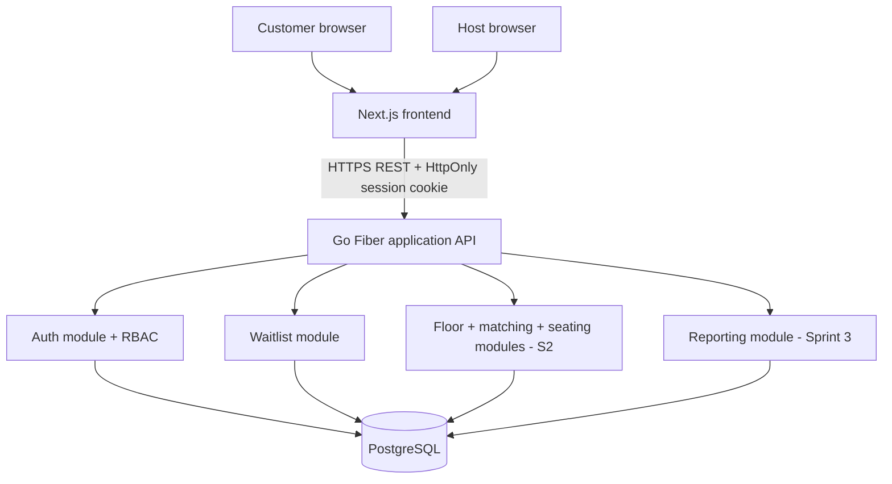
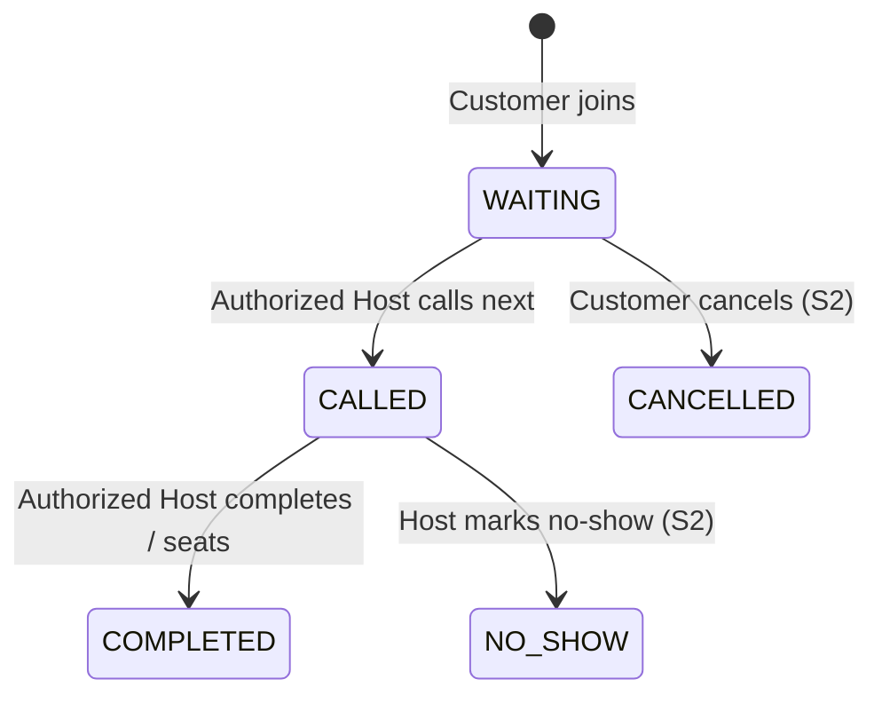

# 03. System-Level Software Design Specification (SDS)

**Version:** DQ-SDS-2.0 proposed (2026-11-05), prior to implementation. Required by CPE 334 §§5.1–5.3, 8.1, Deliverable 1 rubric.

**Implementation boundary (updated 13 Nov 2026):** repository foundation lives in
`apps/web` and `apps/api`; see `features/sprint1-foundation-contract.md` and
`testing/sprint1-foundation-results.md` (historical) and `testing/sprint1-gorm-results.md`
(current access-layer revision). The foundation includes web/config/health/GORM
wiring. F-01 auth, F-02 join, F-03 own-ticket reads/UI and F-04 Host board/FIFO
call/manual completion are implemented. Local integration and review evidence is
recorded in `testing/sprint1-review-results.md`, alongside the historical per-feature
records. Floor/reporting remain proposed designs for later sprints. Local worktree
evidence is not CI/release approval.

## 1. Architecture and rationale

Use a **modular monolith**, not microservices. Three logical layers are required, not three independently hosted machines.



### Tech decisions (proposals, not mandates)

| Concern | Choice | Why |
|---|---|---|
| Web UI | Next.js + TypeScript + Tailwind | Reusable responsive pages, type-safe UI |
| Backend | Go Fiber v3 REST | Lightweight HTTP handlers with explicit domain services and authorization middleware |
| Database | PostgreSQL | ACID transactions, row locks, partial unique indexes |
| DB access | GORM + PostgreSQL driver with SQL migrations (DEC-026) | Familiar ORM models, explicit transaction/locking control and reviewed schema changes |
| Auth | Opaque session cookie with hashed token in DB | Simple actual logout/revocation; easy expiry/ownership tests |
| API spec | [Sprint 1 OpenAPI](api/sprint1.openapi.json) plus versioned route/DTO/error tables in `04-data-and-api.md` and feature addenda | Contract-first design |
| Unit/integration | Go `testing` + Fiber test client + isolated PostgreSQL | Rule, HTTP and persistence verification |
| Browser E2E | Playwright | Customer/Host critical journey |
| Delivery | Docker + GitHub Actions + GCP | Required by Lab 5 |

## 2. Module responsibilities

- `internal/auth`: login, logout, current user, password hashes, session expiry/invalidations, request identity.
- `internal/auth/seed.go`: seeded demo accounts and initial role/grant assignment (account admin UI **not** needed S1).
- `internal/queue`: service queue scope, join, duplicate detection, daily ticket allocation, my ticket, host list, call and complete.
- `internal/seating` (S2): table capacity, occupancy, assignment/release in transaction.
- `internal/reporting` (S3): wait duration and counts, optional event history.
- `internal/platform/postgres`: GORM connection and bounded pool; module repositories
  handle persistence models. SQL migrations and constraints live under `db/migrations`.

All permissions are checked in backend guards **and** resource query/service methods. UI hiding an action is never sufficient.

## 3. Authorization matrix

`✓`: allowed, `—`: forbidden; an authorized Host is assigned to the relevant queue.

| Capability | Anonymous | Customer | Assigned Host | Unassigned Host |
|---|---:|---:|---:|---:|
| Login | ✓ | ✓ | ✓ | ✓ |
| Current user/logout | — | ✓ (self) | ✓ (self) | ✓ (self) |
| Join waitlist | — | ✓ | — | — |
| View own ticket | — | ✓ (own) | — | — |
| List private queue details | — | — | ✓ | — |
| Call Next / Complete | — | — | ✓ | — |
| Table assign/release (S2) | — | — | ✓ | — |
| Cancel WAITING (S2) | — | ✓ (own) | — (unless separately specified) | — |
| Public current number (S3) | ✓ | ✓ | ✓ | ✓ |

Ownership failures must not reveal somebody else's private ticket; return 404 for direct foreign-ticket detail.

## 4. Authentication/session lifecycle

1. Seed accounts with strong, hashed passwords (Argon2id or framework-supported secure alternative).
2. `POST /api/v1/auth/login`: validate credentials and account active flag; create random high-entropy opaque session token; **only token hash** stored in `sessions` table; send token as HttpOnly cookie.
3. Session cookie: `HttpOnly`, `Secure` on HTTPS, `SameSite=Lax` for same-site frontend/API routing; fixed 12h validity (proposed). Deploy frontend/API behind one same-site domain or proxy so cookie policy is predictable.
4. Guard checks hashed token against non-expired DB session; attaches user id, role. Unknown/expired session → 401.
5. `GET /api/v1/auth/me`: reports id/name/role, not password hash.
6. `POST /api/v1/auth/logout`: revokes session row and clears cookie; repeat post-logout access denied.
7. CSRF from S1: exact Origin on login; exact Origin plus per-session HMAC CSRF token on authenticated mutations. SameSite=Lax complements these checks. Login/me return csrfToken to same-origin UI memory; logout uses X-CSRF-Token. See DEC-027.
8. Log auth failures without storing plaintext passwords/tokens. Secrets only in environment variables/secret manager.

S1 can use predefined demo accounts; registration/password reset/email verification are not required.

## 5. Queue transaction design

### Ticket issuance under concurrent joins

- Server validates account, queue, party size.
- Within one DB transaction, rely on the **database partial unique index** on `(customer_id, queue_id) WHERE status IN ('WAITING', 'CALLED')` to reject duplicate active entries. An optional precheck is not authoritative under races; the implementation handles the index conflict and rolls back the counter allocation.
- Atomically upsert `queue_day_counters` by `(queue_id, service_date)` and increment `last_number`, returning new value.
- Insert `queue_entries` with `queue_id`, `service_date`, `sequence_number`, `party_size`, status `WAITING` and server `joined_at`.
- Unique index `(queue_id, service_date, sequence_number)` protects against duplicate numbers.
- On unique/constraint conflict, rollback and respond `409 ACTIVE_QUEUE_EXISTS` or relevant conflict code.

### Call Next without duplicate claiming

- Start DB transaction; lock current `service_queues` row with `SELECT ... FOR UPDATE` **before** examining state.
- Verify operator's queue permission.
- If there is currently a `CALLED` ticket, respond `409 CALL_IN_PROGRESS`.
- Select oldest `WAITING` entry sorted `(joined_at, id)`; update to `CALLED`, set `called_at`, `called_by`.
- Commit; concurrent staff request waits for same queue lock and re-checks updated state. It must not call the same ticket.

### Completion

- Start transaction; confirm Host permission and entry queue/status `CALLED`.
- Update `COMPLETED`, `completed_at`, `completed_by`; release active-ticket constraint for customer.
- Reject any other from-state as `409 INVALID_TRANSITION`.

### Joined-table matching and allocation (Sprint 2, revised)

**This section supersedes the original one-table proposal.** The complete contract and 10-guest example are in [`06-restaurant-operations.md`](06-restaurant-operations.md).

- Model physical floor as `floor_zones`, `dining_tables(capacity CHECK 1..8, status, display_position)` and approved undirected `table_connections(low_id,high_id)`. Same-zone, connected sets of at most 3 tables are eligible, regardless of pixel proximity.
- Read-only matching evaluates candidates deterministically; preview does not reserve tables. For party 10, T4(6)+T5(4) can match only if approved adjacent and both AVAILABLE. T7(8) alone cannot match.
- Host **Call & Hold** locks queue scope, queue entry and selected tables in stable order, revalidates eligible ticket/connection/availability, creates HELD assignment and membership rows, marks **all** tables HELD and sets ticket CALLED in one SQL transaction.
- Host **Seat** atomically sets all tables OCCUPIED, assignment ACTIVE and CALLED ticket COMPLETED (completion of *waiting*, not dining). The old S1 bare complete endpoint becomes guarded/retired by a versioned feature contract.
- Host **No-show/hold expiry** releases all HELD tables, records event and resolves ticket/assignment terminal states. Avoid frontend-authoritative timers.
- Host **Checkout** changes whole active assignment to CLOSED and all selected tables to DIRTY; cleaning proceeds DIRTY→CLEANING→AVAILABLE with server checks. Multiple-table groups are never partially released in v2.
- Add partial unique index on active `seating_assignment_tables.table_id` for HELD/ACTIVE mapping (via `released_at IS NULL`), and unique open assignment per queue entry. Consistent row locks + guards + DB indexes are all required; do not rely on optimistic button disabling.
- For a given selected set, choose oldest **eligible** WAITING ticket, with fairness and any overrides explicitly documented and TA-approved. No unverified 'optimal' or AI claim.

### Concurrency-safe Go service layering

```text
cmd/api/main.go
internal/auth/{handler,service,repository}.go
internal/queue/{handler,service,repository}.go
internal/floor/{handler,service,repository}.go
internal/matching/{algorithm,service}.go
internal/seating/{handler,service,repository}.go
internal/analytics/{handler,service}.go
internal/platform/{config,db,middleware}.go
db/migrations/
```

Handlers validate and parse HTTP input. Services enforce BRs, role/queue scope and transaction boundaries. Repositories use GORM parameterized queries or reviewed SQL where PostgreSQL-specific behavior is needed. Pass the same `tx *gorm.DB` through each atomic operation; no startup AutoMigrate. **Transactions belong to the service/transaction coordinator**, not independent repositories committing separately.

## 6. Explicit status model



`COMPLETED` refers to finishing the **waitlist service**, not a completed restaurant meal. In S2 `CALLED→COMPLETED` must occur in the same transaction as group seating. `CANCELLED` and `NO_SHOW` are planned Sprint 2 statuses. The transition contract will be versioned when introduced.

## 7. UI architecture

Customer mobile-first: `/login`, `/`, `/join`, `/my-queue`. Host desktop-first: `/host/queue`, `/host/floor`, `/host/analytics`, with accessible tabular fallback for interactive floor. Role routing is UX only; backend makes access decisions. Every important view requires loading, empty, error and success feedback.

## 8. Configuration and operations

- Current config: `DATABASE_URL`, `APP_ORIGIN`, `APP_ENV`, `PORT`, web server-only `API_INTERNAL_URL`; four `SEED_*_PASSWORD` values only for opt-in seed tooling. The custom opaque-session design requires no global SESSION_SECRET (DEC-027). HOLD_TTL_MINUTES is future S2 configuration; cross-origin frontend deployment is not implemented. Provide `.env.example` placeholders only.
- API commands proposed: `go build ./...`, `go test ./...`, `go test -tags=integration ./...`, `go vet ./...`; SQL migrations and seeds via documented explicit scripts; Playwright frontend E2E. All need actual implementation first.
- Health endpoints: `/health/live` and `/health/ready` for runtime and database readiness.
- S1 local run: web, API and DB; real data persists between restarts; seed script idempotent.
- Lab 5: containerize accepted release, CI build/test gate on PRs, reviewed main release through repeatable deployment to GCP; exact services to match assigned course resources.
- A separate cloud staging environment and microservices are **not required**.

## 9. Engineering quality constraints

Validate DTOs, keep domain logic in services, do not trust status/number from clients, add database constraints as last line of defense, write negative and race tests, record architecture and lock-order decisions. Do not claim CI, deployment or tests happened until actual logs and linkable results exist.

## 10. Backend stack decision and version caution

The team explored Go Fiber; DEC-023 originally proposed **Go Fiber v3 + pgx/sqlc**. User-authorized DEC-026 supersedes its access layer with **GORM + PostgreSQL driver**, retaining Fiber v3 and explicit SQL migrations. Current Fiber v3 docs require Go 1.26+. Both team members must approve toolchain/framework and ensure versions are pinned. Session middleware ordering (session before CSRF) matters if using Fiber-provided sessions. Fiber request-scoped buffer values must not escape request lifetime. See `16-security-quality-review.md`.
