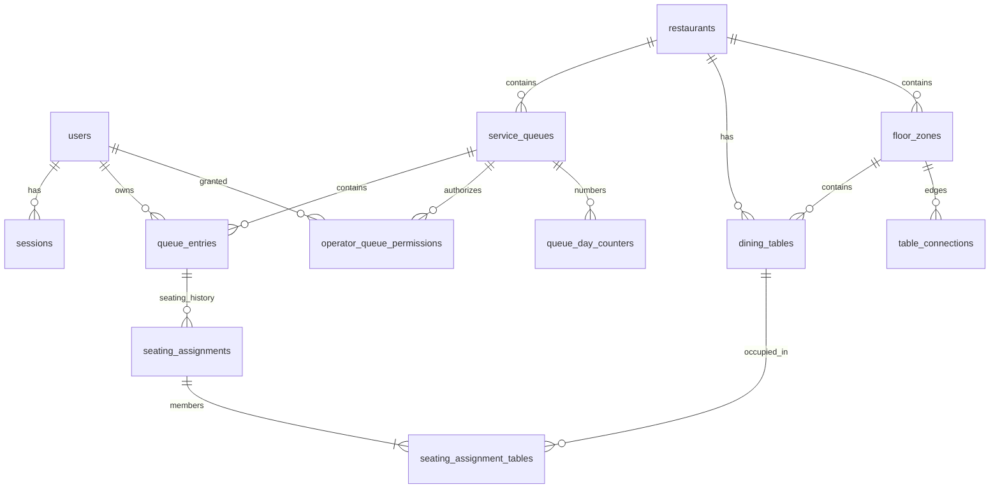

# 04. Database Design and API Contract

> Lab 7 #44 extends Entry/Ticket/HostEntry with `isReady`, adds owner-only readiness PATCH and versions call eligibility. See the [shared contract](labs/lab-07/readiness-contract.md) for JSON/errors, migration 0003 and queue-to-entry locking; [local results](labs/lab-07/readiness-results.md).

**Status:** current S1/Lab 7 interfaces plus proposed S2 additions. [DQ-S2-INTERFACES-2.1](features/sprint2-ui-api-data.md) is the detailed S2 review draft and supersedes conflicting v2 sketches. No new route is implemented by this documentation change. API response shapes and status/error codes are team choices. They are not prescribed by the CPE 334 PDF.

Machine-readable export of the implemented Sprint 1 routes:
[`api/sprint1.openapi.json`](api/sprint1.openapi.json). S2 proposed routes below
are excluded from that implemented API export.

**Access-layer revision (DEC-026, 6 Nov 2026):** GORM + PostgreSQL driver replaces
sqlc/direct pgx access. The schema, API, FR/BR IDs and database invariants below are
unchanged. Use explicit versioned SQL migrations for checks, foreign keys and partial
indexes; do not call AutoMigrate on startup. Keep persistence models separate from
request/response DTOs. Services coordinate `db.Transaction` and pass the same `tx`
to all repository calls; use explicit conditional updates and inspect affected rows.
GORM's per-write default transactions are not a substitute for whole-use-case atomicity.

## Entity relationships (logical, conceptual)



`floor_zones`, `dining_tables`, `table_connections`, `seating_assignments`, `seating_assignment_tables` begin in Sprint 2; `queue_events` begins in Sprint 2 for meaningful audit. `user_id`/`actor_id` foreign keys are omitted from the diagram for readability but documented in tables below.

## 1. Data dictionary: Sprint 1

### `users`

| Field | Type/constraint | Purpose |
|---|---|---|
| `id` | UUID PK | Stable internal user key |
| `display_name` | varchar(100) not null | Account label |
| `email` | case-insensitive unique varchar(254) | Login identity |
| `password_hash` | text not null | Securely hashed password |
| `role` | enum `CUSTOMER`, `HOST` not null | Core two-role model |
| `is_active` | boolean default true | Disabled access prevention |
| `created_at` | timestamptz not null | Audit |

### `sessions`

| Field | Type/constraint | Purpose |
|---|---|---|
| `id` | UUID PK | Session identifier |
| `user_id` | UUID FK users, cascade/delete policy documented | Owner |
| `token_hash` | unique text not null | Hash of opaque cookie token |
| `expires_at` | timestamptz not null | Fixed expiry |
| `created_at` | timestamptz not null | Audit |
| `revoked_at` | timestamptz nullable | Logout/revocation |

### `restaurants`

| Field | Type/constraint | Purpose |
|---|---|---|
| `id` | UUID PK | Restaurant |
| `name` | varchar(120) not null | Display name |
| `timezone` | varchar(64) default `Asia/Bangkok` | Date boundary |

### `service_queues`

| Field | Type/constraint | Purpose |
|---|---|---|
| `id` | UUID PK | Waitlist domain |
| `restaurant_id` | UUID FK restaurants | Owner |
| `name` | varchar(120), e.g. 'Walk-in Dining' | Queue label |
| `ticket_prefix` | varchar(3), e.g. `A` | Human readable ticket |
| `is_active` | boolean not null | Disable new entries |

### `operator_queue_permissions`

| Field | Type/constraint | Purpose |
|---|---|---|
| `user_id` | UUID FK users | Host |
| `queue_id` | UUID FK service_queues | Scope |
| `(user_id,queue_id)` | composite PK | No duplicate grants |

### `queue_day_counters`

| Field | Type/constraint | Purpose |
|---|---|---|
| `queue_id` | UUID FK | Queue |
| `service_date` | date | Restaurant local day |
| `last_number` | int >= 0 | Last allocated number |
| `(queue_id, service_date)` | composite PK | One atomic allocator per day |

### `queue_entries`

| Field | Type/constraint | Purpose |
|---|---|---|
| `id` | UUID PK | Internal unique ticket |
| `queue_id` | UUID FK service_queues | Service scope |
| `customer_id` | UUID FK users | Owner |
| `service_date` | date not null | Numbering scope |
| `sequence_number` | positive int not null | Human number, e.g. 14 |
| `party_size` | int CHECK 1 <= n <= 16 | Number of diners |
| `status` | text CHECK WAITING/CALLED/COMPLETED in 0002 | S1 state; S2 adds terminal values through a new reviewed migration |
| `joined_at` | timestamptz not null | Fairness order |
| `called_at` | timestamptz nullable | Call time |
| `completed_at` | timestamptz nullable | Completion time |
| `called_by` | UUID nullable FK users | Audit |
| `completed_by` | UUID nullable FK users | Audit |
| `version` | integer default 1 | Persisted transition version |
| `is_ready` | boolean NOT NULL, new default false | Lab 7 owner readiness; existing rows backfilled true by 0003 |

**Essential SQL constraints/indexes** (implement with migrations and confirm against test PostgreSQL):

```sql
-- One displayed ticket number per queue per local service day.
CREATE UNIQUE INDEX uq_queue_day_number
ON queue_entries (queue_id, service_date, sequence_number);

-- Prevent same customer holding multiple active entries in same queue.
CREATE UNIQUE INDEX uq_one_active_ticket_per_customer_queue
ON queue_entries (customer_id, queue_id)
WHERE status IN ('WAITING', 'CALLED');

-- S1 one currently called entry per queue.
CREATE UNIQUE INDEX uq_one_called_per_queue
ON queue_entries (queue_id)
WHERE status = 'CALLED';

CREATE INDEX idx_queue_fifo
ON queue_entries (queue_id, status, joined_at, id);
```

**Migration caution:** Keep one CALLED per service queue in v2; revise queue status enum/constraints when adding CANCELLED/NO_SHOW. Use SQL migrations for partial unique indexes and tested rollback. Do not assume ORM schema alone handles them.

## 2. Sprint 2 floor and seating data review draft

The complete field/constraint and migration definitions are in [S2 UI/API/data sections 6–8](features/sprint2-ui-api-data.md#6-persistent-model-and-invariants). They are proposed schema, not applied migrations.

| Entity | Responsibility and invariant |
|---|---|
| service_queues additions | Explicit MANUAL/SEATING mode, five-minute hold policy; existing rows stay MANUAL until guarded activation |
| restaurant_floor_state | Restaurant-wide layout version and shared transaction lock, including cross-queue claims |
| floor_zones / dining_tables | Same-restaurant/zone references, capacity1–8, persisted state/version and display coordinates |
| table_connections | Active approved undirected low/high pair; no self, duplicate or cross-zone combinations |
| seating_assignments | HELD/ACTIVE/CLOSED/RELEASED, queue/entry/zone, versions and lifecycle times; CLOSED carries DIRTY/CLEANING/CLEANED turnover |
| seating_assignment_tables | Historical N:M membership with capacity snapshot and released_at; unique outstanding table claim retained until release or finish-cleaning |
| queue_entries additions | Add CANCELLED/NO_SHOW with versioned lifecycle CHECKs/terminal metadata; preserve old times, IDs, is_ready and uniqueness |
| operation_events / operation_requests | Append-only transition/selection audit and scoped idempotency results committed with business state |

Memberships remain claimed during dirty/cleaning turnover, rather than being released at checkout as in the old sketch. An explicit turnover phase prevents an old assignment cleaning tables reallocated to a new group. Same-zone connectivity and summed capacity require service validation under locks; a simple cross-row CHECK is not sufficient.

Do not edit applied migrations 0001–0003 or use startup AutoMigrate. Stage additive floor data under #50 and common seating/lifecycle data under #52; #53/#54 reuse that schema. Provision/activate explicitly with database confirmation; never fabricate old assignments, alter existing readiness/passwords or silently convert a legacy CALLED ticket. See the contract for MANUAL compatibility and the application rollback boundary.

## 3. API design conventions

Base: `/api/v1`. JSON request/response. Cookie session. UUID as path ID; ticket code e.g. `A-014` as **display only**. UTC ISO timestamps and separately local `serviceDate` `YYYY-MM-DD`.

Common error body:

```json
{
  "error": {
    "code": "ACTIVE_QUEUE_EXISTS",
    "message": "You already have an active ticket for this queue.",
    "requestId": "opaque-correlation-id"
  }
}
```

Recommended codes: 400 validation; 401 unauthenticated; 403 forbidden action/scope; 404 not found or foreign private ticket; 409 business-rule/state conflict; 500 unexpected with no secret leaked.

### Authentication and public queue catalog — S1

| Method | Path | Role | Request | Success |
|---|---|---|---|---|
| POST | `/auth/login` | Anonymous | `{email,password}` + exact Origin | 200 `{user:{id,displayName,role},csrfToken}`, sets session cookie |
| POST | `/auth/logout` | Authenticated | exact Origin + X-CSRF-Token | 204, invalidates session and cookie |
| GET | `/auth/me` | Authenticated | none | 200 `{user:{id,displayName,role},csrfToken}` |
| GET | `/queues` | Authenticated | none | 200 `{queues:[{id,name,restaurantName}]}` active queues only (F-02) |

F-01 implementation uses a 12h opaque session, SHA-256 token digest in DB and
per-session HMAC CSRF token (DEC-027). No password hash/email/cookie-token value in user
responses. HTTPS uses `__Host-dineq_session`; local HTTP uses `dineq_session`.
Login allows only email/password JSON fields, limits body to 4 KiB and password
to 128 UTF-8 bytes; invalid credentials are generic 401, per-IP limits return 429.
No credentialed CORS is enabled. The frontend uses same-origin auth rewrites.

### Customer endpoints — S1

Queue path IDs in Join and Host routes use the 36-character UUID representation.
Malformed IDs and alternate encodings (URN, braces or compact hex) return 404
`NOT_FOUND` before SQL permission/resource queries. This preserves the existing
not-found contract without letting PostgreSQL parsing errors become 500 responses.

| Method | Path | Request | Success | Errors |
|---|---|---|---|---|
| POST | `/queues/{queueId}/entries` | `{ "partySize": 4 }` | 201 entry summary | 400,401,403,404,409 |
| GET | `/me/queue-entries/active` | none | 200 `{entries:[...]}` own WAITING/CALLED entries (0 or 1 per queue) | 401,403 |
| GET | `/me/queue-entries/{entryId}` | none | 200 own detail, including COMPLETED | 401,403,404 |

Both read endpoints require CUSTOMER at HTTP and service layers (DEC-030).
Read summaries contain the eight entry-summary fields below plus `queueName`,
`restaurantName` and `timezone`. `serviceDate` is YYYY-MM-DD, `joinedAt` UTC;
no customer identity or staff audit fields are returned. Active entries include
prior business dates and inactive queues, ordered `(joined_at,id)`; detail queries
bind both owner and entry ID. Malformed, missing and foreign ticket IDs produce
the same 404 `NOT_FOUND` response. All private reads are `Cache-Control: no-store`.

Example 201 response:

```json
{
  "id": "4a89b918-e95d-4e70-9b09-76c0ea181f8a",
  "queueId": "0f5812a0-e02b-4185-a803-62de3bef22bc",
  "ticketCode": "A-014",
  "serviceDate": "2026-11-05",
  "partySize": 4,
  "isReady": false,
  "status": "WAITING",
  "joinedAt": "2026-11-05T04:15:00.000Z"
}
```

### Operator endpoints — S1

| Method | Path | Request | Success | Errors |
|---|---|---|---|---|
| GET | `/host/queues` | none | 200 `{queues:[{id,name,restaurantName,timezone,isActive}]}` assigned only | 401,403 |
| GET | `/host/queues/{queueId}/entries?status=WAITING` | none | 200 `{entries:[...]}` oldest first `(joined_at,id)` | 400,401,403,404 |
| GET | `/host/queues/{queueId}/current` | none | 200 `{entry:null}` or `{entry:HostEntry}` | 401,403,404 |
| POST | `/host/queues/{queueId}/call-next` | empty body | 200 updated CALLED entry | 400,401,403,404,409 `CALL_IN_PROGRESS`/`QUEUE_EMPTY`/`NO_READY_PARTIES` |
| POST | `/host/queues/{queueId}/entries/{entryId}/complete` | empty body | 200 updated COMPLETED entry | 400,401,403,404,409 `INVALID_TRANSITION` |

All paths are under `/api/v1`, require role HOST plus a queue grant (unknown queue
UUID → 403, malformed ID → 404), and mutations require Origin + CSRF (DEC-031).
Host entry DTO: `id, queueId, ticketCode, serviceDate, partySize, isReady, status, joinedAt,
calledAt, completedAt`; no customer identity or actor IDs.

**S1 compatibility:** Host's `Complete` confirms party was seated/handled manually, before digital table assignment exists. S2 introduces table-assignment precondition via recorded contract revision.

### Proposed S2 interfaces

All paths remain under `/api/v1`. Full request/response DTOs, strict validation, idempotency, privacy, error precedence and expiry semantics are defined in [S2 UI/API/data sections 1–5](features/sprint2-ui-api-data.md#1-scope-and-shared-transport).

| Method | Path | Contract |
|---|---|---|
| GET | `/host/queues/{queueId}/floor` | Granted queue's floor snapshot, private assignments scoped to that queue |
| GET | `/host/queues/{queueId}/matching` | Selected tableId list or one entryId recommendation query; no writes |
| POST | `/host/queues/{queueId}/match-and-call` | Explicit party/set/expected versions/key; atomic CALLED and HELD |
| POST | `/host/queues/{queueId}/seating-assignments/{id}/seat` | Unexpired HELD to ACTIVE/OCCUPIED and ticket COMPLETED |
| POST | `/host/queues/{queueId}/seating-assignments/{id}/checkout` | Whole ACTIVE group to CLOSED/DIRTY |
| POST | `/host/queues/{queueId}/seating-assignments/{id}/start-cleaning` | Whole CLOSED/DIRTY group to CLEANING |
| POST | `/host/queues/{queueId}/seating-assignments/{id}/finish-cleaning` | Whole group AVAILABLE; release claims; mark turnover CLEANED |
| POST | `/host/queues/{queueId}/entries/{entryId}/no-show` | CALLED/HELD group to NO_SHOW/RELEASED/AVAILABLE |
| POST | `/host/queues/{queueId}/expire-holds` | Idempotent server-deadline cleanup, separate audit transaction |
| POST | `/me/queue-entries/{entryId}/cancel` | Only owner WAITING to CANCELLED; owned detail preserved |

Queue-scoped Host routes replace the earlier proposed restaurant-only floor and unscoped assignment routes before implementation. This reuses the existing queue-grant boundary. MANUAL retains implemented call/complete; SEATING rejects those bare endpoints with TABLE_SELECTION_REQUIRED / SEATING_ASSIGNMENT_REQUIRED so the new lifecycle cannot be bypassed. Existing Customer envelopes, isReady, no-store, session and CSRF behavior remain.

### Proposed S3 extensions

The earlier restaurant-wide analytics/private-UUID public route sketch is superseded for the proposed S3 implementation by [DQ-S3-1.0 UI/API/data](features/sprint3-ui-api-data.md). It specifies queue-granted staff history/reports, owner-scoped Customer history, public slug-only display, configuration-granted floor setup and separate activation. No S3 endpoint is claimed implemented. New grants/display settings/configuration audit require explicit migrations; Customer history/status use existing ticket data.

## 4. Seed and validation plan

- One restaurant, one active service queue (prefix A), one authorized Host, 2–3 demo Customers, one unassigned Host for negative tests.
- Seed scripts must be deterministic/idempotent; seed passwords sourced from secure local config and never printed in CI logs.
- Dedicated local/test Postgres databases; integration tests reset data between cases.
- API status/error schema frozen in Feature Contracts before implementation; actual test run must be linked to commit.


## 5. Analytical views and provenance (S3)

- `waitSeconds`: for called ticket, `called_at - joined_at`. Show sample count and exclude never-called records; do not turn it into exact ETA.
- `seatingSeconds`: from assignment `seated_at - held_at`; exclude missing timestamps.
- `tableOccupancySeconds`: sum ACTIVE windows `closed_at - seated_at` per table (combined party counts toward each occupied table's total), with total available table-time denominator and clear filter window.
- `throughput`: count distinct tickets seated (`COMPLETED` with ACTIVE/CLOSED assignment) in selected window, **not** per-table members.
- `noShowRate`: no-show / (called tickets with known terminal disposition) with zero-denominator safe handling.
- `turnoverSeconds`: DIRTY → AVAILABLE interval for fully cleaned group; status history provides times.
- `waitingCount`: currently WAITING, not sum of history; analytics never counts canceled as served.

No unverified “live” or AI-generated wait time claims. ETA is optional, must be explicitly labelled estimate with insufficient-data fallback.

### S3 analytical coverage refinement

The formulas above describe intended metrics. [The S3 interface contract](features/sprint3-ui-api-data.md#cohorts-and-formulas) freezes the proposed date cohorts, nullable metrics, exclusions and coverage rules before implementation. Unknown historical in-service table-time and shared-floor queue denominators yield unavailable utilization with a reason. Never reconstruct opening hours or backdate inventory snapshots. Ticket COMPLETED is not proof of dining checkout.
