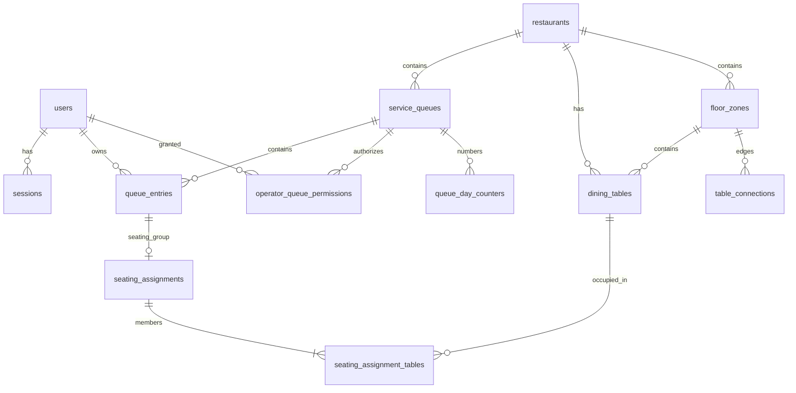

# 04. Database Design and API Contract

**Status:** proposed implementation contract. API response shapes and status/error codes are team choices. They are not prescribed by the CPE 334 PDF.

**Access-layer revision (DEC-026, 6 Nov 2026):** GORM + PostgreSQL driver replaces
sqlc/direct pgx access. The schema, API, FR/BR IDs and database invariants below are
unchanged. Use explicit versioned SQL migrations for checks, foreign keys and partial
indexes; do not call AutoMigrate on startup. Keep persistence models separate from
request/response DTOs. Services coordinate `db.Transaction` and pass the same `tx`
to all repository calls; use explicit conditional updates and inspect affected rows.
GORM's per-write default transactions are not a substitute for whole-use-case atomicity.

## Entity relationships (logical, conceptual)



`floor_zones`, `dining_tables`, `table_connections`, `seating_assignments`, `seating_assignment_tables` begin in Sprint 2; `queue_events` begins in Sprint 2 for meaningful audit. `user_id`/`actor_id` foreign keys are omitted from the diagram for readability but documented in tables below.

## 1. Data dictionary: Sprint 1

### `users`

| Field | Type/constraint | Purpose |
|---|---|---|
| `id` | UUID PK | Stable internal user key |
| `display_name` | varchar(100) not null | Account label |
| `email` | case-insensitive unique varchar(254) | Login identity |
| `password_hash` | text not null | Securely hashed password |
| `role` | enum `CUSTOMER`, `HOST` not null | Core two-role model |
| `is_active` | boolean default true | Disabled access prevention |
| `created_at` | timestamptz not null | Audit |

### `sessions`

| Field | Type/constraint | Purpose |
|---|---|---|
| `id` | UUID PK | Session identifier |
| `user_id` | UUID FK users, cascade/delete policy documented | Owner |
| `token_hash` | unique text not null | Hash of opaque cookie token |
| `expires_at` | timestamptz not null | Fixed expiry |
| `created_at` | timestamptz not null | Audit |
| `revoked_at` | timestamptz nullable | Logout/revocation |

### `restaurants`

| Field | Type/constraint | Purpose |
|---|---|---|
| `id` | UUID PK | Restaurant |
| `name` | varchar(120) not null | Display name |
| `timezone` | varchar(64) default `Asia/Bangkok` | Date boundary |

### `service_queues`

| Field | Type/constraint | Purpose |
|---|---|---|
| `id` | UUID PK | Waitlist domain |
| `restaurant_id` | UUID FK restaurants | Owner |
| `name` | varchar(120), e.g. 'Walk-in Dining' | Queue label |
| `ticket_prefix` | varchar(3), e.g. `A` | Human readable ticket |
| `is_active` | boolean not null | Disable new entries |

### `operator_queue_permissions`

| Field | Type/constraint | Purpose |
|---|---|---|
| `user_id` | UUID FK users | Host |
| `queue_id` | UUID FK service_queues | Scope |
| `(user_id,queue_id)` | composite PK | No duplicate grants |

### `queue_day_counters`

| Field | Type/constraint | Purpose |
|---|---|---|
| `queue_id` | UUID FK | Queue |
| `service_date` | date | Restaurant local day |
| `last_number` | int >= 0 | Last allocated number |
| `(queue_id, service_date)` | composite PK | One atomic allocator per day |

### `queue_entries`

| Field | Type/constraint | Purpose |
|---|---|---|
| `id` | UUID PK | Internal unique ticket |
| `queue_id` | UUID FK service_queues | Service scope |
| `customer_id` | UUID FK users | Owner |
| `service_date` | date not null | Numbering scope |
| `sequence_number` | positive int not null | Human number, e.g. 14 |
| `party_size` | int CHECK 1 <= n <= 16 | Number of diners |
| `status` | enum WAITING/CALLED/COMPLETED (S1) | State |
| `joined_at` | timestamptz not null | Fairness order |
| `called_at` | timestamptz nullable | Call time |
| `completed_at` | timestamptz nullable | Completion time |
| `called_by` | UUID nullable FK users | Audit |
| `completed_by` | UUID nullable FK users | Audit |
| `version` | integer default 1 | Optional optimistic control |

**Essential SQL constraints/indexes** (implement with migrations and confirm against test PostgreSQL):

```sql
-- One displayed ticket number per queue per local service day.
CREATE UNIQUE INDEX uq_queue_day_number
ON queue_entries (queue_id, service_date, sequence_number);

-- Prevent same customer holding multiple active entries in same queue.
CREATE UNIQUE INDEX uq_one_active_ticket_per_customer_queue
ON queue_entries (customer_id, queue_id)
WHERE status IN ('WAITING', 'CALLED');

-- S1 one currently called entry per queue.
CREATE UNIQUE INDEX uq_one_called_per_queue
ON queue_entries (queue_id)
WHERE status = 'CALLED';

CREATE INDEX idx_queue_fifo
ON queue_entries (queue_id, status, joined_at, id);
```

**Migration caution:** Keep one CALLED per service queue in v2; revise queue status enum/constraints when adding CANCELLED/NO_SHOW. Use SQL migrations for partial unique indexes and tested rollback. Do not assume ORM schema alone handles them.

## 2. Sprint 2 floor and seating extensions — definitive v2 design

All records are within a restaurant; enforce FK/transactional same-restaurant and zone checks. Do not use the location of visual cards to infer combinability. Use PostgreSQL `timestamptz` and store UTC instants.

### `floor_zones`

| Field | Type / constraint | Purpose |
|---|---|---|
| `id` | UUID PK | Stable floor zone |
| `restaurant_id` | UUID FK restaurants | Owning restaurant |
| `name` | varchar(80) | Main/Terrace/Private |
| `layout_version` | bigint >= 1 | Detect stale previews |
| `is_active` | bool | Whether eligible for seating |

### `dining_tables`

| Field | Type / constraint | Purpose |
|---|---|---|
| `id` | UUID PK | Physical table |
| `restaurant_id`, `zone_id` | UUID FKs | Restaurant/floor scope |
| `code` | varchar(20), unique per restaurant | T4, T5 |
| `capacity` | integer CHECK 1..8 | **Individual** table capacity |
| `status` | enum AVAILABLE/HELD/OCCUPIED/DIRTY/CLEANING/OUT_OF_SERVICE | Lifecycle |
| `position_x`, `position_y` | numeric bounded | Display coordinates, not adjacency proof |
| `version` | bigint default 1 | Snapshot protection |
| `updated_at` | timestamptz | Status update |

### `table_connections` — approved physical adjacency graph

| Field | Type / constraint | Purpose |
|---|---|---|
| `table_low_id`, `table_high_id` | UUID FKs, composite PK with `low_id < high_id` | Unique undirected edge |
| `is_active` | boolean default true | Explicit permitted combination |
| `approved_by` | UUID FK users nullable for seeded edges | Trace decision |
| `created_at` | timestamptz | Audit |

**Important:** `table_low_id < table_high_id` is a stable canonical order; physical floor joins must be manager-validated. A DB CHECK cannot enforce same-zone membership across two FKs by itself: service + transaction/trigger (if required) validates those referenced rows. Prevent removing an edge while held/active assignments rely on it, or record a reviewed migration policy.

### `seating_assignments` — one party, 1–3 physical tables

| Field | Type / constraint | Purpose |
|---|---|---|
| `id` | UUID PK | Group assignment |
| `queue_entry_id` | UUID unique FK | One seating assignment per queue entry in v2 |
| `status` | HELD/ACTIVE/CLOSED/RELEASED | Hold, seat, checkout lifecycle |
| `created_by` | UUID FK users | Authorized Host |
| `hold_expires_at` | timestamptz nullable | Server-controlled hold expiry |
| `held_at`, `seated_at`, `closed_at` | timestamptz | Operations analytics |
| `capacity_snapshot` | integer >= party size | Snapshot of all member seats |
| `restaurant_id`, `zone_id` | UUID FKs | Scope consistency |
| `idempotency_key` | unique per actor/operation scope | Safe UI repeat behavior |

### `seating_assignment_tables` — the crucial N:M membership table

| Field | Type / constraint | Purpose |
|---|---|---|
| `assignment_id`, `table_id` | UUID FKs, composite PK | Which tables belong to which party |
| `released_at` | timestamptz nullable | Non-null after RELEASED/CLOSED |
| `capacity_at_assignment` | integer 1..8 | Historical capacity snapshot |

Partial unique index `table_id WHERE released_at IS NULL` ensures one table cannot be concurrently HELD or ACTIVE for two different assignments. All membership rows for a group are created/closed in a **single transaction**. Status column and membership index are mutually consistent only with transaction service checks and tests.

### `queue_events` / `table_events`

- Append-only event with `id`, actor, restaurant, queue entry / assignment / table references, `action`, server timestamp, status from/to, restricted JSON metadata (reason and selected table IDs only; no session secrets).
- Event records begin Sprint 2 for important mutations (call, hold, seat, no-show, checkout, clean) and feed Sprint 3 analytics.

### Migration/invariant SQL sketch (adapt to actual schema)

```sql
ALTER TABLE queue_entries
  ADD CONSTRAINT chk_party_size CHECK (party_size BETWEEN 1 AND 16);

-- Physical table capacity remains <= 8; group capacity is summed at runtime.
ALTER TABLE dining_tables
  ADD CONSTRAINT chk_table_capacity CHECK (capacity BETWEEN 1 AND 8);

CREATE UNIQUE INDEX uq_open_table_member
ON seating_assignment_tables (table_id)
WHERE released_at IS NULL;

CREATE INDEX idx_tables_zone_state
ON dining_tables (zone_id, status, id);
```

**Migration note:** If a `chk_party_size` constraint already exists, replace it with `DROP CONSTRAINT` then `ADD CONSTRAINT` in a reviewed migration, not duplicate it. Creation-order/foreign-key state and exact constraint names must be checked against the actual DB, then integration-tested. PostgreSQL cannot directly enforce cross-row connectedness or summed group capacity with a simple CHECK; business transactions + explicit tests remain essential.

## 3. API design conventions

Base: `/api/v1`. JSON request/response. Cookie session. UUID as path ID; ticket code e.g. `A-014` as **display only**. UTC ISO timestamps and separately local `serviceDate` `YYYY-MM-DD`.

Common error body:

```json
{
  "error": {
    "code": "ACTIVE_QUEUE_EXISTS",
    "message": "You already have an active ticket for this queue.",
    "requestId": "opaque-correlation-id"
  }
}
```

Recommended codes: 400 validation; 401 unauthenticated; 403 forbidden action/scope; 404 not found or foreign private ticket; 409 business-rule/state conflict; 500 unexpected with no secret leaked.

### Authentication and public queue catalog — S1

| Method | Path | Role | Request | Success |
|---|---|---|---|---|
| POST | `/auth/login` | Anonymous | `{email,password}` + exact Origin | 200 `{user:{id,displayName,role},csrfToken}`, sets session cookie |
| POST | `/auth/logout` | Authenticated | exact Origin + X-CSRF-Token | 204, invalidates session and cookie |
| GET | `/auth/me` | Authenticated | none | 200 `{user:{id,displayName,role},csrfToken}` |
| GET | `/queues` | Authenticated | none | 200 `{queues:[{id,name,restaurantName}]}` active queues only (F-02) |

F-01 implementation uses a 12h opaque session, SHA-256 token digest in DB and
per-session HMAC CSRF token (DEC-027). No password hash/email/cookie-token value in user
responses. HTTPS uses `__Host-dineq_session`; local HTTP uses `dineq_session`.
Login allows only email/password JSON fields, limits body to 4 KiB and password
to 128 UTF-8 bytes; invalid credentials are generic 401, per-IP limits return 429.
No credentialed CORS is enabled. The frontend uses same-origin auth rewrites.

### Customer endpoints — S1

| Method | Path | Request | Success | Errors |
|---|---|---|---|---|
| POST | `/queues/{queueId}/entries` | `{ "partySize": 4 }` | 201 entry summary | 400,401,403,404,409 |
| GET | `/me/queue-entries/active` | none | 200 `{entries:[...]}` own WAITING/CALLED entries (0 or 1 per queue) | 401,403 |
| GET | `/me/queue-entries/{entryId}` | none | 200 own detail, including COMPLETED | 401,403,404 |

Both read endpoints require CUSTOMER at HTTP and service layers (DEC-030).
Read summaries contain the seven entry-summary fields below plus `queueName`,
`restaurantName` and `timezone`. `serviceDate` is YYYY-MM-DD, `joinedAt` UTC;
no customer identity or staff audit fields are returned. Active entries include
prior business dates and inactive queues, ordered `(joined_at,id)`; detail queries
bind both owner and entry ID. Malformed, missing and foreign ticket IDs produce
the same 404 `NOT_FOUND` response. All private reads are `Cache-Control: no-store`.

Example 201 response:

```json
{
  "id": "4a89b918-e95d-4e70-9b09-76c0ea181f8a",
  "queueId": "0f5812a0-e02b-4185-a803-62de3bef22bc",
  "ticketCode": "A-014",
  "serviceDate": "2026-11-05",
  "partySize": 4,
  "status": "WAITING",
  "joinedAt": "2026-11-05T04:15:00.000Z"
}
```

### Operator endpoints — S1

| Method | Path | Request | Success | Errors |
|---|---|---|---|---|
| GET | `/host/queues` | none | 200 `{queues:[{id,name,restaurantName,timezone,isActive}]}` assigned only | 401,403 |
| GET | `/host/queues/{queueId}/entries?status=WAITING` | none | 200 `{entries:[...]}` oldest first `(joined_at,id)` | 400,401,403,404 |
| GET | `/host/queues/{queueId}/current` | none | 200 `{entry:null|...}` | 401,403,404 |
| POST | `/host/queues/{queueId}/call-next` | empty body | 200 updated CALLED entry | 400,401,403,404,409 `CALL_IN_PROGRESS`/`QUEUE_EMPTY` |
| POST | `/host/queues/{queueId}/entries/{entryId}/complete` | empty body | 200 updated COMPLETED entry | 400,401,403,404,409 `INVALID_TRANSITION` |

All paths are under `/api/v1`, require role HOST plus a queue grant (unknown queue
UUID → 403, malformed ID → 404), and mutations require Origin + CSRF (DEC-031).
Host entry DTO: `id, queueId, ticketCode, serviceDate, partySize, status, joinedAt,
calledAt, completedAt`; no customer identity or actor IDs.

**S1 compatibility:** Host's `Complete` confirms party was seated/handled manually, before digital table assignment exists. S2 introduces table-assignment precondition via recorded contract revision.

### Proposed S2 extensions (updated; always under `/api/v1`)

| Method | Path | Role | Request / response shape | Principal validation |
|---|---|---|---|---|
| GET | `/host/restaurants/{id}/floor` | assigned Host | `{zones:[{id,name,layoutVersion,tables,connections}]}` | Scope, statuses server-backed |
| GET | `/host/queues/{id}/matching?entryId={uuid}` | assigned Host | `200 {entryId,candidates:[{tableIds,totalSeats,unusedSeats,reason}],snapshotVersion}` | Read-only candidate preview |
| POST | `/host/queues/{id}/match-and-call` | assigned Host | `{entryId,tableIds:[...],expectedLayoutVersion,idempotencyKey}` → `{ticket,assignment,holdExpiresAt}` | Connected & capacity-safe, atomic HELD/ CALLED |
| POST | `/host/seating-assignments/{id}/seat` | assigned Host | `{expectedVersion}` → active assignment + occupied table IDs | Valid unexpired HELD group; atomic |
| POST | `/host/seating-assignments/{id}/checkout` | assigned Host | `{expectedVersion}` → CLOSED + all DIRTY | Must be ACTIVE; whole group |
| POST | `/host/seating-assignments/{id}/start-cleaning` | assigned Host | `{expectedVersion}` → all member tables CLEANING | CLOSED group, all DIRTY |
| POST | `/host/seating-assignments/{id}/finish-cleaning` | assigned Host | `{expectedVersion}` → all member tables AVAILABLE | whole group CLEANING only |
| POST | `/me/queue-entries/{id}/cancel` | owning Customer | no body → CANCELLED | WAITING only |
| POST | `/host/queue-entries/{id}/no-show` | assigned Host | `{reasonCode}` → NO_SHOW and release all HELD members | CALLED only |

**10-person example request:**

```json
{
  "entryId": "4a89b918-e95d-4e70-9b09-76c0ea181f8a",
  "tableIds": ["<T4-uuid>", "<T5-uuid>"],
  "expectedLayoutVersion": 3,
  "idempotencyKey": "a-request-scoped-random-identifier"
}
```

The API checks both tables have APPROVED connection in same zone, capacity 6+4 >=10, statuses AVAILABLE, queue entry WAITING, Host queue grants, and one CALLED per queue. It locks and commits all member states or rejects with an error; **the JSON is illustrative**, not a valid request until actual UUID values exist.

**S1 backwards-compatibility:** `/host/queues/{queueId}/call-next` and bare `/complete` are valid for Sprint 1 without digital table handling. In Sprint 2 document whether to retire, alias or gate those operations; do **not** permit bypassing required seating assignment. New response shapes/409 codes must be formalized in S2 contracts and API tests.

### Proposed S3 extensions

`GET /host/restaurants/{restaurantId}/analytics?from=...&to=...&zoneId=...`, `GET /me/queue-entries/history`, `GET /public/queues/{queueId}/now-serving`. Public endpoint returns number/status only; no names or emails.

## 4. Seed and validation plan

- One restaurant, one active service queue (prefix A), one authorized Host, 2–3 demo Customers, one unassigned Host for negative tests.
- Seed scripts must be deterministic/idempotent; seed passwords sourced from secure local config and never printed in CI logs.
- Dedicated local/test Postgres databases; integration tests reset data between cases.
- API status/error schema frozen in Feature Contracts before implementation; actual test run must be linked to commit.


## 5. Analytical views and provenance (S3)

- `waitSeconds`: for called ticket, `called_at - joined_at`. Show sample count and exclude never-called records; do not turn it into exact ETA.
- `seatingSeconds`: from assignment `seated_at - held_at`; exclude missing timestamps.
- `tableOccupancySeconds`: sum ACTIVE windows `closed_at - seated_at` per table (combined party counts toward each occupied table's total), with total available table-time denominator and clear filter window.
- `throughput`: count distinct tickets seated (`COMPLETED` with ACTIVE/CLOSED assignment) in selected window, **not** per-table members.
- `noShowRate`: no-show / (called tickets with known terminal disposition) with zero-denominator safe handling.
- `turnoverSeconds`: DIRTY → AVAILABLE interval for fully cleaned group; status history provides times.
- `waitingCount`: currently WAITING, not sum of history; analytics never counts canceled as served.

No unverified “live” or AI-generated wait time claims. ETA is optional, must be explicitly labelled estimate with insufficient-data fallback.
