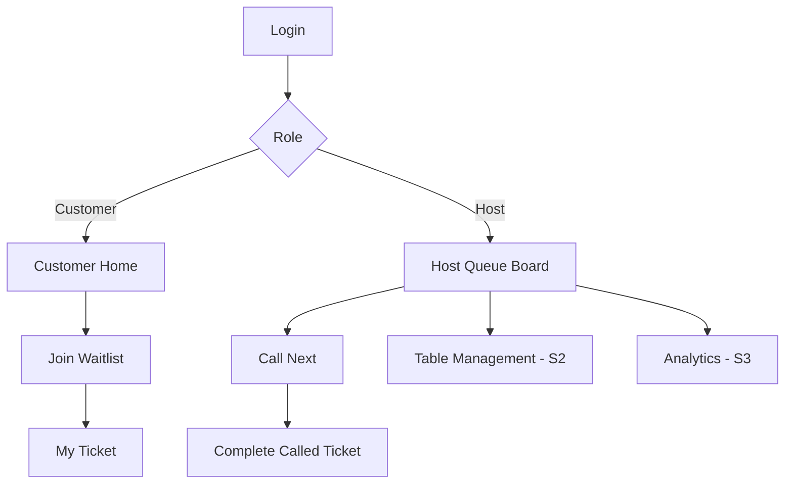

# 05. UI/UX Specification

**Purpose:** Specify observable screens and state for feature engineering. Visuals are a concept, **not an approved mandatory screen layout**. Customer is mobile-first; Host is desktop-first. The previous DineQueue mockup is a visual reference; this file is the normative functional UI draft.

## 1. UI principles

- Restaurant feel: warm burgundy (#6C1728), off-white (#FCF9F6), clear green/amber/red statuses; color **plus label**, never color alone.
- Touch-friendly customer actions; desktop table/list scanning for Host.
- Loading/empty/success/error messages for every API operation; disable Submit while mutation is pending.
- Never display other customers' names or private IDs in a public queue/status screen.
- All forms have associated labels and inline validation; actionable error messages rather than raw server stack traces.

## 2. Sitemap / user journeys



### P-01 `/login` — Both roles, Sprint 1

Fields: Email, Password. Actions: Login. States: loading / invalid credentials / account disabled / success. The returned role determines landing route. No public sign-up required. Session persisted in HttpOnly cookie; logout control available on logged-in pages.

### P-02 `/` — Customer home, Sprint 1

Header: DineQueue logo, selected Restaurant/Queue name, My Queue, profile/logout. Primary card: **Join Waitlist**. If customer has active queue, primary action becomes **View My Queue**, and creating a second active entry is blocked both by UI and API. No estimated wait time promise in S1.

### P-03 `/join` — Join waitlist, Sprint 1

Inputs: Queue (seeded/readonly if only one); Party size control (1–16). Summary: queue name, walk-in notice. Confirm button. Client validates integer 1–16; backend independently validates. Success redirects to ticket. Error states: invalid party size (400), already active (409), queue closed (409/404), session expired (401).

### P-04 `/my-queue` — Own queue ticket, Sprint 1

Fields: large human-readable ticket number, party size, current status, created/joined timestamp, selected queue. Optionally show **now called ticket** from privacy-safe data; must not expose names. For status WAITING show a waiting badge; CALLED show prominent 'Please go to the counter'; COMPLETED show 'Your waitlist service has finished'. Sprint 2 adds customer Cancel if WAITING.

F-03 implements explicit Refresh status (no automatic refresh/ETA), queue and
restaurant labels, joined time in the labelled restaurant timezone, and an empty
state with Join Waitlist. `/my-queue/{entryId}` is an owner-only detail bookmark,
including COMPLETED; inaccessible details show generic not-found feedback.
Successful join navigates to `/my-queue`; duplicate feedback offers View My Ticket.
Now-called public data and history listing remain outside F-03.

### P-05 `/host/queue` — Host dashboard, Sprint 1

- Queue selector restricted to authorized queues; Sprint 1 only one.
- Current called card (ticket number/party size/join time) with **Complete** button when CALLED.
- Waiting list sorted by server FIFO: ticket number, party size, joined time; no need to expose customer email.
- On narrow screens the waiting table keeps readable column spacing inside a
  labelled, keyboard-focusable horizontal scroll region; the document itself
  must not overflow horizontally.
- **Call Next** button enabled only if no current called ticket and a WAITING entry exists.
- Important error: two Hosts racing to call next; losing request displays 'The queue has changed. Refreshing.' and refreshes state.
- Complete confirmation belongs to one entry ID. When refresh shows a different
  current ticket, discard the old confirmation and require a new Complete action.
- Retry after a server read failure re-fetches server data without requiring the
  Host to navigate away. A failed read must not be shown as an empty queue.
- Empty state 'No waiting parties'. Pending state blocks repeated button presses. Backend always enforces rules independently.

### P-06 `/host/floor` — Interactive Floor Plan, Sprint 2

Interactive zones and table cards: table code/capacity/coordinates, `AVAILABLE/HELD/OCCUPIED/DIRTY/CLEANING/OUT_OF_SERVICE`, plus accessible tabular/list fallback. Approved connectivity is drawn from `table_connections`, never pixel distance. Host selects one or multiple table cards and opens a matching drawer showing total seats and suitability. For a party of 10, an approved adjacent T4(6)+T5(4) set is valid, a lone 8-seat table is not. A separate **Call & Hold** confirmation shows selected queue, table IDs and expiry, then **Seat** confirms all OCCUPIED atomically. Conflicts reload authoritative floor data; check-out and cleaning follow explicit lifecycle.

### P-07 `/host/history` and `/host/analytics` — Sprint 3

Filter by date and queue. Display completed/cancelled/no-show counts and measured wait duration. Avoid ungrounded 'live wait estimate'. Clearly separate calculated metrics from optional predictions.

### P-08 `/public/now-serving` — Optional Sprint 3

Shows ticket code and counter only; does not show user names or email. If this feature is deferred, document omission explicitly in Sprint 3 completion status.

## 3. UI controls by sprint

| Control | S1 | S2 | S3 |
|---|---|---|---|
| Customer Login/Logout | ✓ | retain | retain |
| Customer Join with party size | ✓ | retain | retain |
| Customer My Ticket status | ✓ | retain | retain |
| Customer Cancel | — | ✓ | retain |
| Host Call Next/Complete | ✓ | revise for table allocation | retain |
| Host interactive floor/matching/combined assignment | — | ✓ | retain |
| History/analytics | — | — | ✓ |
| Public privacy-limited screen | — | — | optional |

## 4. Critical UI acceptance cases

- Clicking Join with party size 0/17 shows validation and does not create a ticket; choosing 10 is accepted in S1, with a non-guaranteed combined-table seating notice.
- Login as Customer never exposes Host actions; calling host API directly must be 403.
- Loading state prevents UI double-submit, **but database constraints** guarantee correctness even if requests race.
- Host Dashboard refresh after a completed ticket shows correct next waiting entry.
- On expired session, show login state without leaking old user ticket details.
- Screen supports keyboard focus order, visible focus, semantic buttons, and readable text labels.

## 5. Provisional wireframe sketch

```text
CUSTOMER                           HOST
┌────────────────────────┐         ┌─────────────────────────────────┐
│ DineQueue       Profile│         │ DineQueue / Host Queue          │
│ Welcome                │         │ Queue: Walk-in Dining          │
│ [Join Waitlist]        │         │ Current: A-013 [Complete]      │
│ [My Queue]             │         │ Waiting:                        │
└────────────────────────┘         │ A-014 | 4 guests | 12:05        │
┌────────────────────────┐         │ A-015 | 2 guests | 12:07        │
│ Your ticket: A-014     │         │ [Call Next]                     │
│ Party size: 4          │         └─────────────────────────────────┘
│ Status: WAITING        │
└────────────────────────┘
```

These are design expectations only; design handoff should use the previously generated visual mockup if desired, and screen behavior remains driven by ACs rather than pixel matching.


## 6. Expanded UI / screen coverage (v2)

Detailed states, routes, dialogs, accessible floor fallback, semantics of each action, typography/color tokens, privacy review and conflict scenarios are in `docs/ui/operations-interaction-spec.md`. Minimum S2 Host workspace: queue rail → selected party detail → live floor surface, with side drawer `Match Options` and explicit confirmation. `Call & Hold` is **not** equivalent to `Seat`; `Checkout` is **not** equivalent to `Mark Available`. Customer ticket status persists across refresh and uses server state.

**Prior mockups:** illustrative only. Where earlier design depicts only one table per assignment or permits immediate AVAILABLE after checkout, this v2 spec supersedes it. Visual sample values are never proof of live API data.
